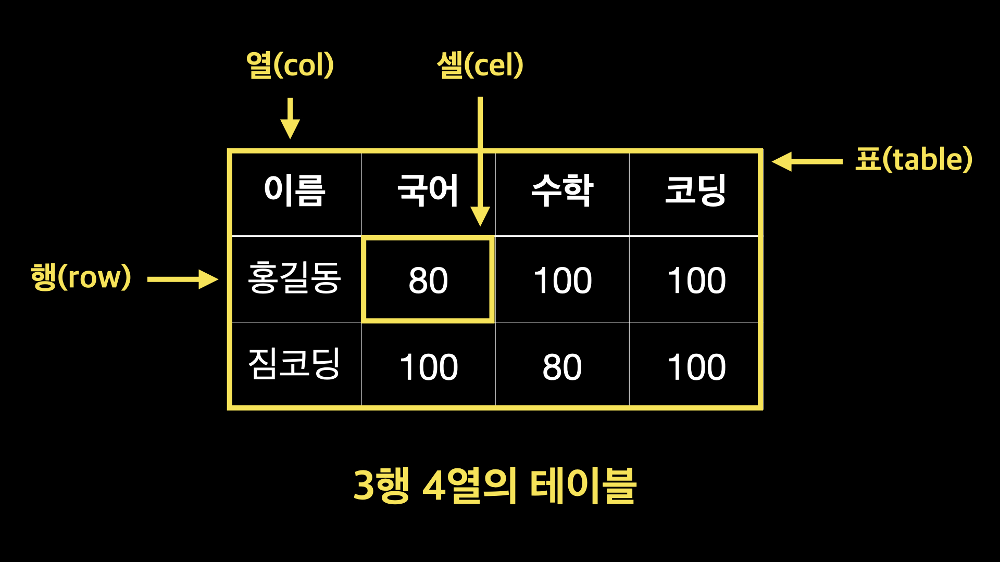

## 표(Table) 태그

---

### Table 구조



- `<table>` 태그 - 표
- `<tr>` 태그 - 행
- `<th>, <td>` 태그 - 열(제목, 일반)

### Table 기본 태그

- `<table>`
표를 만드는 태그로써, 표 전체를 감싸는 데 사용한다.
- `<caption>`
표의 제목이나 설명을 작성하는 태그
- `<tr>`
표의 행을 의미하는 태그. 자식으로 `<th>`태그나 `<td>`태그가 반드시 있어야 한다.
- `<th>`
표의 **제목 열**을 의미하는 태그. 부모 태그인 `<tr>` 태그 안에 있어야 한다.
- `<td>`
표의 **일반 열**을 의미하는 태그. 부모인 `<tr>`태그안에 있어야 한다.

```javascript
<style>
  table {
    border: 1px solid black;
    border-collapse: collapse;
  }
  th,
  td {
    border: 1px solid black;
    padding: 12px;
  }
</style>
<table>
    <caption>프로필 테이블</caption> <!-- 테이블 제목, 설명 -->
    <tr> <!-- 행 -->
        <th>이름</th> <!--열-->
        <th>취미</th>
        <th>특기</th>
    </tr>
    <tr>
        <td>홍길동</td>
        <td>도술</td>
        <td>축지법</td>
    </tr>
    <tr>
        <td>짐코딩</td>
        <td>헬스</td>
        <td>코딩</td>
    </tr>
 </table>  
```

### Table 그룹 관련 태그

- `<colgroup>`
열을 그룹으로 묶을 수 있도록 해주는 태그이다.
- `<col>`
`<colgroup>`태그의 자식으로 열 단위를 나눌 수 있다. `span` 속성을 사용하여 열을 그룹으로 묶을지 설정한다. 예) <col span="3"> → 세 개의 열을 그룹으로 묶음
- `<thead>`
표의 제목 열들을 묶는 그룹 태그
- `<tbody>`
표의 일반적인 데이터들을 묶는 그룹태그.
기본적으로 행그룹태그를 사용하지 않으면 크롬브라우저가 자동으로 tbody 태그로 묶어준다.
- `<tfoot>`
표의 하단 영역을 묶는 그룹태그

```javascript
 <table>
      <caption>
        학급 점수
      </caption>
      <colgroup>
        <col class="col1" />
        <col class="col2" />
        <col class="col3" />
        <col class="col4" />
        <col class="col5" />
        <col class="col6" />
      </colgroup>
      <thead>
        <tr>
          <th>반</th>
          <th>이름</th>
          <th>국어</th>
          <th>영어</th>
          <th>수학</th>
          <th>코딩</th>
        </tr>
      </thead>
      <tbody>
        <tr>
          <td>1반</td>
          <td>홍길동</td>
          <td>90</td>
          <td>100</td>
          <td>90</td>
          <td>81</td>
        </tr>
        <tr>
          <td>1반</td>
          <td>짐코딩</td>
          <td>85</td>
          <td>81</td>
          <td>95</td>
          <td>81</td>
        </tr>
      </tbody>
      <tfoot>
        <tr>
          <td>1반</td>
          <td>평균</td>
          <td>87.5</td>
          <td>90.5</td>
          <td>92.5</td>
          <td>90.5</td>
        </tr>
      </tfoot>
    </table>
```

### Table 태그 관련 속성

- `<table>` 태그 속성
- border - 테이블이 갖고 있는 테이블과 셀 모두 선을 표시한다. `웹표준X`
  - width - 테이블의 가로너비를 설정한다. `웹표준X`
  - cellpadding - 셀의 안쪽 여백으로써, 셀과 콘텐츠와의 간격을 조절함. `웹표준X`
  - cellspacing - 셀의 바깥쪽 여백으로써, 셀과 셀간의 간격을 조절함. `웹표준X`

위 속성들은 XHTML 1.0에서는 웹 표준이지만 오늘날 **HTML5에서는 웹 표준이 아닙니다. → CSS로 대체해야 함.**
- `<th>` 태그 속성
- scope - 웹접근성 관련 속성으로 스크린리더가 데이터를 인식하고 읽는 순서를 결정짓게 합니다.
- th가 열에 쓰일경우 값을 "col"로 설정합니다. 예) `<th scope="col">`
    - th가 행에 쓰일경우 값은 "row"로 설정합니다. 예) `<th scope="row">`
-  `<th>`, `<td>`
- colspan - 열을 병합하는 속성. 예) <td colspan="2">
  - rowspan - 행을 병합하는 속성. 예) <td rowspan="2">

```javascript
<tbody>
  <tr>
    <td rowspan="2">1반</td>
    <td>홍길동</td>
    <td>90</td>
    <td>100</td>
    <td>90</td>
    <td>81</td>
  </tr>
  <tr>
    <!-- <td>1반</td> -->
    <td>짐코딩</td>
    <td>85</td>
    <td>81</td>
    <td>95</td>
    <td>81</td>
  </tr>
</tbody>
```

- `<col>`
- width - 열의 가로너비를 지정하지만 `웹표준X` → CSS로 대체
  - span - 열을 그룹화 함. 예) <col span="3"> → 세 개의 열을 묶음.

