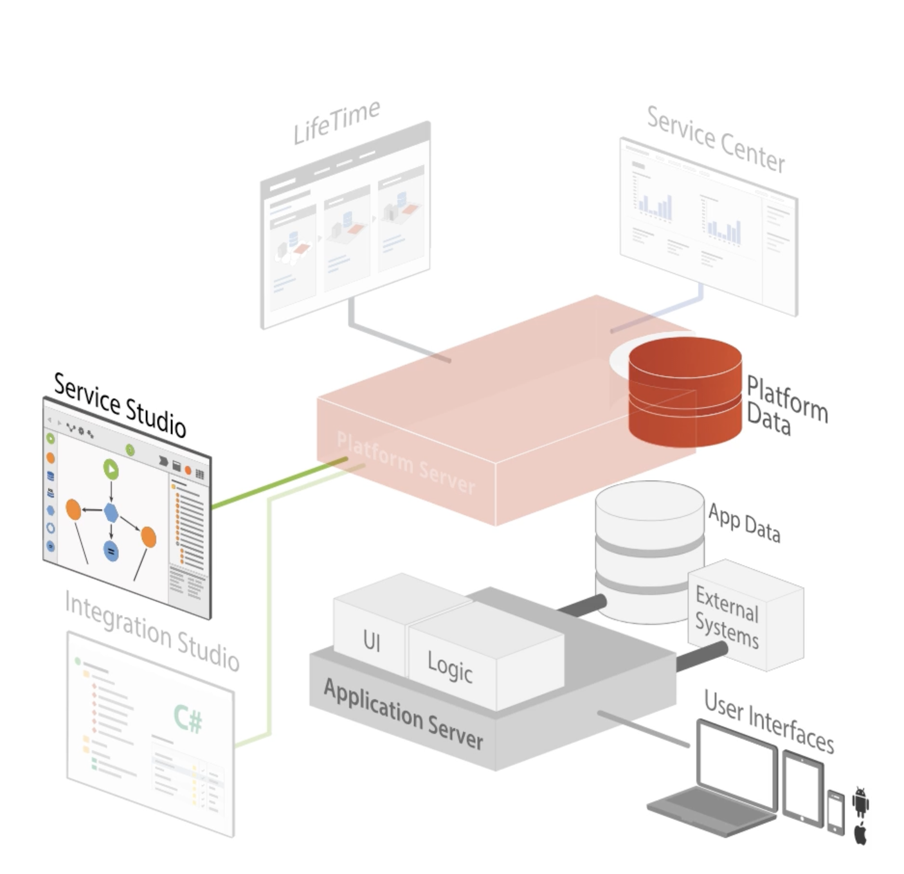
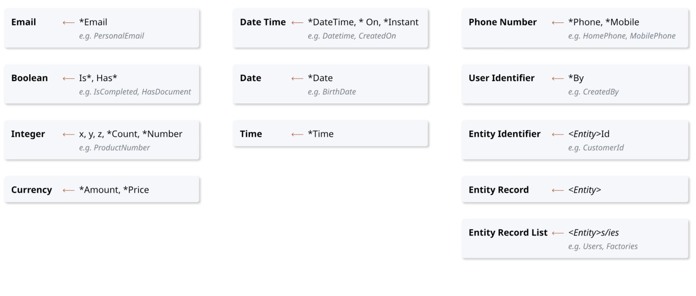
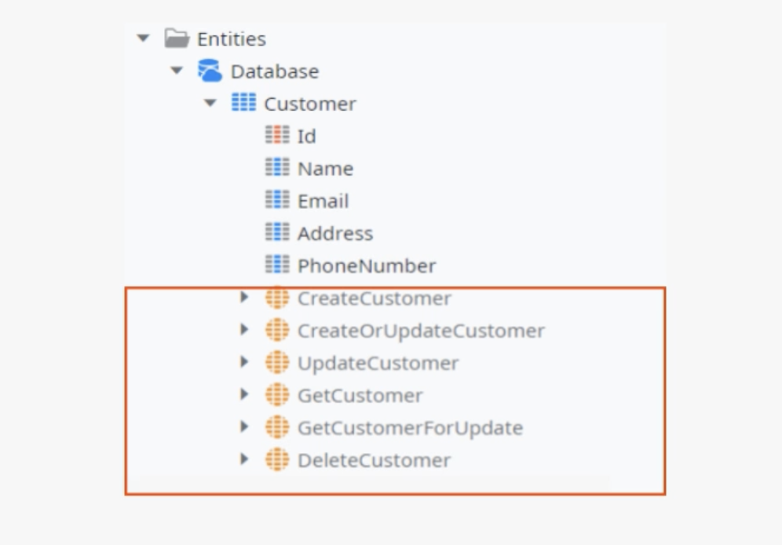
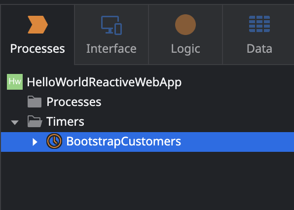
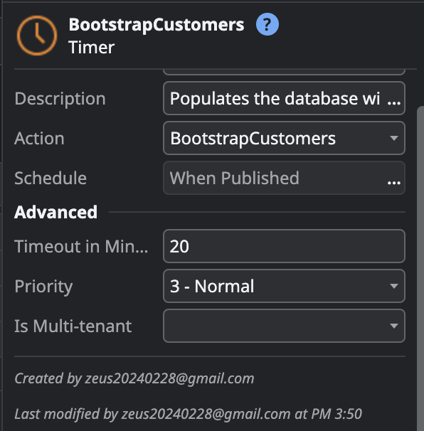
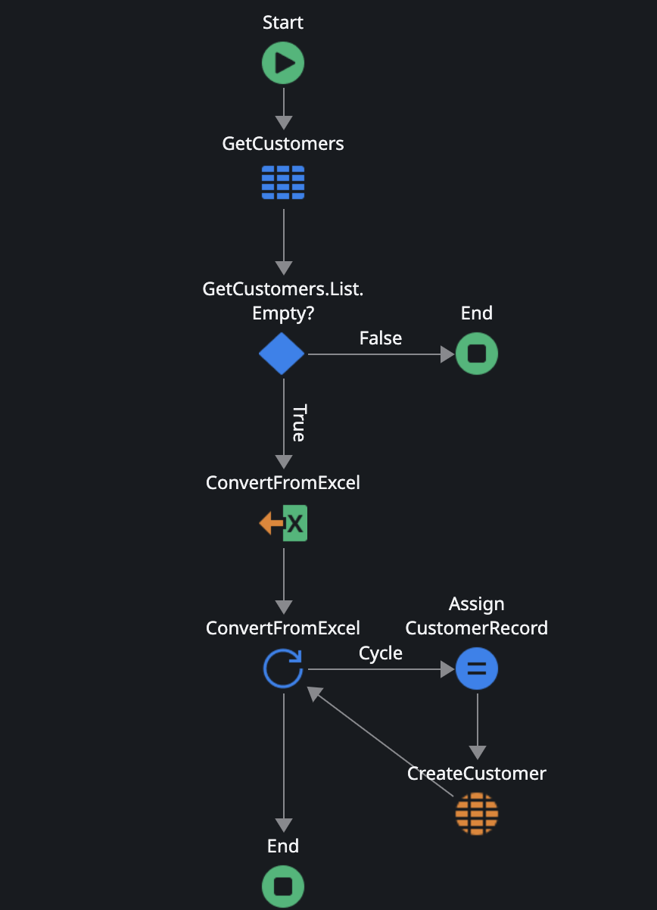
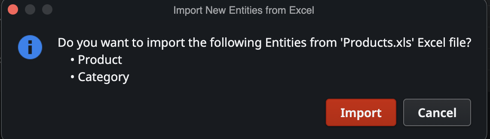
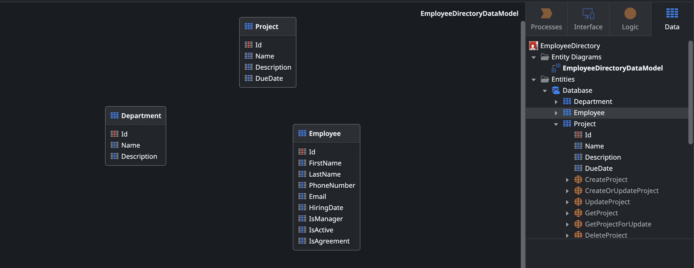

## 교육링크

[https://learn.outsystems.com/ko-kr/training/journeys/web-developer-662/outsystems-overview/o11/2155](https://learn.outsystems.com/ko-kr/training/journeys/web-developer-662/outsystems-overview/o11/2155)

### OutSystems 직접 정리

```html
아웃시스템즈에서의 엔터티는 복합키 설정이 불가능하다.
하지만 데이터 타입의 제약은 없다.
```

### OutSystems Sample Exam 

1. ***OutSystems 개요***
  1. ***서비스 스튜디오 개요***
  1. ***OutSystems 개발 소개***
  1. ***데이터 모델링***
  1. ***데이터 관계 모델링***
  1. ***데이터 모델 무결성*** 
  1. ***UI 개발 101***
  1. ***어셈블리 101***
  1. ***데이터를 사용하는 화면 만들기***
  1. ***웹 양식 구축***
  1. ***논리***
  1. ***폼 유효성 검사***
  1. ***고급 애그리게이트***
  1. ***역할 기반 보안***
  1. ***OutSystems에서 디버깅***
  1. ***페이지네이션 및 정렬***
  1. ***블록과 이벤트***
  1. ***반응형 프로그래밍 모델***
  1. ***클라이언트 변수***
  1. ***사이트 속성***
  1. ***SQL 쿼리***

# OutSystems 개요

---

**OutSystems는 엔터프라이즈 웹 및 모바일 애플리케이션의 개발, 배포를 지원한다**

  - *로우코드 개발 환경*
  - *엔터프라이즈 수준의 풀 스택 시스템*
  - *다른 시스템과의 통합 지원*
  - *애플리케이션 및 사용자에 대한 관리 및 분석을 제공 → 의도대로 동작하는지 확인 가능*
  - *애플리케이션은 HTML, CSS, JavaScript, .NET 같은 표준 및 최적화된 코드를 사용하여 컴파일된다.*
  - *CI/CD를 지원하며, 클라우드 또는 온프레미스 환경 모두 수행 가능하다*

# 컴포넌트 및 도구

---



### **OutSystems 서버(플랫폼 서버)**

  - *애플리케이션을 인프라 내부에 컴파일, 배포, 관리, 실행 및 모니터링하는 서버들의 집합*
  - *Platform Data(플랫폼 데이터 데이터베이스)*

### **Application Server**

  - *생성한 애플리케이션을 실행*
  - *기존 데이터베이스 및 외부 시스템(oracle, mysql, … ) 사용*

### **Service Studio(개발 환경)**

  - *플랫폼 서버와 연결* 
  - *Web 및 모바일 앱의 OutSystems 시각적 개발 환경*
  - *플랫폼 서버와 연결되면 애플리케이션 생성 및 게시가 가능하다*
  - *해당 애플리케이션의 각 버전은 플랫폼 데이터 데이터베이스에 저장된다*
  - *플랫폼 서버는 애플리케이션을 위한 최적화 코드를 컴파일하고 생성한 다음 표준 애플리케이션 서버에 배포한다*

### **Integration Studio(통합 스튜디오, 개발 환경)**

  - *C# 코드, 데이터베이스와 같은 외부 시스템(리소스)과의 통합*
- *통합을 위한 가속기를 제공한다*
  - *플랫폼 자체에 대한 확장을 허용*
  - *확장에 성공하면 즉, 서버 게시에 성공하면 Service Studio에서 정상적인 OutSystems 리소스처럼 사용할 수 있다*

### Service Center(서비스 센터)

  - *플랫폼 서버 관리 및 관리 콘솔*
  - *웹 브라우저를 통해 엑세스 가능*
  - *관리 및 운영 관점에서 플랫폼 서버를 살펴보고 구성할 수 있다*
  - **서비스 센터 - 공장**
- *서비스 센터 내에서 공장을 살펴보고 어떤 애플리케이션이 사용 가능한지 확인 가능*
  - **서비스 센터 - 모니터링**
- *환경을 모니터링*
    - *플랫폼 및 실행 중인 애플리케이션에서 생성된 로그 검사가 가능*
  - **서비스 센터 - 관리**
- *서버 관리 및, 환경 설정 구성이 가능*
  - **서비스 센터 - 분석**
- *다양한 유형의 분석을 수집이 가능*

### LifeTime(라이프 타임)

  - *서비스 센터는 개별 서버 또는 환경을 관리, 라이프타임은 여러 환경에 걸쳐 전체 애플리케이션의 라이프사이클을 관리할 수 있게 지원*
  - *라이프 타임은 서비스센터의 기능을 확장하는 웹 애플리케이션*
  - *개발 환경에서의 품질 환경, 인프라 각 환경에 배포된 애플리케이션의 버전 같이 애플리케이션 라이플프사이클을 다양한 스테이징 환경에서 볼 수 있다.*
  - **라이프 타임 - 사용자 관리**
- *각 환경 또는 애플리케이션에 대해 각 사용자 또는 팀이 갖는 권한 수준을 관리할 수 있다.*
  - **라이프 타임 - 인프라**
- *인프라의 모든 환경에 대한 가시성을 확보하고, 해당 환경이 라이프사이클에 어떻게 배치되는지 관리할 수 있다.*
  - **라이프타임 - 분석**
- *애플리케이션 성능에 대한 분석을 수집, 성능 병목 현상을 쉽게 파악하고 해결할 수 있다*

### OutSystems Forge 및 커뮤니티(Forge & Forums)

  - *OutSystems 작업에 대한 지원을 받을 수 있다*
  - *https:://www.outsystems.com/forge*
  - **OutSystems Forge**
- *애플리케이션 개발 및 배포 속도를 높이는 다운로드 가능한 컴포넌스 소스*
  - **OutSystems Community Forums**
- OutSystems 개발자들에게 Q&A 가능

# Capabilities(능력)

---

*서로 다른 환경에서 엔터프라이즈 개발이 가능*

*OutSystems 솔루션에 이미 존재하는 애플리케이션들의 통합이 간단 (외부 시스템의 데이터도 마찬가지)*

### OutSystems 를 통한 개발 프로세스 정리

  1. **Integration with everything**
1. *기존에 개발된 애플리케이션 및 데이터베이스 통합*
  1. **Visual Design and Development(Service Studio)**
1. *low-code를 통한 시각적 디자인 및 개발*
    1. *Processes And Logic → 비즈니스 로직 생성*
    1. *User Interface 생성*
    1. *개발이 끝나면 클릭 한번으로 배포가 가능*
  1. **Standard and Optimized**
1. *HTML, CSS, JS, .NET (컴파일)*
  1. **Continuous Integration and Continuous Delivery**
1. *Deploy → Integrity → Governance → Monitoring*
  1. **Flexible Infrastructure**
1. *Cloud*
    1. *On-Premise*

# 퀴즈

---

  1. 다음 중 개발 환경이 아닌 것은 무엇입니까?
1. Service Studio
    1. Integration Studio
    1. Service Center
  1. 다음 중 애플리케이션의 라이프사이클을 인프라 전반에 걸쳐 관리할 수 있는 도구는 무엇입니까?
1. 서비스 센터
    1. 라이프타임
    1. 서비스 스튜디오
    1. 통합 스튜디오
  1. Click 게시판 중 앱 데이터 모델, 코드 및 인터페이스가 컴파일되어 .NET 코드, HTML, CSS, JavaScript를 생성한다.
1. 참
    1. 거짓

*1번 정답 c: 서비스 센터는 하나의 환경(개발, 프로덕션)에 대한 관리 및 관리 콘솔*

*2번 정답 b: 또한 라이프 타임은 IT 사용자 및 팀을 관리할 수도 있다*

*3번 정답 a: 그리고 생성된 코드는 최적화된다*

# Service Studio Overview

---

### Service Studio 시작하기

*Service Studio는 OutSystems의* ***로우코드 및 비주얼 개발 환경***

*Service Studio를 사용하면 개발자는 서버 상에서 애플리케이션과 모듈(Module)을 생성할 수 있다.*

*모듈 내부에서는 애플리케이션에서 사용할* ***데이터 모델****을 정의할 수 있다.*

***웹(Web)과 모바일(Mobile) 애플리케이션*** *모두를 위한 사용자 인터페이스를* ***시각적으로 생성하고 정의****할 수 있습니다.*

*여기에는 해당 인터페이스에 필요한* ***HTML과 CSS****도 포함,* ***비즈니스 로직****과 애플리케이션을 지원하는* ***더 큰 비즈니스 프로세스****까지 정의할 수 있다*

*즉, 애플리케이션을 생성한 뒤* ***수정, 업데이트, 배포, 조회, 디버깅****까지 서버에서 모두 수행이 가능하다*

---

### Service Studio 설치 및 서버 연결

*다운로드 →* [*https://www.outsystems.com/downloads*](https://www.outsystems.com/downloads/)

*다운로드 + 실행 후에는 환경(Environment) 또는 서버(Server)에 연결해야 한다.*

*이 서버는* ***클라우드 환경****일 수도 있고, 자체 데이터 센터의* ***온프레미스 서버****일 수도 있다.*

*필요한 정보는* ***서버 주소, 사용자 이름, 비밀번호***

*Service Studio는 단순한 개발 도구가 아니라* ***애플리케이션을 정의하고 플랫폼 서버로 배포할 수 있는 클라이언트****이다.*

*실제로* ***코드를 생성·컴파일하고****, IIS 같은 실제 애플리케이션 서버에* ***배포****하는 작업은 OutSystems 서버에서 수행*

*Service Studio는 서버의* ***클라이언트 역할****을 하며,애플리케이션을* ***로컬에서 실행하지는 않는다.***

*대신, 생성한 애플리케이션을 서버로 전송(push)하고 브라우저나 모바일 디바이스를 통해* ***조회, 디버깅, 상호작용****할 수 있게 된다.*

| 구분 | Mendix | OutSystems |
| --- | --- | --- |
| 로컬 런타임 | ✅ 있음 | ❌ 없음 |
| 서버 없이 개발 | ✅ 가능 | ❌ 불가능 |
| 오프라인 개발 | ✅ 가능 | ❌ 불가능 |
| 중앙 통제 | 약함 | 매우 강함 |
| 엔터프라이즈 | ○ | ◎ |
| 개발 자유도 | 높음 | 낮음 |

---

### 애플리케이션과 모듈 구조

*Service Studio에서 서버에 연결하면 해당 서버에 존재하는* ***애플리케이션 목록****이 표시된다.*

*이 애플리케이션들은 사용자가 접근 권한을 가진 것들이며, 공용 환경에서는 다른 개발자가 만든 것일 수도 있다.*

*기존 애플리케이션을 열 수 있을 뿐만 아니라 새로운 애플리케이션을 생성하거나* ***OutSystems Forge****에서 기존 애플리케이션이나 컴포넌트를 설치할 수도 있다.*

*일반적으로는 애플리케이션 하나를 열어 그 안에서 개발을 시작하게 된다.*

*애플리케이션을 열면 해당 애플리케이션의* ***세부 정보****가 표시된다.*

***Develop 탭****에서는 이 애플리케이션에 포함된* ***모듈 목록****을 확인할 수 있다.*

*또한 이 애플리케이션이* ***의존하고 있는 다른 애플리케이션****도 확인할 수 있다.*

*모바일 애플리케이션을 위한* ***Distribute 탭****도 있는데, 이 탭에서는* ***네이티브 모바일 앱을 생성****하거나*

*PWA(Progressive Web App)를 활성화할 수 있다.*

***PWA(Progressive Wev App):*** *웹 기술로 만들었지만 모바일 앱처럼 동작하는 웹 애플리케이션*

---

### 모듈 개발 환경

*개발을 시작하려면 모듈을 하나 열어 로우코드로 표현된 구조를 확인해야 한다.*

*모듈을 열면* ***워크스페이스 탭(Workspace Tab)****이 새로 열린다.*

*워크스페이스 탭에서는 모듈의 다양한* ***레이어****와 사용 가능한* ***도구들****을 확인할 수 있다.*

*또한 사용할 수 있는 요소(Element)들과 새로운 요소를 생성하는 기능도 볼 수 있다.*

*중앙의* ***메인 캔버스 에디터****에서는 UI를 정의하거나 로직 흐름을 설계하는* ***비주얼 로우코드 편집기****를 사용할 수 있다.*

*Service Studio에는 모듈이 항상 유효한 상태인지 확인하는* ***실시간 변경 검증(True Change) 기능****이 있다.*

*이 기능은* ***유효한 모듈만 서버에 배포****되도록 보장한다. 즉, 실시간 변경 검증은 배포 안정성을 보장하는 요소이다.*

---

### 환경 전환과 Forge

*모듈 메뉴에서는* ***환경(Environment)을 전환****하여 다른 서버로 이동할 수 있다.*

*새 환경의 URL과 사용자 이름, 비밀번호만 입력하면 된다.*

*환경 탭, 애플리케이션 및 모듈 탭 외에도* ***OutSystems Forge 탭****이 있다.*

*Forge에는 서버에 다운로드하여 설치할 수 있는 다양한* ***컴포넌트****가 제공된다.*

*Forge를 통해 새로운 리소스를 빠르게 가져와 개발 속도를 크게 향상시킬 수 있다.*

# Service Studio Walkthrough

---

***Service Studio****의 작업 공간에서는 다양한 구성 요소에 접근할 수 있다.*

*비즈니스 프로세스나 타이머부터 사용자 인터페이스(UI) 요소, 비즈니스 로직 흐름, 그리고 데이터 관련 요소까지 모두 포함된다.*

***Service Studio*** *오른쪽 상단에는 네 개의 탭이 있다. 각 탭은 각각의 계층(Layer)에 대응한다.*

***Processes(프로세스)****,* ***Interface(인터페이스)****,* ***Logic(로직)****, 그리고* ***Data(데이터)***

*각 탭으로 전환하면 해당 레이어에 속한 요소들이 표시된다.*

*트리에서 요소를 선택하거나 열면 아래쪽에 해당 요소의 속성이 나타난다.*

*이 속성들은 각 요소의 동작을 세부적으로 조정하고 사용자 정의할 수 있게 해준다.*

*여러 요소를 동시에 선택해서 공통 속성을 한 번에 수정할 수도 있다.*

***TrueChange****는 Service Studio의 유용한 기능으로, 애플리케이션 모듈을 자동으로 검사해준다.*

*만약* ***오류가 있으면, 상단에 빨간색 X(크로스) 아이콘이 표시되고 하단에 오류 목록이 나타난다.***

***오류가 없을 때는 초록색 1-Click Publish 버튼이 표시****된다.*

*이 버****튼을 눌러 모듈을 서버에 게시하면, 버튼 색상이 파란색으로 바뀌며 Open In Browser(브라우저에서 열기)로 변경****된다.*

*이제 UI 요소(예: Screen)를 열었을 때 Canvas(작업 영역)가 어떻게 달라지는지 살펴보자*

*Canvas 중앙에는 화면(Screens)의 실시간 미리보기가 표시된다*

*왼쪽에는 Toolbox(도구 상자)가 있다. 현재 UI 요소를 편집 중이므로, 도구 상자에는 Widget(위젯)들이 표시된*다. 

***위젯은 화면을 구성하는 기본 단위****이다. 이 화면은 여러 위젯들로 구성되어 있으며,*

*텍스트, 이미지, 차트, 지도, 버튼 등 다양한 위젯을 포함한다. 위젯은 드래그앤드롭으로 화면(Canvas)에 배치할 수 있다.*

*또한* ***미리보기 모드****를 변경해 화면이 다양한 기기나 방향에서 어떻게 보일지 확인할 수도 있습니다.*

*UI나 다른 요소를 작업할 때, 스타일을 적용할 수 있는 요소에는 빠르게 스타일을 변경할 수 있는* ***툴바****가 표시된다.*

*직접 작성한 CSS를 추가로 적용하고, 각 위젯에 특정 클래스 이름을 지정할 수도 있다.*

*또한,* ***Element Breadcrumb(요소 경로 표시줄)****을 이용하면 요소 계층 구조를 편리하게 탐색할 수 있다.*

*UI 화면 작업 시 유용한* ***Widget Tree(위젯 트리 토글 버튼)****도 있다.*

*화면이 복잡해질수록 많은 위젯들이 포함되기 때문에, 위젯 트리를 토글하면 화면 내 모든 위젯의 계층 구조를*

*한눈에 볼 수 있다. 이는 요소 트리 상단에 표시된다.*

*하단의* ***Widget Breadcrumb(위젯 경로 표시줄)*** *또한 현재 작업 중인 위젯의 계층을 빠르게 탐색할 때 유용하다.*

***Processes(프로세스)****와* ***Logic(로직) 편집기***

*UI와 마찬가지로, 가운데에는 로직의 시각적 표현을 위한* ***Canvas 영역****이 있다.*

*프로세스나 비즈니스 로직을 설계할 때 이 캔버스는 로직 흐름을 시각적으로 표시한다.*

*툴박스도 동일한 방식으로 작동하지만, 이 경우에는 위젯 대신 로직 플로우에 사용할 수 있는 요소들이 나타난다.*

*예를 들어* ***할당(assignment)****,* ***for-each 반복문****,* ***데이터베이스 쿼리*** *등이 있다.*

***Data Layer(데이터 계층****)**를 살펴보자.*

*여기에서는* ***Entity(엔터티) 다이어그램****을 열어 데이터 모델과 생성된 엔터티(즉, 데이터베이스 테이블)의*

*시각적 구성을 볼 수 있다.*

*데이터 관련 요소들은 모두 오른쪽의* ***요소 트리****에서 손쉽게 관리할 수 있다.*

# Application Layers

---

*애플리케이션을 구성하는 서로 다른* ***계층****과, 각 계층 안에 포함된* ***요소들****을 살펴보자*

***Processes(프로세스) 계층은*** *두 가지 주요 그룹이 있다 →* ***Processes(프로세스) & Timers(타이머)***

*프로세스에는 비즈니스 프로세스, 사람이 수행하는 작업(human tasks), 자동화된 작업(automated tasks),*

*의사결정(Decisions), 이벤트(Events), 그리고 대기(Waits) 등이 포함*

*타이머(Timer)는 특정 시간에 실행되도록 예약된 작업 이 타이머는 매일, 매주 또는 다른 주기로 다시 예약할 수도 있다.*

*여러 이벤트가 동시에 실행되어야 할 때, 일부* ***타이머에 우선순위(priority)를 설정****하여 더 중요한 작업이 먼저 수행되도록 할 수 있다.*

*또한* ***타임아웃(timeout)*** *설정도 가능하여 지속적으로 실행되지 않도록 제어할 수도 있다.*

*즉,* ***Processes 계층****은 가장 높은 수준의 로직과 업무 흐름을 다룬다고 볼 수 있다.*

***User Interface(사용자 인터페이스) 계층***

*이 계층은 애플리케이션의 사용자 인터페이스를 구성하는 다양한 컴포넌트에 초점을 맞춘다.*

*화면(Screen)과 블록(Block)으로 구성된 그룹을 User Interface Flow(사용자 인터페이스 플로우)라고 부릅니*다.

*UI 플로우 외에도, 이 계층에는 그래픽이나 아이콘 같은* ***이미지 리소스****가 포함된다.*

*OutSystems가 애플리케이션의 디자인(look & feel)을 정의하는 방식은 Themes(테마)라고 한다.*

*그 아래에는 Scripts(스크립트)가 있다. 이들은 자바스크립트 리소스로서, 다른 UI 요소들이 동작하는 데 필요할 수 있다.*

***Logic(로직) 계층***

*이곳에서는 애플리케이션의* ***동작 로직****을 정의한다.*

*Client Actions(클라이언트 액션)과 Server Actions(서버 액션)이 있다.*

*클라이언트 액션은 모바일 기기나 웹 브라우저처럼 클라이언트 측에서 실행된다.*

*반면에 서버 액션은 실제로* ***서버에서 실행된다****.*

*또한 외부 시스템과 통합할 수 있는* ***통합 로직 요소****도 있습니다.*

*예를 들어,* ***SOAP 웹 서비스****나* ***RESTful 서비스*** *같은 것들이 이에 해당한다.*

*이 모든 로직 구성요소에 접근하거나 변경할 수 있는 사용자를 제한하기 위해* ***보안 권한(roles)을 정의****한다.*

*이를 사용자에게 할당하면, 누가 어떤 리소스에 접근 가능한지 명확히 관리할 수 있다.*

*또한 이 계층에는* ***Exceptions(예외)****도 존재하며,* ***예외를 던지거나(catch)*** *처리할 수 있다.*

***Data(데이터) 계층***

*이 계층에서는* ***Entity(엔터티)****를 정의할 수 있다.*

*엔터티는 데이터베이스 테이블에 해당하며, 기기 로컬 저장소(Local Storage)에 저장될 수도 있다.*

*이 엔터티들을 시각적으로 표현하려면* ***Entity Diagram(엔터티 다이어그램)****을 만들 수 있다.*

*데이터의 메모리 내 표현은* ***Structure(구조체)****라고 부른다.*

***Client Variables(클라이언트 변수)****는 사용자별 데이터를 클라이언트 측(브라우저 또는 모바일 기기)에 저장한다.*

*반면* ***Site Properties(사이트 속성)****은 서버 측에서 여러 애플리케이션 간에 공유되는 데이터를 저장할 수 있다.* 

*마지막으로, 위 범주들에 속하지 않는 기타 데이터를* ***Generic Resources(일반 리소스)****라고 부른다.*

*이 네 가지 계층은 작업 공간(workspace)에 존재하는 다양한 요소들을 효율적으로* ***조직화****할 수 있게 도와준다.*

*이를 통해 필요한 요소를 빠르고 쉽게 찾아 작업할 수 있다.*

# 1-Click Publish

---

*Service Studio 메뉴 바에는* ***1-Click Publish 버튼****이 있다.*

*이 버튼을 클릭하면, 우리가 개발한* ***애플리케이션 모듈의 정의****가 OutSystems 플랫폼 서버에 업로드되고* ***Service Center****로 전송된다.*

*OutSystems 서버는 이 모듈을* ***새 버전****으로 저장하며, 이를 플랫폼 데이터베이스에 기록한다.*

*그 후, 서버는 코드를 생성(generate)하고, 컴파일(compile)하며, 애플리케이션 서버에 배포(deploy)한다.*

*이 과정에서 데이터베이스의 구조도 필요한 경우* ***자동으로 업데이트****되어 비즈니스 로직과 데이터 모델이 일관성을 유지하도록 한다.*

*배포가 진행되는 동안, Service Studio는* ***Publish 로그 창****을 표시해 현재 진행 상황을 보여준다.*

*배포가 완료되면, 애플리케이션이 서버에서 사용할 준비가 되었다는 메시지가 표시된다.*

*이 시점에서 초록색* ***1-Click Publish 버튼****은 파란색* ***Open in Browser(브라우저에서 열기)*** *버튼으로 바뀐다.*

이 버튼을 클릭하면, 웹 애플리케이션의 경우 브라우저에서 애플리케이션이 열린다.

*모바일 앱이라면 실제 휴대폰 대신* ***모바일 에뮬레이터****가 실행되어 앱을 미리볼 수 있다.*

*한 번 서버에 배포된 버전은 버전 관리가 이루어진다. 필요하다면* ***이전 버전으로 되돌아갈 수도 있다.***

*이전 버전을 열려면, 모듈 메뉴에서 Open Other Version(다른 버전 열기)를 선택한다.*

*그러면 모든 버전이* ***날짜, 시간, 게시한 사용자****와 함께 표시된다.*

*원하는 버전을 선택하여 언제든 이전 상태로 복원할 수 있다.*

*경우에 따라서는 두 명 이상이 동시에 하나의 모듈을 수정할 수도 있다.*

*이때 서로 다른 변경사항이 충돌하면, Service Studio는 이를 감지하고* ***사용자에게 선택을 요청한다.***

*가능한 선택지는 다음과 같다.*

  - *모든 버전을 병합(merge)하여 게시하기*
  - *자신의 버전으로 기존 버전을* ***덮어쓰기(overwrite)***
  - *두 버전을 비교(compare)하여 수동으로 확인하기*

*일반적으로는 비교 도구를 한 번 확인해 다른 사람의 중요한 변경사항을 덮어쓰지 않도록 하는 것이 좋다.*

***Compare 버튼****을 클릭하면 diff tool(비교 도구)이 열린다.*

*이 도구에서는 내 버전과 현재 게시된 버전을 나란히(side-by-side) 보여준다.*

***변경된 부분이 하이라이트되어 표시되므로, 각 항목을 검토하고 필요한 경우 체크박스로 선택****할 수 있다.*

# OutSystems 앱 소개(반응형 웹 VS 모바일)

---

### 앱 유형

  - *전통적인 웹: 대부분의 애플리케이션 로직이 서버에서 실행*
  - *모바일(스마트폰 및 태블릿)*
  - *반응형 웹*

### 최신 아키텍처

*최신 표준 및 모범 사례를 따르며, 끈임없이 변화하는 환경에서 빠르게 움직일 수 있도록 보호한다*

*백그라운드에서 OutSystems는 React JS를 기반으로 하는 단일 페이지 애플리케이션을 컴파일하고 생성한다*

*또한 low-code 기반으로 앱을 생성하고 HTML, CSS, JavaScript 또한 모두 생성한다*

*run time에 JavaScript는 HTML 요소를 생성하고 클라이언트 측 로직을 실행하며, 필요한 경우 비동기적으로 데이터를 가져온다*

*멋지고 풍부한 UI/UX를 만들기 위해 OutSystems는 반응형 웹 앱과 모바일 앱을 모두 제공한다*

### 코드 재사용성

*반응형 웹과 모바일 앱 모두 코드 재사용성 측면에서 매우 유사하다*

*반응형 웹은 모든 장치 및 화면 크기에 대한 공통 로직이 있고, 모바일은 지원되는 네이티브 모바일 플랫폼 및 PWAs를 위한 지원되는 브라우저에 대한 공통 로직이 존재한다*

*결국 동일한 로직이 어느 쪽이든 공통으로 사용된다*

*반응형 웹은 웹 브라우저만 존재하면 별도 설치는 필요없다, 하지만 네이티브 모바일 앱은 Android 및 iOS에서 실행된다 PWAs는 지원되는 브라우저로 실행되거나 네이티브로 실행된다*

### 사용자 경험

*반응형 웹 앱은 모든 화면 크기 및 유형에 대한 반응형 레이아웃 → 장치의 화면 크기에 따라 동적으로 적응*

*모바일은 전용 모바일 UI 패턴 및 경험이 필요 → 작은 장치에서 손가락이 상호 작용 도구로 사용되는 것을 고려*

### 성능

*백그라운드(서버?)에서는 반응형 웹 앱과 모바일 앱 모두 동일한 기술 스택을 공유한다*

*모두 클라이언트 측에 최적화된 성능으로, 데이터 전송을 최적화하는 스마트 메커니즘을 제공한다*

*모바일의 경우 장치의 내부 저장소에 엑세스할 수 있다는 차이가 있다*

### 장치 하드웨어 엑세스

*반응형 웹 앱의 경우 장치 하드웨어에 대한 엑세스가 제한적이다, HTML5를 통해 사용할 수 있는 기능이 적기 때문 반면에 모바일 앱의 경우 터치 ID와 같은 더 많은 네이티브 기능에 엑세스할 수 있다.*

### 오프라인 기능

*반응형 웹 → 오프라인 기능 존재 x* 

*모바일 앱 → 오프라인 데이터를 저장하려면 네이티브 모바일 앱은 로컬 스토리지, PWA는 브라우저 스토리지를 사용*

### 배포 및 업데이트

*반응형 웹 → 사용자가 브라우저 페이지를 새로 고침할 때 자동으로 적용*

*모바일 앱 → 네이티브 모바일 앱은 자동으로 업데이트, PWA는 새 버전이 감지될 때 자동으로 업데이트*

*반응형 웹은 사용자에게 링크를 공유, 모바일은 내부 배포 또는 앱 스토어를 통해 배포한다 사용자는 웹사이트에서 PWA를 직접 실행하고 장치 홈 화면에 앱 아이콘을 추가할 수 있다*

### 서비스 스튜디오 워크플로우

*Service Studio는 개발자로서 앱의 사용자 인터페이스, 비즈니스 로직 및 데이터 모델을 구축하는 데 사용되는 곳*

*Service Studio에서 배포 하면 OutSystems Platform 서버는 React JS 기반으로 HTML, JS, CSS를 생성한다 이러한 배포 과정은 모두 플랫폼 서버에서 백그라운드를 통해 관리한다*

# 모듈화 프로그래밍

---

### 캡슐화

*모든 것을 캡슐화하여 단일 모듈에서 기능의 하나의 측면만 실행하도록 한다*

*각 모듈은 특정 기능의 하나의 측면을 실행하는데 모든 것을 캡슐화해야 한다*

*이렇게 기능을 모듈로 분리하면 독립적이고 교체 가능하게 된다*

### 모듈

*사용자 인터페이스 및 비즈니스 로직 코드가 모듈 내에서 개발된다*

*모듈에는 여러 유형이 존재*

  - *앱 유형(반응형 웹 앱, 전화 앱)*
  - *empty: 새롭게 시작*
  - *서비스*
  - *라이브러리: 재사용성이 높은 구성 요소를 구축할 때 사용*
  - *확장 모듈: 외부 데이터베이스, 사용자 지정 C# 코드 사용*

*모듈은 애플리케이션 내에서 생성되고 실행되며, 애플리케이션이 관련된 모듈 집합을 그룹화한다*

### 생산자 및 소비자

*모듈은 다른 모듈과 요소를 공유할 수 있다*

*특징을 공유하는 모듈은 생산자, 다른 모듈의 기능을 사용하는 모듈을 소비자라고 한다*

*생산자와 소비자는 서로 다른 애플리케이션에 있을 수 있다*

*모듈화된 프로그래밍 접근 방식을 사용하면 개념을 서로 다른 모듈로 분리하여 요소의 재사용성을 높일 수 있다*

# 데모: 반응형 웹 앱 만들기 방법

---

간단한 화면 만들기(add screen) & one click publish

# Create Employee Directory App

---

### Employee Directory 앱

*Employee Directory 앱은 조직 구성원의 이름, 직책, 연락처 정보 등 구성원에 대한 포괄적인 정보를 저장하기 위한 전용 리소스 역할을 한다. 이 앱을 통해 조직 구성원들은 동료들의 정보를 손쉽게 검색하고 조회할 수 있다.*

*이 과정을 진행하는 동안, 매 강의마다 Employee Directory 앱을 조금씩 만들어 나가게 된다. 과정이 끝날 때쯤이면 Employee Directory 앱을 완성하게 될 것이다.*

*각 강의가 끝날 때마다, 이후 강의의 실습 시작점으로 사용되기 때문에 앱을 저장(게시, publish)하는 것이 필요하다는 점에 유의해야 한다.*

### 개요(Outline)

*이 첫 번째 실습에서는 OutSystems에서 엔티티를 생성하는 데 집중하게 된다. 이를 위해 다음 작업을 수행한다.*

  - *Reactive Web App 생성*

*실습을 마치면 아직 기능은 없는 뼈대 수준의 앱이 만들어진다. 이후 실습에서 여기에 기능을 추가해 나가게 된다.*

### 리소스(Resources)

*이 실습을 완료하려면 다음 이미지 파일이 필요하다.*

  - [**Directory Icon.png**](https://learn.outsystems.com/TK_Resource/d7fc428a-6ae9-554a-8f3f-44ca7cddf1dc)

*이 파일은 해당 강의 자료의 Resources 폴더에서 찾을 수 있다. 이 이미지 파일은 앱의 아이콘으로 사용된다.*

### 시나리오(Scenario)

*이 실습에서는 Employee Directory라는 웹 앱을 만들 것이다.*

*빈 캔버스 상태에서 시작하므로, 첫 번째 단계는 새로운 Web App을 만든 다음 Reactive Web App 모듈을 추가하는 것이다.*

# 데이터 모델링

---

*엔티티가 데이터베이스에 매핑되는 방법을 설명*

## 앱을 위한 데이터 모델링

*애플리케이션은 비즈니스에 가치가 있는 정보를 포함한다(저장, 검색)*

*OutSystems에서는 그 개념이 모델링되고 엔티티로 참조된다*

*데이터베이스 엔티티는 데이터베이스에 저장하고 검색할 수 있는 데이터를 보유한다*

## 엔티티 - 데이터베이스 매핑

| OutSystems Entity | Database Table |
| --- | --- |
| Attribute(Data Types software) | Columns Data Types (database) |
| Id(Identifier attributes) | Primary Key |
| Reference Attribute | Foreign Key |
| Index | Index |
| Record or Instance | Row or Tuple |

# 데이터베이스 엔티티

---

## 엔티티

*엔티티는 OutSystems 애플리케이션에서 필요한 정보를 저장하고 엑세스할 수 있게 해주는 요소*

*각 비즈니스 개념이 엔티티로 표현, 엔티티 데이터는 데이터베이스 테이블에 저장된다*

*새로운 엔티티 레코드는 해당 테이블의 행으로 삽입된다*

엔티티

  - *데이터 세트 저장*
  - *속성을 가진다*
  - *엔티티 액션을 가진다*

## ID 속성

*자동으로 생성된다*

*엔티티 레코드를 고유하게 식별한다*

*필요한 경우 수정이 가능하다*

*DB의 기본 키*

*관계형 데이터베이스 작업 지원*

***속성은 기본적으로 기본 데이터 유형을 가지며, 엔티티 및 테이블은 하나 이상의 속성을 가져야한다***

## 기본 데이터 유형

*Text, Phone Number, Email*

*Integer, Long Integer, Decimal, Currency*

*Date Time, Date, Time*

*Boolean, Binary Data, Referential*

*이러한 각 데이터 유형에 대해 OutSystems는 기본값을 제공한다*

*즉, 엔티티 속성 또는 변수가 항상 값을 가지고 그렇지 않으면 기본값이 적용됨을 의미한다*

***새로운 속성(또는 변수)을 지정할 때 OutSystems는 해당 유형을 추론하려고 시도한다***



*가정: 만약 속성 이름이 Personal Email* 

*타입 추론: Email* 

## 엔티티 액션

***자동으로 생성된다***



*CRUD 데이터 작업*

  - *Create(생성)*
  - *Retrieve(검색)*
  - *Update(업데이트)*
  - *Delete(삭제)*

*엔티티 액션은 애플리케이션의 비즈니스 로직에서 직접 사용할 수 있다*

*엔티티 액션은 OutSystems에서 자동으로 생성되며 수정할 수 없다*

## 데모: 데이터베이스 엔티티 만들기 방법

*간단한 엔티티 생성 및 속성 추가, Email & Phone Number 데이터 타입 추론으로 자동 지정 확인*

*one click publish를 통해 데이터베이스에 테이블 생성*

## 데모: Excel에서 엔터티 데이터를 시작하기

*엑셀 데이터는 데이터 유형과, 이름 기반으로 엔티티 속성에 매핑되고 매핑되지 않으면 해당 속성(값)은 추가되지 않는다*

**작접 진행 순서**

*엔티티 우클릭 → Advanced → Create Action to Bootstrap Data from Excel →* 

*Excel 파일 선택 → Proceed → one click publish →*

*Processes 탭 Timers 밑에 보면 BootStrapCustomer(엔티티 이름)이 존재*

**OutSystems Timers?**

*타이머는 미리 정의된 스케줄에 따라 실행되는 백그라운드 작업이다.*





*타이머 속성에서 Schedule을 보면 모듈이 게시될 때마다 실행된다*

*타이머를 더블클릭하면 관련된 로직을 확인할 수 있다*



*데이터 텝으로 돌아가서 데이터를 확인하면 엑셀 데이터가 추가된것을 볼 수 있다*

## Excel에서 엔티티 및 데이터를 시작하는 방법

*Data 텝 → Entity 우클릭 → Import New Entities From Excel 버튼 클릭*



*Service Studio는 Excel 파일을 분석하여, 두 개의 시트를 감지했다(Product, Category)*

*Category, Product 엔티티의 속성을 보면 자동으로 Id 속성(식별자)이 추가된것을 볼 수 있다.*

*one click publish를 통해 데이터베이스에 엔티티(테이블)이 생성되고 모듈을 성공적으로 배포한 후 데이터가 해당 엔티티로 부트스트랩된다*

## Bootstrap Entity and data from an Excel File

### OAP 파일 설치

  1. *OutSystems Service Studio를 열고 로그인한다.*
  1. *로그인 후 상단에서 Environment를 클릭한다.*
  1. *Environment 메뉴에서 Open Files를 선택한다.*
  1. *다운로드한 Lesson Materials 폴더로 이동하여 OAP 파일을 찾는다.*
  1. *해당 파일을 선택하고 Open을 클릭한다.*
  1. *앱이 Service Studio에 설치될 때까지 기다린 뒤, 안내가 뜨면 Proceed를 클릭한다.*
  1. *Employee Directory 앱 설치가 끝나면 그 앱을 클릭해 연결된 모듈을 연다. 그러면 앱이 Service Studio에서 열린다.*

### 엔티티 추가

*이전 과정과 똑같이 Import New Entities From Excel을 통해 Employees 엔티티 생성 및 데이터 추가*

*데이터가 보이지 않으면 CTRL + R****(맥북: command + R)****을 통해 미리보기를 새로고침한다*

### 속성 수정

*표에 나타난 속성 이름과 데이터를 수정할 수도 있다*

*‘PhoneNo_’ 속성을 수정하자*

  1. *Data 탭에서 Employee Entity를 펼친다.*
  1. *Entity 목록에서* ***`PhoneNo_`*** *속성을 선택하고, 속성 창에서 Name을* ***`PhoneNumber`****로 변경한다.*
  1. *Data Type을 Long Integer로 바꾸고, 해당 속성을 mandatory(필수)로 설정한다.*

*또한 다음 속성들도 모두 mandatory로 설정해야 한다.*

  - FirstName
  - LastName
  - Email
  - HiringDate
  - IsManager

*변경 사항을 서버에 저장하기 위해 다시 모듈을 Publish 한다.*

*속성 설정을 업데이트하면 해당 값이 0으로 보이게 된다.*

### 데이터 넣기

*PhoneNumber 속성에 실제 값을 넣으려면, 수정이 필요한 행에서 Edit 아이콘을 클릭한다.*

*다음과 같이 전화번호를 입력한다.*

  - *Caddric Saiz: 9148033049*
  - *Irvine Hasser: 9148033048*
  - *Fidelia Garahan: 9148033045*
  - *Zacharias Pre: 9148033044*
  - *Cletus Harget: 9148033043*
  - *Anatol Lago: 9148033042*
  - *Anny Ledington: 9148033041*
  - *Elka Scopes: 9148033047*
  - *Deloria McInility: 9148033046*

*입력을 마친 후 Apply를 클릭해 Entity에 변경 사항을 반영한다.*

## Create an Entity Exercise

*Project와 Department라는 두 개의 엔티티를 추가로 생성*

*첫 번째 엔티티(Project)는 아래 속성들로 수동으로 만든다.*

  - *Id (기본)*
  - *Name (필수)*
  - *Description (필수, 데이터 타입 Text, 길이 500자)*
  - *DueDate (필수, 데이터 타입 Date)*

*두 번째 엔티티(Department)도 아래 속성들로 수동으로 만든다.*

  - *Id (기본)*
  - *Name (필수)*
  - *Description (필수, 데이터 타입 Text, 길이 500자)*

*엔티티들을 생성한 후, Project.xlsx와 Department.xlsx 파일에 있는 데이터를 사용해 Bootstrap Data from Excel 액션으로 각각의 엔티티에 데이터를 부트스트랩한다.*

### 엔티티 다이어그램 만들기



  1. *Data 탭에서 Entity Diagrams 아래의 EmployeeDirectoryDataModel을 더블 클릭해 연다.*
  1. *미리보기 영역으로 Department 엔티티를 드래그한다.*
  1. *같은 방식으로 Employee 엔티티와 Project 엔티티도 미리보기 영역으로 드래그한다.*
  1. *변경 사항을 저장하기 위해 모듈을 Publish 한다.*

*이로써 다음 작업들을 성공적으로 수행한 것이다.*

  - *두 개의 엔티티와 그 속성들을 생성했다.*
  - *새로 만든 엔티티들에 데이터를 부트스트랩했다.*
  - *Employee Directory 데이터 모델에 대한 엔티티 다이어그램을 만들었다.*

## 퀴즈 오답노트

*엔티티는 최소한 하나의 속성을 가져야 하지만 식별자는 필수 사항은 아니다.*

  - *엔티티는 식별자가 필수 사항이다? 뭐가 정답인건지 ;*

*엔티티는 영구적이며 실제로 데이터베이스에 테이블로 생성된다.*

*Q: HouseNumber라는 이름의 엔티티 속성을 생성할 경우, 해당 속성의 데이터 형식은 어떻게 설정해야 합니까?*

*A:* ***OutSystems의 데이터 유형 추론 메커니즘이 이를 자동으로 Integer(정수형)으로 처리한다***

*부가 설명: suffix가 Number인 경우 → 타입 추론을 통해 Integer로 처리한다.*

**자동 생성되는 엔티티 액션 종류**

  - *create*
  - *createOrUpdate*
  - *Update*
  - *get*
  - *getForUpdate*
  - *delete*

# 정적 엔티티

---

## 정적 엔터티

*정적 엔터티는 애플리케이션에서 사용할 수 있는* ***사전에 정의된 값 목록****을 만드는 특별한 유형의 엔터티이다.*

*마치 Java Enum(열거형)같은 기능*

*정적 엔터티는 속성과 레코드를 가지고 있다*

  - *설계 및 개발 중에 정의된다*
  - *실시간(run time)으로 변경이 불가능하다*

*단 하나의 엔터티 액션이 있다(Get) → 데이터는 read only*

### 정적 엔티티 기본 4가지 속성

  - ID
  - 레이블(Label)
  - 순서(Order)
  - Is Active

### 정적 엔티티 속성 특징

  - *기본 속성 변경이 가능*
  - *다른 속성 추가가 가능*

### 정적 엔티티 레코드

  - *정적 엔터티는 레코드 집합을 가진다*

## 데모: 정적 엔터티 만들기 방법

*data tab → database 우클릭 → add static entity*

*새로 생성된 정적 엔터티를 보면 기본 4가지 속성(Id, Label, Order, Is Active), Get 엔터티 액션,* 

*빈 Records 폴더가 표시된다*

*Records 우클릭 → Add Record*

## Create Static Entity

*아웃시스템즈 Employee Directory 앱에서 정적 엔터티를 생성하고 레코드를 추가하는 실습 가이드*

### 실습 목표

*Employee Directory 앱 내에서 Job Title이라는 정적 엔터티를 생성하여, 애플리케이션 실행 중 변경되지 않는 직책 목록 레코드를 저장합니다.*

## 퀴즈 오답노트

**1. 다음 중 정적 엔터티의 특징은 무엇입니까?** 

  - *초기 게시 후에는 변경할 수 없습니다. → 변경이 가능하다. 애플리케이션 런타임에만 변경이 불가능*
  - *레코드 집합을 포함합니다. → 정답*
  - *두 개의 엔터티 액션을 가지고 있습니다. → 1개의 Get 엔티티 액션만을 가진다.*
  - *새로운 속성으로 확장할 수 없습니다. → 새로운 속성을 확장할 수 있다.*

**2. 정적 엔터티의 기록에 대해, 다음 중 어떤 것이 거짓입니까?** 

  - *모든 4개의 기본 속성 값은 정의되어야 합니다. → 정적 엔터티의 속성 값은 필수가 아니다.*
  - *레코드는 개발 중에만 추가 및 제거할 수 있습니다. → 레코드는 런타임에 변경이 불가능하다*
  - *레코드 식별자는 정적 엔터티의 식별자입니다. → 레코드 식별자는 정적 엔터티의 식별자이다*
  - *정적 엔터티의 모든 엔터티에는 식별자 속성이 필요합니다. → 정적 엔터티의 모든 엔터티에는 식별자 속성이 필요*

**3. 정적 엔터티는 어떤 다른 프로그래밍 개념과 가장 유사합니까?** 

  - *연결 리스트*
  - *열거형 → 정적 엔터티는 Enum 즉, 열거형과 가장 유사한 개념이다.*
  - *해시 맵*
  - *정적 변수*

## 정적 엔터티 구조 정리

```html
JobTitle (정적 엔터티)
├── 속성들
│   ├── Id (Integer, 자동생성, PK)
│   ├── Label (Text, 필수)
│   ├── Order (Integer, 선택)
│   └── Is_Active (Boolean, 선택)
│
└── Records (레코드 집합)
    ├── Record A
    │   ├── Id = 1 (자동생성)
    │   ├── Label = "Software Engineer"
    │   ├── Order = 1 (수동입력)
    │   └── Is_Active = True
    ├── Record B  
    │   ├── Id = 2 (자동생성)
    │   └── Label = "Senior Software Engineer"
    └── Record C...
```

```html
// 변수 타입: JobTitle Identifier
MyJobTitle = JobTitle.SoftwareEngineer  // Id=1을 가리킴

// 조건 비교
If(MyJobTitle == JobTitle.SoftwareEngineer, ...)
```

***즉, 레코드 식별자는 정적 엔터티의 식별자와 동일하다***

# 데이터 관계 모델링

---

### 엔터티 식별자

*엔터티는 관계를 허용하기 위해 식별자를 필수로 갖는다*

*Id 속성은 Long Integer 이며, 기본적으로 Auto Increment가 적용된다*

**가능한 유형/타입**

  - *Text*
  - *Integer / Long Integer*
  - *다른 엔터티 식별자*

***식별자 속성을 삭제할 수도 있지만, 이 경우 엔터티와 관계를 생성할 수 없다.***

***OutSystems는 단순 기본 키만 지원하며 복합 키를 지원하지 않는다 →*** *즉, 식별자는 하나의 속성만을 가진다.*

### 엔터티 참조

*엔터티는 식별자를 사용하여 참조될 수 있다*

*엔터티 식별자 유형의 속성을 만든다*

*필수 또는 선택 사항일 수 있다*

***정적 엔터티는 다른 정적 엔터티만 참조할 수 있다***

*데이터베이스 외래 키를 나타낸다*

*참조 속성의 기본값은 NullIdentifier()이다.*

  - 정수 식별자의 경우 값은 0
  - 텍스트 식별자의 경우 값은 빈 텍스트가 된다.

### 관계의 종류

*OutSystems는 1:N, 1:1, N:N 세 가지 유형의 데이터 관계를 지원한다.*

*1:N 관계는 엔터티 중 하나에 참조 속성을 추가하여 생성된다*

*1:1 관계는 엔터티 중 하나에서 식별자 유형을 Other Entity Identifier로 설정하여 생성된다*

*n:n 관계는 관계에 있는 엔티티 자체 식별자와 2개의 참조 식별자를 추가하여 생성된다*

# 1-to-Many Relationship

---

# 1-to-Many Relationship Exercise

---

# 1-to-1 Relationship

---

# 1-to-1 Relationship Exercise

---

# Many-to-Many Relationship

---

# Many-to-Many Relationship Exercise

---

# 퀴즈

---

