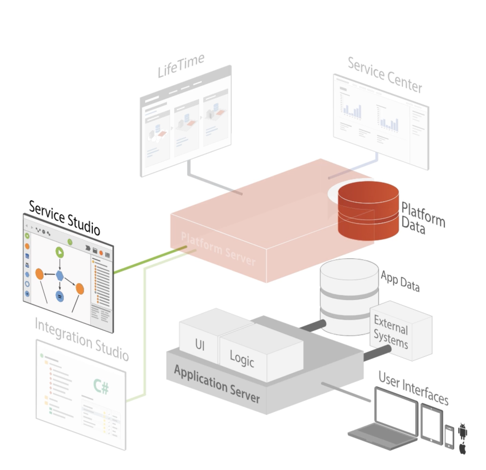

# OutSystems 개요

---

**OutSystems는 엔터프라이즈 웹 및 모바일 애플리케이션의 개발, 배포를 지원한다**

- *로우코드 개발 환경*
- *엔터프라이즈 수준의 풀 스택 시스템*
- *다른 시스템과의 통합 지원*
- *애플리케이션 및 사용자에 대한 관리 및 분석을 제공 → 의도대로 동작하는지 확인 가능*
- *애플리케이션은 HTML, CSS, JavaScript, .NET 같은 표준 및 최적화된 코드를 사용하여 컴파일된다.*
- *CI/CD를 지원하며, 클라우드 또는 온프레미스 환경 모두 수행 가능하다*

# 컴포넌트 및 도구

---

### **OutSystems 서버(플랫폼 서버)**

- *애플리케이션을 인프라 내부에 컴파일, 배포, 관리, 실행 및 모니터링하는 서버들의 집합*
- *Platform Data(플랫폼 데이터 데이터베이스)*

### **Application Server**

- *생성한 애플리케이션을 실행*
- *기존 데이터베이스 및 외부 시스템(oracle, mysql, … ) 사용*

### **Service Studio(개발 환경)**

- *플랫폼 서버와 연결* 
- *Web 및 모바일 앱의 OutSystems 시각적 개발 환경*
- *플랫폼 서버와 연결되면 애플리케이션 생성 및 게시가 가능하다*
- *해당 애플리케이션의 각 버전은 플랫폼 데이터 데이터베이스에 저장된다*
- *플랫폼 서버는 애플리케이션을 위한 최적화 코드를 컴파일하고 생성한 다음 표준 애플리케이션 서버에 배포한다*

### **Integration Studio(통합 스튜디오, 개발 환경)**

- *C# 코드, 데이터베이스와 같은 외부 시스템(리소스)과의 통합*
- *통합을 위한 가속기를 제공한다*
- *플랫폼 자체에 대한 확장을 허용*
- *확장에 성공하면 즉, 서버 게시에 성공하면 Service Studio에서 정상적인 OutSystems 리소스처럼 사용할 수 있다*

### Service Center(서비스 센터)

- *플랫폼 서버 관리 및 관리 콘솔*
- *웹 브라우저를 통해 엑세스 가능*
- *관리 및 운영 관점에서 플랫폼 서버를 살펴보고 구성할 수 있다*
- **서비스 센터 - 공장**
- *서비스 센터 내에서 공장을 살펴보고 어떤 애플리케이션이 사용 가능한지 확인 가능*
- **서비스 센터 - 모니터링**
- *환경을 모니터링*
  - *플랫폼 및 실행 중인 애플리케이션에서 생성된 로그 검사가 가능*
- **서비스 센터 - 관리**
- *서버 관리 및, 환경 설정 구성이 가능*
- **서비스 센터 - 분석**
- *다양한 유형의 분석을 수집이 가능*

### LifeTime(라이프 타임)

- *서비스 센터는 개별 서버 또는 환경을 관리, 라이프타임은 여러 환경에 걸쳐 전체 애플리케이션의 라이프사이클을 관리할 수 있게 지원*
- *라이프 타임은 서비스센터의 기능을 확장하는 웹 애플리케이션*
- *개발 환경에서의 품질 환경, 인프라 각 환경에 배포된 애플리케이션의 버전 같이 애플리케이션 라이플프사이클을 다양한 스테이징 환경에서 볼 수 있다.*
- **라이프 타임 - 사용자 관리**
- *각 환경 또는 애플리케이션에 대해 각 사용자 또는 팀이 갖는 권한 수준을 관리할 수 있다.*
- **라이프 타임 - 인프라**
- *인프라의 모든 환경에 대한 가시성을 확보하고, 해당 환경이 라이프사이클에 어떻게 배치되는지 관리할 수 있다.*
- **라이프타임 - 분석**
- *애플리케이션 성능에 대한 분석을 수집, 성능 병목 현상을 쉽게 파악하고 해결할 수 있다*

### OutSystems Forge 및 커뮤니티(Forge & Forums)

- *OutSystems 작업에 대한 지원을 받을 수 있다*
- *https:://www.outsystems.com/forge*
- **OutSystems Forge**
- *애플리케이션 개발 및 배포 속도를 높이는 다운로드 가능한 컴포넌스 소스*
- **OutSystems Community Forums**
- OutSystems 개발자들에게 Q&A 가능

# Capabilities(능력)

---

*서로 다른 환경에서 엔터프라이즈 개발이 가능*

*OutSystems 솔루션에 이미 존재하는 애플리케이션들의 통합이 간단 (외부 시스템의 데이터도 마찬가지)*

### OutSystems 를 통한 개발 프로세스 정리

1. **Integration with everything**
1. *기존에 개발된 애플리케이션 및 데이터베이스 통합*
1. **Visual Design and Development(Service Studio)**
1. *low-code를 통한 시각적 디자인 및 개발*
  1. *Processes And Logic → 비즈니스 로직 생성*
  1. *User Interface 생성*
  1. *개발이 끝나면 클릭 한번으로 배포가 가능*
1. **Standard and Optimized**
1. *HTML, CSS, JS, .NET (컴파일)*
1. **Continuous Integration and Continuous Delivery**
1. *Deploy → Integrity → Governance → Monitoring*
1. **Flexible Infrastructure**
1. *Cloud*
  1. *On-Premise*

# 퀴즈

---

1. 다음 중 개발 환경이 아닌 것은 무엇입니까?
1. Service Studio
  1. Integration Studio
  1. Service Center
1. 다음 중 애플리케이션의 라이프사이클을 인프라 전반에 걸쳐 관리할 수 있는 도구는 무엇입니까?
1. 서비스 센터
  1. 라이프타임
  1. 서비스 스튜디오
  1. 통합 스튜디오
1. Click 게시판 중 앱 데이터 모델, 코드 및 인터페이스가 컴파일되어 .NET 코드, HTML, CSS, JavaScript를 생성한다.
1. 참
  1. 거짓

*1번 정답 c: 서비스 센터는 하나의 환경(개발, 프로덕션)에 대한 관리 및 관리 콘솔*

*2번 정답 b: 또한 라이프 타임은 IT 사용자 및 팀을 관리할 수도 있다*

*3번 정답 a: 그리고 생성된 코드는 최적화된다*

