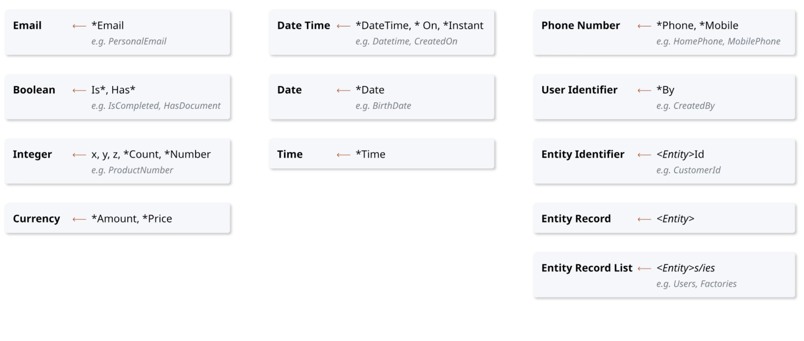
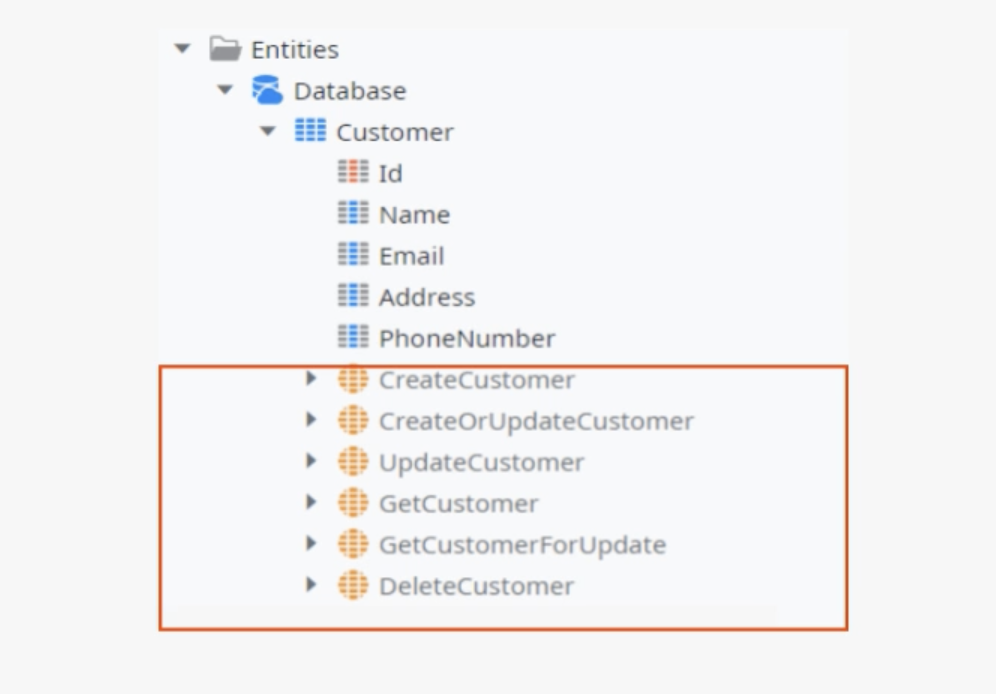
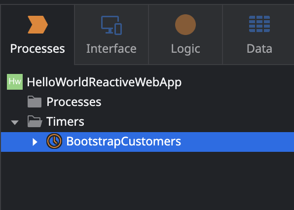
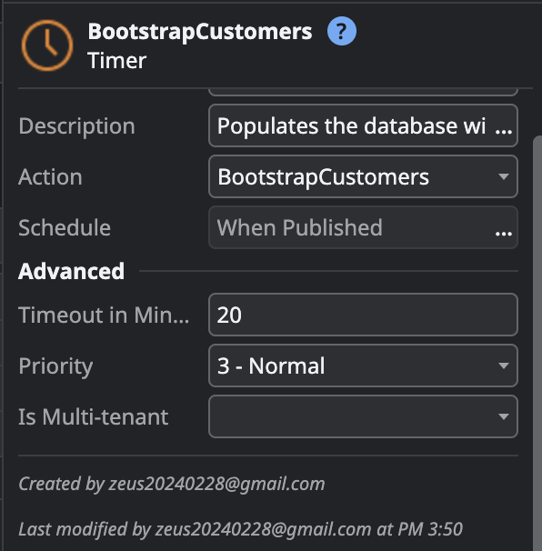
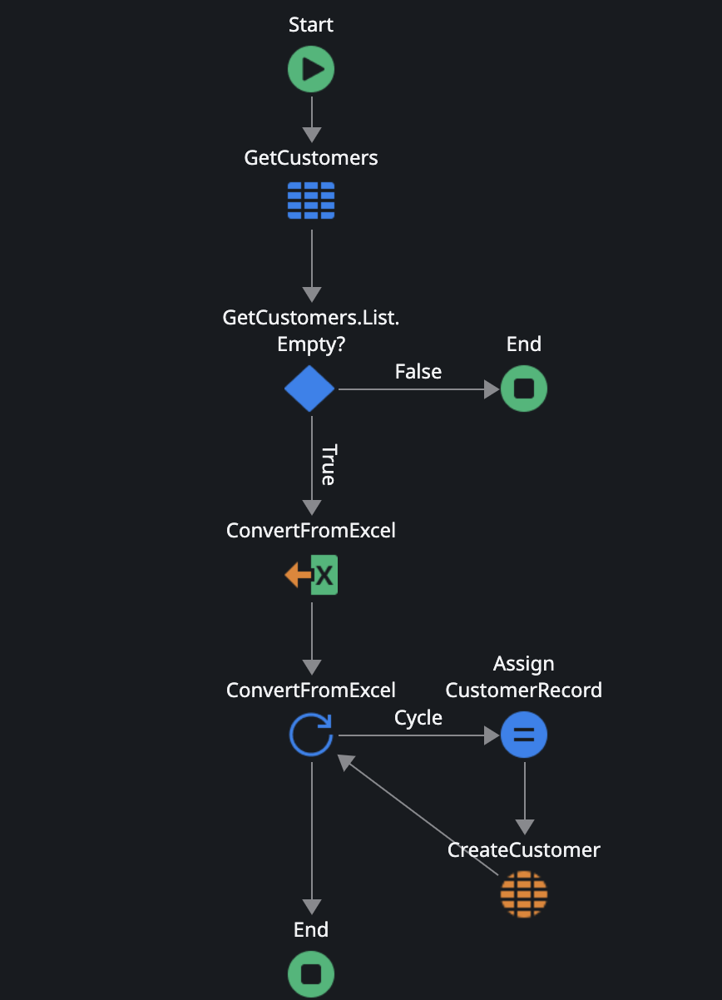
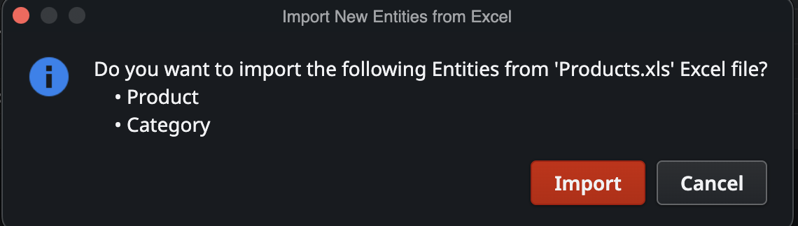
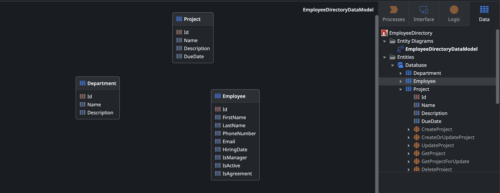

# 데이터 모델링

---

*엔티티가 데이터베이스에 매핑되는 방법을 설명*

## 앱을 위한 데이터 모델링

*애플리케이션은 비즈니스에 가치가 있는 정보를 포함한다(저장, 검색)*

*OutSystems에서는 그 개념이 모델링되고 엔티티로 참조된다*

*데이터베이스 엔티티는 데이터베이스에 저장하고 검색할 수 있는 데이터를 보유한다*

## 엔티티 - 데이터베이스 매핑

| OutSystems Entity | Database Table |
| --- | --- |
| Attribute(Data Types software) | Columns Data Types (database) |
| Id(Identifier attributes) | Primary Key |
| Reference Attribute | Foreign Key |
| Index | Index |
| Record or Instance | Row or Tuple |

# 데이터베이스 엔티티

---

## 엔티티

*엔티티는 OutSystems 애플리케이션에서 필요한 정보를 저장하고 엑세스할 수 있게 해주는 요소*

*각 비즈니스 개념이 엔티티로 표현, 엔티티 데이터는 데이터베이스 테이블에 저장된다*

*새로운 엔티티 레코드는 해당 테이블의 행으로 삽입된다*

엔티티

- *데이터 세트 저장*
- *속성을 가진다*
- *엔티티 액션을 가진다*

## ID 속성

*자동으로 생성된다*

*엔티티 레코드를 고유하게 식별한다*

*필요한 경우 수정이 가능하다*

*DB의 기본 키*

*관계형 데이터베이스 작업 지원*

***속성은 기본적으로 기본 데이터 유형을 가지며, 엔티티 및 테이블은 하나 이상의 속성을 가져야한다***

## 기본 데이터 유형

*Text, Phone Number, Email*

*Integer, Long Integer, Decimal, Currency*

*Date Time, Date, Time*

*Boolean, Binary Data, Referential*

*이러한 각 데이터 유형에 대해 OutSystems는 기본값을 제공한다*

*즉, 엔티티 속성 또는 변수가 항상 값을 가지고 그렇지 않으면 기본값이 적용됨을 의미한다*

***새로운 속성(또는 변수)을 지정할 때 OutSystems는 해당 유형을 추론하려고 시도한다***



*가정: 만약 속성 이름이 Personal Email* 

*타입 추론: Email* 

## 엔티티 액션

***자동으로 생성된다***



*CRUD 데이터 작업*

- *Create(생성)*
- *Retrieve(검색)*
- *Update(업데이트)*
- *Delete(삭제)*

*엔티티 액션은 애플리케이션의 비즈니스 로직에서 직접 사용할 수 있다*

*엔티티 액션은 OutSystems에서 자동으로 생성되며 수정할 수 없다*

## 데모: 데이터베이스 엔티티 만들기 방법

*간단한 엔티티 생성 및 속성 추가, Email & Phone Number 데이터 타입 추론으로 자동 지정 확인*

*one click publish를 통해 데이터베이스에 테이블 생성*

## 데모: Excel에서 엔터티 데이터를 시작하기

*엑셀 데이터는 데이터 유형과, 이름 기반으로 엔티티 속성에 매핑되고 매핑되지 않으면 해당 속성(값)은 추가되지 않는다*

**작접 진행 순서**

*엔티티 우클릭 → Advanced → Create Action to Bootstrap Data from Excel →* 

*Excel 파일 선택 → Proceed → one click publish →*

*Processes 탭 Timers 밑에 보면 BootStrapCustomer(엔티티 이름)이 존재*

**OutSystems Timers?**

*타이머는 미리 정의된 스케줄에 따라 실행되는 백그라운드 작업이다.*





*타이머 속성에서 Schedule을 보면 모듈이 게시될 때마다 실행된다*

*타이머를 더블클릭하면 관련된 로직을 확인할 수 있다*



*데이터 텝으로 돌아가서 데이터를 확인하면 엑셀 데이터가 추가된것을 볼 수 있다*

## Excel에서 엔티티 및 데이터를 시작하는 방법

*Data 텝 → Entity 우클릭 → Import New Entities From Excel 버튼 클릭*



*Service Studio는 Excel 파일을 분석하여, 두 개의 시트를 감지했다(Product, Category)*

*Category, Product 엔티티의 속성을 보면 자동으로 Id 속성(식별자)이 추가된것을 볼 수 있다.*

*one click publish를 통해 데이터베이스에 엔티티(테이블)이 생성되고 모듈을 성공적으로 배포한 후 데이터가 해당 엔티티로 부트스트랩된다*

## Bootstrap Entity and data from an Excel File

### OAP 파일 설치

1. *OutSystems Service Studio를 열고 로그인한다.*
1. *로그인 후 상단에서 Environment를 클릭한다.*
1. *Environment 메뉴에서 Open Files를 선택한다.*
1. *다운로드한 Lesson Materials 폴더로 이동하여 OAP 파일을 찾는다.*
1. *해당 파일을 선택하고 Open을 클릭한다.*
1. *앱이 Service Studio에 설치될 때까지 기다린 뒤, 안내가 뜨면 Proceed를 클릭한다.*
1. *Employee Directory 앱 설치가 끝나면 그 앱을 클릭해 연결된 모듈을 연다. 그러면 앱이 Service Studio에서 열린다.*

### 엔티티 추가

*이전 과정과 똑같이 Import New Entities From Excel을 통해 Employees 엔티티 생성 및 데이터 추가*

*데이터가 보이지 않으면 CTRL + R****(맥북: command + R)****을 통해 미리보기를 새로고침한다*

### 속성 수정

*표에 나타난 속성 이름과 데이터를 수정할 수도 있다*

*‘PhoneNo_’ 속성을 수정하자*

1. *Data 탭에서 Employee Entity를 펼친다.*
1. *Entity 목록에서* ***`PhoneNo_`*** *속성을 선택하고, 속성 창에서 Name을* ***`PhoneNumber`****로 변경한다.*
1. *Data Type을 Long Integer로 바꾸고, 해당 속성을 mandatory(필수)로 설정한다.*

*또한 다음 속성들도 모두 mandatory로 설정해야 한다.*

- FirstName
- LastName
- Email
- HiringDate
- IsManager

*변경 사항을 서버에 저장하기 위해 다시 모듈을 Publish 한다.*

*속성 설정을 업데이트하면 해당 값이 0으로 보이게 된다.*

### 데이터 넣기

*PhoneNumber 속성에 실제 값을 넣으려면, 수정이 필요한 행에서 Edit 아이콘을 클릭한다.*

*다음과 같이 전화번호를 입력한다.*

- *Caddric Saiz: 9148033049*
- *Irvine Hasser: 9148033048*
- *Fidelia Garahan: 9148033045*
- *Zacharias Pre: 9148033044*
- *Cletus Harget: 9148033043*
- *Anatol Lago: 9148033042*
- *Anny Ledington: 9148033041*
- *Elka Scopes: 9148033047*
- *Deloria McInility: 9148033046*

*입력을 마친 후 Apply를 클릭해 Entity에 변경 사항을 반영한다.*

## Create an Entity Exercise

*Project와 Department라는 두 개의 엔티티를 추가로 생성*

*첫 번째 엔티티(Project)는 아래 속성들로 수동으로 만든다.*

- *Id (기본)*
- *Name (필수)*
- *Description (필수, 데이터 타입 Text, 길이 500자)*
- *DueDate (필수, 데이터 타입 Date)*

*두 번째 엔티티(Department)도 아래 속성들로 수동으로 만든다.*

- *Id (기본)*
- *Name (필수)*
- *Description (필수, 데이터 타입 Text, 길이 500자)*

*엔티티들을 생성한 후, Project.xlsx와 Department.xlsx 파일에 있는 데이터를 사용해 Bootstrap Data from Excel 액션으로 각각의 엔티티에 데이터를 부트스트랩한다.*

### 엔티티 다이어그램 만들기



1. *Data 탭에서 Entity Diagrams 아래의 EmployeeDirectoryDataModel을 더블 클릭해 연다.*
1. *미리보기 영역으로 Department 엔티티를 드래그한다.*
1. *같은 방식으로 Employee 엔티티와 Project 엔티티도 미리보기 영역으로 드래그한다.*
1. *변경 사항을 저장하기 위해 모듈을 Publish 한다.*

*이로써 다음 작업들을 성공적으로 수행한 것이다.*

- *두 개의 엔티티와 그 속성들을 생성했다.*
- *새로 만든 엔티티들에 데이터를 부트스트랩했다.*
- *Employee Directory 데이터 모델에 대한 엔티티 다이어그램을 만들었다.*

## 퀴즈 오답노트

*엔티티는 최소한 하나의 속성을 가져야 하지만 식별자는 필수 사항은 아니다.*

- *엔티티는 식별자가 필수 사항이다? 뭐가 정답인건지 ;*

*엔티티는 영구적이며 실제로 데이터베이스에 테이블로 생성된다.*

*Q: HouseNumber라는 이름의 엔티티 속성을 생성할 경우, 해당 속성의 데이터 형식은 어떻게 설정해야 합니까?*

*A:* ***OutSystems의 데이터 유형 추론 메커니즘이 이를 자동으로 Integer(정수형)으로 처리한다***

*부가 설명: suffix가 Number인 경우 → 타입 추론을 통해 Integer로 처리한다.*

**자동 생성되는 엔티티 액션 종류**

- *create*
- *createOrUpdate*
- *Update*
- *get*
- *getForUpdate*
- *delete*

# 정적 엔티티

---

## 정적 엔터티

*정적 엔터티는 애플리케이션에서 사용할 수 있는* ***사전에 정의된 값 목록****을 만드는 특별한 유형의 엔터티이다.*

*마치 Java Enum(열거형)같은 기능*

*정적 엔터티는 속성과 레코드를 가지고 있다*

- *설계 및 개발 중에 정의된다*
- *실시간(run time)으로 변경이 불가능하다*

*단 하나의 엔터티 액션이 있다(Get) → 데이터는 read only*

### 정적 엔티티 기본 4가지 속성

- ID
- 레이블(Label)
- 순서(Order)
- Is Active

### 정적 엔티티 속성 특징

- *기본 속성 변경이 가능*
- *다른 속성 추가가 가능*

### 정적 엔티티 레코드

- *정적 엔터티는 레코드 집합을 가진다*

## 데모: 정적 엔터티 만들기 방법

*data tab → database 우클릭 → add static entity*

*새로 생성된 정적 엔터티를 보면 기본 4가지 속성(Id, Label, Order, Is Active), Get 엔터티 액션,* 

*빈 Records 폴더가 표시된다*

*Records 우클릭 → Add Record*

## Create Static Entity

*아웃시스템즈 Employee Directory 앱에서 정적 엔터티를 생성하고 레코드를 추가하는 실습 가이드*

### 실습 목표

*Employee Directory 앱 내에서 Job Title이라는 정적 엔터티를 생성하여, 애플리케이션 실행 중 변경되지 않는 직책 목록 레코드를 저장합니다.*

## 퀴즈 오답노트

**1. 다음 중 정적 엔터티의 특징은 무엇입니까?** 

- *초기 게시 후에는 변경할 수 없습니다. → 변경이 가능하다. 애플리케이션 런타임에만 변경이 불가능*
- *레코드 집합을 포함합니다. → 정답*
- *두 개의 엔터티 액션을 가지고 있습니다. → 1개의 Get 엔티티 액션만을 가진다.*
- *새로운 속성으로 확장할 수 없습니다. → 새로운 속성을 확장할 수 있다.*

**2. 정적 엔터티의 기록에 대해, 다음 중 어떤 것이 거짓입니까?** 

- *모든 4개의 기본 속성 값은 정의되어야 합니다. → 정적 엔터티의 속성 값은 필수가 아니다.*
- *레코드는 개발 중에만 추가 및 제거할 수 있습니다. → 레코드는 런타임에 변경이 불가능하다*
- *레코드 식별자는 정적 엔터티의 식별자입니다. → 레코드 식별자는 정적 엔터티의 식별자이다*
- *정적 엔터티의 모든 엔터티에는 식별자 속성이 필요합니다. → 정적 엔터티의 모든 엔터티에는 식별자 속성이 필요*

**3. 정적 엔터티는 어떤 다른 프로그래밍 개념과 가장 유사합니까?** 

- *연결 리스트*
- *열거형 → 정적 엔터티는 Enum 즉, 열거형과 가장 유사한 개념이다.*
- *해시 맵*
- *정적 변수*

## 정적 엔터티 구조 정리

```html
JobTitle (정적 엔터티)
├── 속성들
│   ├── Id (Integer, 자동생성, PK)
│   ├── Label (Text, 필수)
│   ├── Order (Integer, 선택)
│   └── Is_Active (Boolean, 선택)
│
└── Records (레코드 집합)
    ├── Record A
    │   ├── Id = 1 (자동생성)
    │   ├── Label = "Software Engineer"
    │   ├── Order = 1 (수동입력)
    │   └── Is_Active = True
    ├── Record B  
    │   ├── Id = 2 (자동생성)
    │   └── Label = "Senior Software Engineer"
    └── Record C...
```

```html
// 변수 타입: JobTitle Identifier
MyJobTitle = JobTitle.SoftwareEngineer  // Id=1을 가리킴

// 조건 비교
If(MyJobTitle == JobTitle.SoftwareEngineer, ...)
```

***즉, 레코드 식별자는 정적 엔터티의 식별자와 동일하다***

