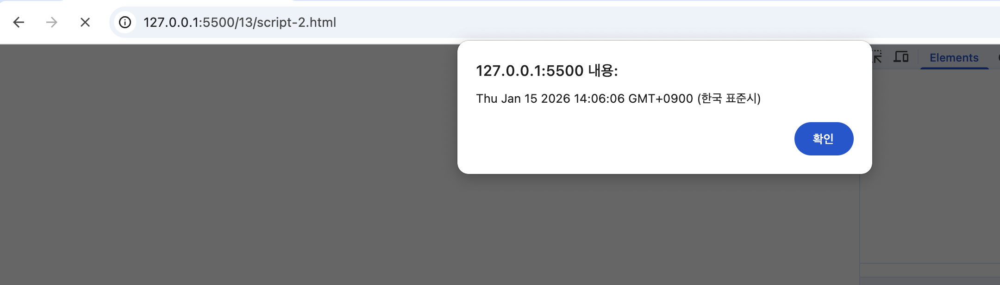
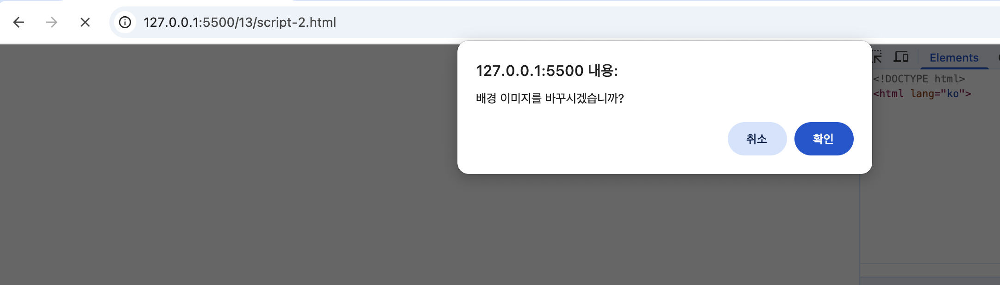
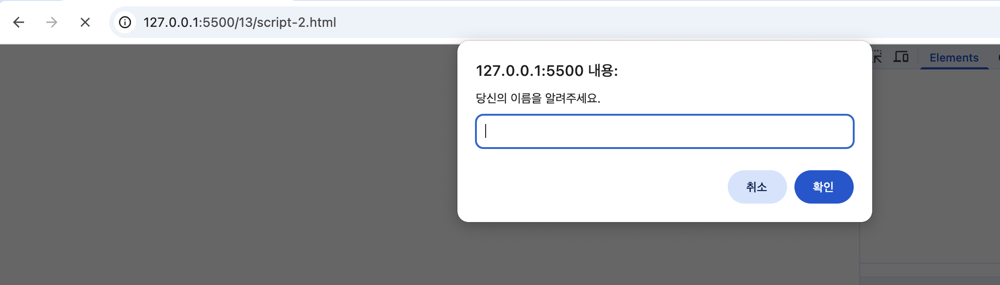
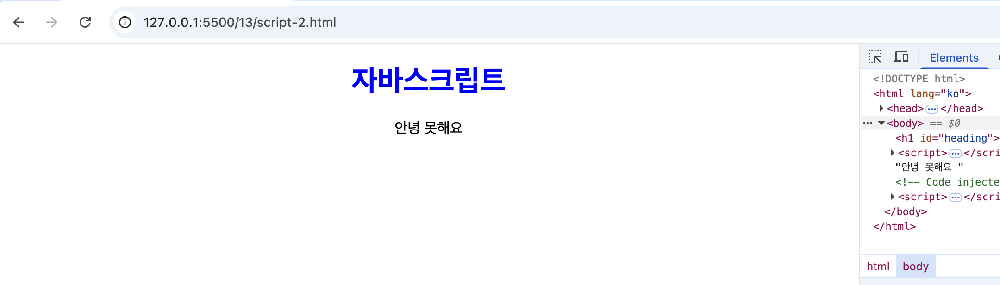
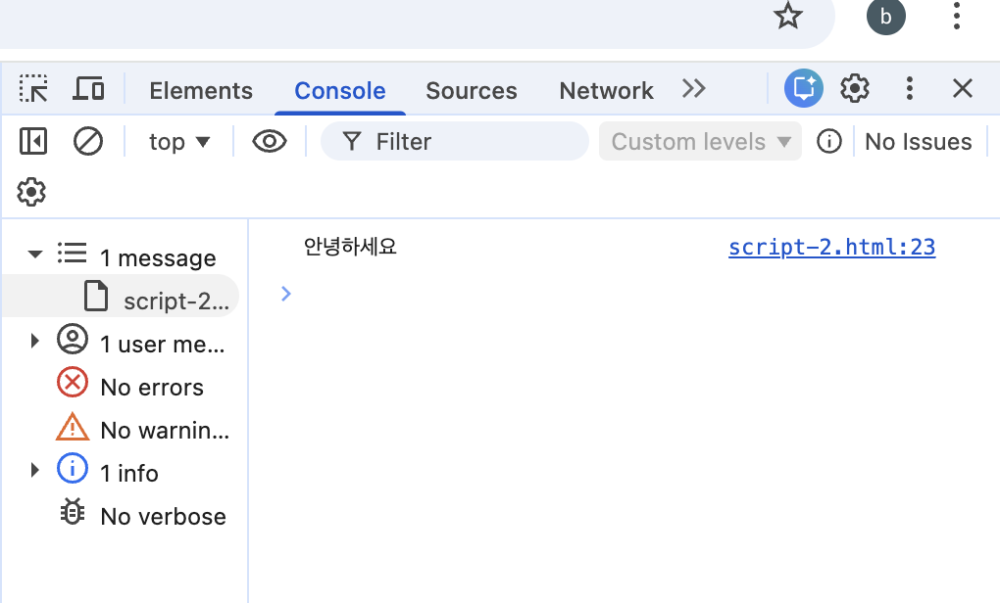
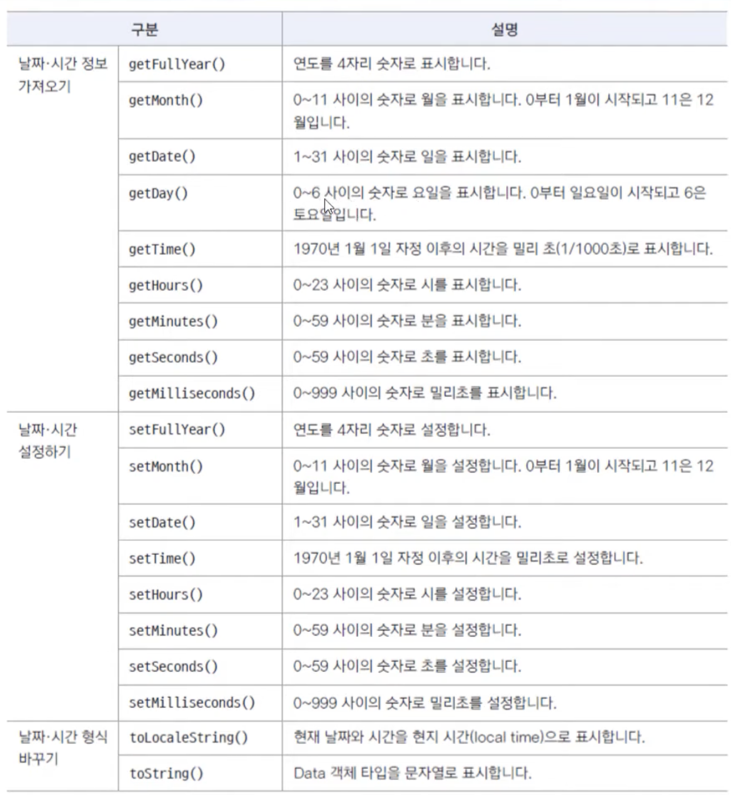
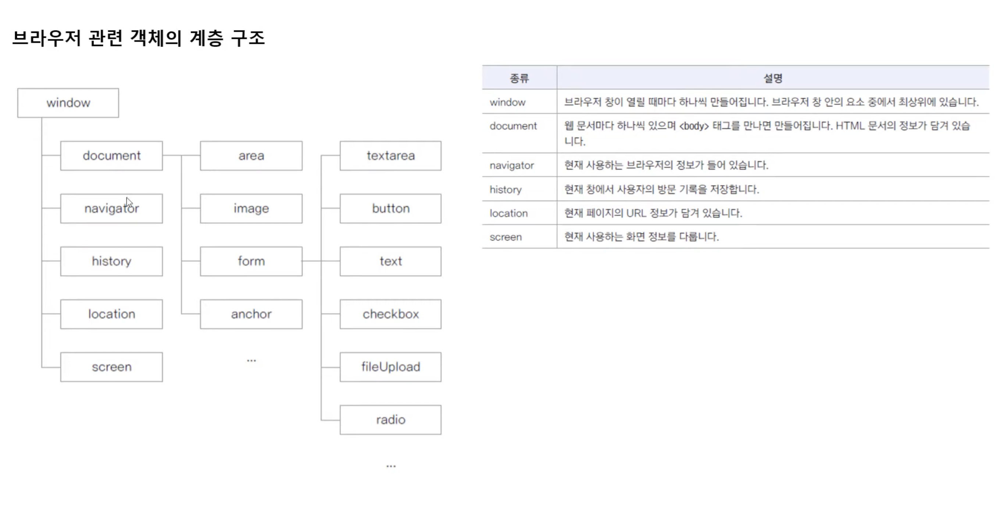
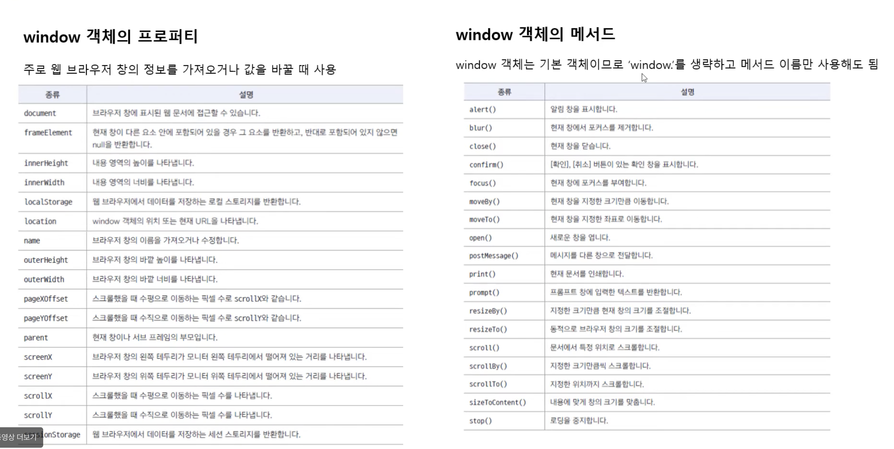
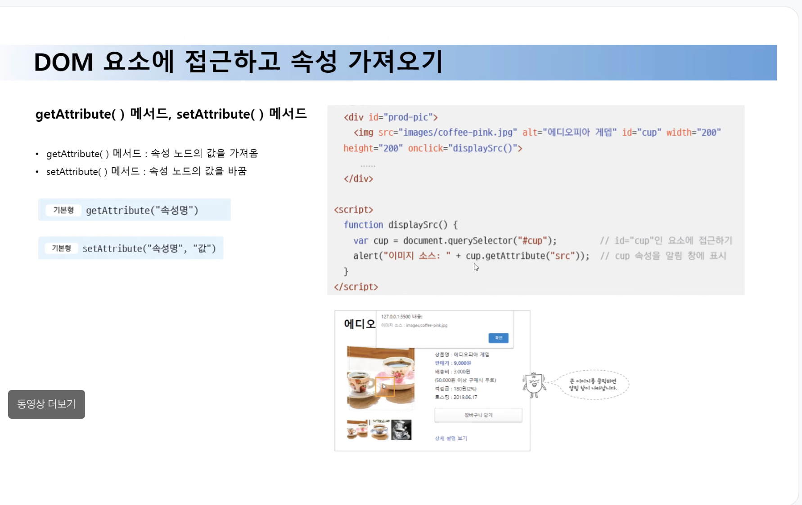
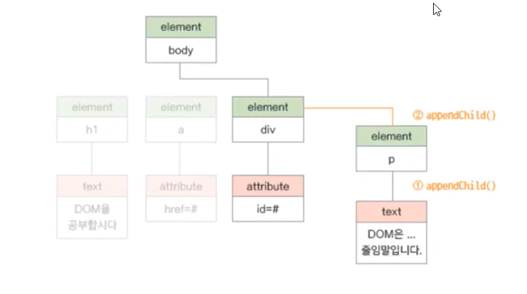

```html
<script src="js/change-color.js"></script>
```

# alert: 서버 알림(판업창)

---

```html
<script>
  var toDay = new Date();
  alert(toDay);
</script>
```



# confirm: 확인/취소 버튼

---

***return true false***

```html
<script>
  confirm('배경 이미지를 바꾸시겠습니까?');
</script>
```



# prompt: 사용자 텍스트 입력 

---

*입력 필드가 있는 알림창으로 사용자 입력 반환*

```html
<script>
  prompt('당신의 이름을 알려주세요.');
</script>
```



# document.write: 페이지 출력

---

```html
<script>
	document.write('안녕 못해요');
</script>
```



# console.log: 디버깅을 위한 출력

---

```html
<script>
  console.log('안녕하세요');
</script>
```



# 변수란

---

***변수(variable):*** *값이 달라질 수 있는 데이터*

***상수(constant):*** *값을 한번 지정하면 바뀌지 않는 데이터*

# 변수 선언하기

---

```javascript
var currentYear;
var birhYear;
var age;
// 여러 개의 변수를 한꺼번에 선언할 수 있다.
var currentYear, birhYear, age;
```

# 실습(나이 계산하기 프로그램)

---

```html
<script>
	var currentYear = 2026;
	var birthYear;
	var age;
	
	birthYear = prompt('태어난 연도를 입력하세요. (YYYY)', '');
	age = currentYear - birthYear + 1;
	document.write(currentYear + '년 현재<br>');
	document.write(
	  birthYear + '년에 태어난 사람의 나이는 ' + age + '세입니다.'
	);
</script>
```

# 자료형

---

*숫자형: 2000*

*문자열: “Hello”, ‘Hello’*

*논리형: true, false*

*배열: [’봄’, ‘가을’, ‘겨울’]*

*객체: var date = new Date();*

*undefined: 자료형이 지정되지 않았을 때의 상태, 선언만 하고 값을 할당하지 않은 상태*

*null: 값이 유효하지 않을 때의 상태*

***“typeof” 문법을 통해 자료형을 확인할 수 있다.***

```javascript
typeof(1 > 10)
"boolean"
```

# == VS === (비교 연산자)

---

*JavaScript에서 “==”와 “===”는 값 비교 연산자지만 타입 변환 처리 방식이 다르다.*

*“==”는 느슨한 비교로 타입을 자동 변환한 후 값만 비교하며, “===”는 엄격한 비교로 타입과 값이 모두 동일해야 true를 반환한다.*

# let VS var VS 변수 선언하지 않는 경우

---

  1. **let 변수**
- *`let`* *키워드로 선언된 변수는 블록 스코프(block scope)를 가집니다. 즉, 해당 변수가 선언된 중괄호({}) 내에서만 접근할 수 있습니다.*
    - *함수 내부에서 선언된* *`let`* *변수는 해당 함수 내에서만 접근 가능합니다.*
    - *중복된 이름의 변수 선언이 허용되지 않습니다. 같은 스코프 내에서 같은 이름의 변수를 다시 선언하면 SyntaxError가 발생합니다.*
    - *변수 호이스팅(hoisting)이 발생하지 않습니다.*
  1. ***var 변수***
- *`var`* *키워드로 선언된 변수는 함수 스코프(function scope)를 가집니다. 함수 내에서 선언된 변수는 함수 내에서만 유효하며, 블록 스코프를 갖지 않습니다.*
    - *중복된 이름의 변수 선언이 가능합니다. 동일한 스코프 내에서 같은 이름의 변수를 여러 번 선언해도 오류가 발생하지 않습니다.*
    - *변수 호이스팅이 발생합니다. 즉, 변수 선언이 스코프의 맨 위로 끌어올려지기 때문에 선언 이전에도 변수에 접근할 수 있습니다.*
  1. ***변수 선언하지 않은 경우***
- *변수를 선언하지 않고 값을 할당하면 해당 변수는 암묵적으로 글로벌 변수(global variable)로 선언됩니다. 글로벌 변수는 어디서든 접근 가능하며, 전역 스코프를 가집니다. 이는 코드의 복잡성을 증가시키고 예상치 못한 부작용을 초래할 수 있으므로 되도록 사용을 지양해야 합니다.*

# onclick 이벤트

---

```html
<ul>
  <li><a href="#" onclick="changeBg('green')">Green</a></li>
  <li><a href="#" onclick="changeBg('orange')">Orange</a></li>
  <li><a href="#" onclick="changeBg('purple')">Purple</a></li>
</ul>
<div id="result"></div>
<script>
  function changeBg(color) {
    var result = document.querySelector('#result');
    result.style.backgroundColor = color;
  }
</script>
```

  - ***`document.querySelector`***
-  ***`#result`****: id 선택자. 문서에서* ***`id="result"`****인 첫 번째 요소 반환*
    - *일치하는 요소 없으면* ***`null`*** *반환 (에러 방지 필요)*
    - ***`querySelectorAll()`****과 달리 첫 번째 요소만 반환*
  - ***`style.backgroundColor`****로 배경색을* ***`color`*** *매개변수로 설정*

# Date 내장 객체

---

```javascript
new Date(); // 현재 날짜로 객체 만들기
new Date("2026-01-15"); // 특정 날짜를 기준으로 만들기 YYYY-MM-DD
```

  - *YYYY-MM—DDTHH* 
  - *MM/DD/YYYY*
  - *이름 형식*

### Date 객체 3가지 메서드



  - *날씨/시간 정보를 가져오는 메서드*
  - *날씨/시간 정보를 설정하는 메서드*
  - *날짜/시간 형식을 바꿔주는 메서드*

```javascript
var now = new Date();
var firstDay = new Date('2026-01-01');

var passedTime = now.getTime() - firstDay.getTime();
passedTime = Math.round(passedTime / (1000 * 60 * 60 * 24));

document.querySelector('#result').innerText = passedTime;
```

# 브라우저 객체

---





# DOM 객체

---

### DOM  요소에 접근하기(메서드)

  - *document.****getElementById(”idName”)***
  - *document.****getElementsByClassName(”className”)***
- *반환값이 2개 이상일 수 있다. → HTML Collection 객체에 저장된다.*
  - *document.****getElementsByTagName(”tagName”)***
- *반환값이 2개 이상일 수 있다. → HTML Collection 객체에 저장된다.*
  - *document.****queySelector(선택자 또는 태그)***
  - *document.****queySelectorAll(선택자 또는 태그)***
- *반환값이 2개 이상일 수 있다. → 노드 리스트(Node List)로 반환된다.*

*querySelector, querySelectorAll 같은 경우 id 앞에는 “#”, class 이름 앞에는 “.”, 태그 이름 앞에는
아무것도 붙이지 않는다.*



*getAttribute() 메서드: 속성 노드의 값을 가져온다*

*setAttribute() 메서드: 속성 노드의 값을 바꿈*

  - *setAttribute(”속성명”, “값”)*

# DOM에서 이벤트 처리하기

---

### addEventListener() 메서드 사용하기

*이벤트 객체를 사용해 이벤트 처리기 연결*

```
document.addEventListener(이벤트, 함수, 캡처 여부);
```

  - ***이벤트***
- *이벤트 유형을 지정한다. 단, click과 keypress 처럼 on을 붙이지 않고 쓴다.*
  - ***함수***
- *이벤트가 발생하면 실행할 명령이나 함수를 지정한다. 함수를 정의할 때는 event 객체를 인수로 받는다.*
  - ***캡처 여부***
- *이벤트를 캡처하는지 여부를 지정하며 기본값은 false 이다. true는 캡처링, false는 버블링을 의미한다.
이벤트 캡처링은 DOM의 부모  노드에서 자식 노드로 전달되는 것이고, 이벤트 버블링은 DOM의 자식 노드에서 부모 노드로 전달되는 것이다.*

```html
<body>
	<div id = "container">
		
	</div>

	<script>
		var cover = document.getElementById("cover");
		cover.addEventListener("mouseover", changePic, false);
		cover.addEventListener("mouseout", function() {
			cover.src = "images/1.jpg";
		}, false);
		
		function changePic() {
			cover.src = "images/2.jpg";
		}
	</script>
</body>	
```

### addEventListener 활용 CSS 수정하기

```html
<head>
	/* 코드 생략 */
	<style>
		#rect {
			width:100px;
			height:100px;
			border:1px solid #222;
			margin:30px auto;
			transition:1s; /* *스타일이 변경될 때, 변경된 값까지 1초 동안 서서히 변화 */*
		}
	</style>
</head>
<body>
	<div id="container">
		<p>도형 위로 마우스 포인터를 올려놓으세요.</p>
		<div id ="rect"><div>
	</div>
	<script>
		var rect = document.querySelector("#rect");

		rect.addEventListener("mouseover", function() {
			rect.style.backgroundclolor = "green";
			rect.style.borderRadius = "50%";
		}, false);
		
		rect.addEventListener("mouseout", function() {
			rect.style.backgroundclolor = "";
			rect.style.borderRadius = "";
		}, false);
		
	</script>
</body>
</html>	
```

  - ***transition 1s:*** *#rect의 스타일이 변경될 때, 변경된 값까지 1초 동안 서서히 변화*

# DOM에서 노드 추가, 삭제하기

---

### 요소 노드 만들기 - createElement(노드명)

```html
var newP = document.createElement("p");
```

  - *p 요소 만들기*

### 텍스트 노드 만들기 - createTextNode() 

```html
vat txtNode = document.createTextNode("DOM은 document object model 줄임말");
```

### 자식 노드 연결하기 - appendChild()



```html
newP.appendChild(txtNode); // 새로 만들었던 p 노드에 text 노드 자식으로 연결
document.getElementByUd("info").appendChild(newP); // 기존에 있던 노드에 p 노드 자식으로 연결 
```

### 속성 값이 있는 새로운 요소 추가하기

  1. **요소 만들기 - createElement()**
```html
var newImg = document.createElement("img");
```
  1. **속성 노드 만들기 - createAttribute()**
```html
var srcNode = document.createAttribute("src");
var altNode = document.createAttribute("alt");

srcNode.value = "images/dom.jpg"    // src 속성값 지정
altNode.value = "돔 트리 예제 이미지";  // alt 속성값 지정
```
  1. **속성 노드 연결하기 - setAttributeNode()**
```html
newImg.setAttributeNode(srcNode);
newImg.setAttributeNode(altNode);
```
  1. **자식 노드 연결하기 - appendChild()**
```html
document.getElementById("info").appendChild(newImg)
```

### 노드 삭제하기

*노드를 삭제할 때는 부모 노드에서 자식 노드를 삭제해야 한다*

*→ 노드를 삭제하려면 부모 노드부터 찾아야함*

**현재 노드의 부모 노드에 접근해서 부모 노드의 요소 노드를 반환**

```html
노드.parentNode
```

removeChild() 메서드: 자식 노드 삭제

```html
부모 노드.removeChild(자식노드)
```

# 마무리

***event listener 활용 코드***

```html
<!DOCTYPE html>
<html lang="ko">
  <head>
    <meta charset="UTF-8" />
    <meta name="viewport" content="width=device-width, initial-scale=1.0" />
    <title>Web Programming</title>
    <link rel="stylesheet" href="css/nodelist.css" />
  </head>
  <body>
    <div id="container">
      <h1>Web Programming</h1>
      <p>공부할 주제를 기록해 보세요</p>
      <form>
        <input type="text" id="subject" autofocus />
        <button type="button" id="addButton">추가</button>
        <!-- 변경1: onclick 제거, id 추가 -->
      </form>
      <hr />
      <ul id="itemList"></ul>
    </div>

    <script>
      // 변경2: 페이지 로드 후 이벤트 리스너 등록
      document.addEventListener('DOMContentLoaded', function () {
        var button = document.querySelector('#addButton');
        var subject = document.querySelector('#subject');

        // 변경3: addEventListener로 onclick 대체
        button.addEventListener('click', function (e) {
          e.preventDefault(); // form submit 방지
          newRegister();
        });

        subject.addEventListener('keypress', function (e) {
          if (e.key === 'Enter') {
            e.preventDefault();
            newRegister();
          }
        });
      });

      function newRegister() {
        var subject = document.querySelector('#subject');
        console.log('입력값:', subject.value);

        if (subject.value.trim() === '') {
          alert('빈 텍스트는 추가가 불가능 합니다!');
          subject.focus();
          return;
        }

        var newItem = document.createElement('li');
        var newText = document.createTextNode(subject.value);
        newItem.appendChild(newText);

        newItem.addEventListener('click', function () {
          if (this.parentNode) {
            this.parentNode.removeChild(this);
          }
        });

        document.querySelector('#itemList').appendChild(newItem);
        subject.value = '';
        subject.focus();
      }
    </script>
  </body>
</html>

```

