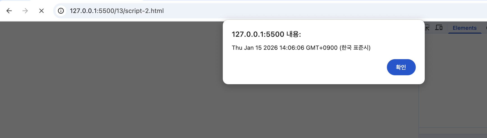
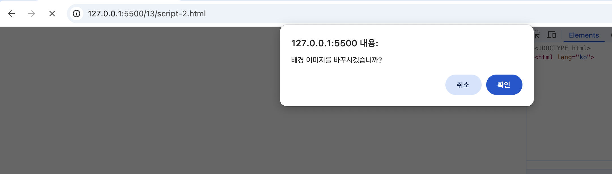
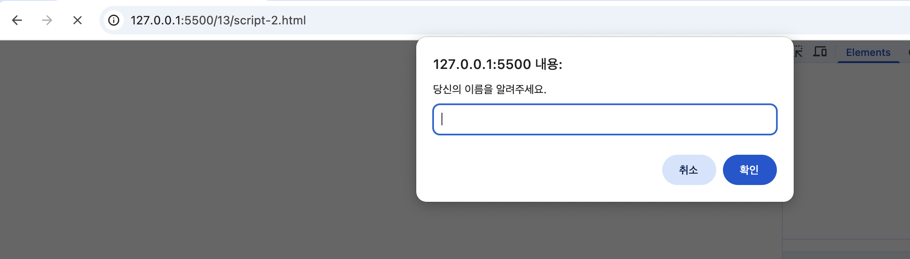
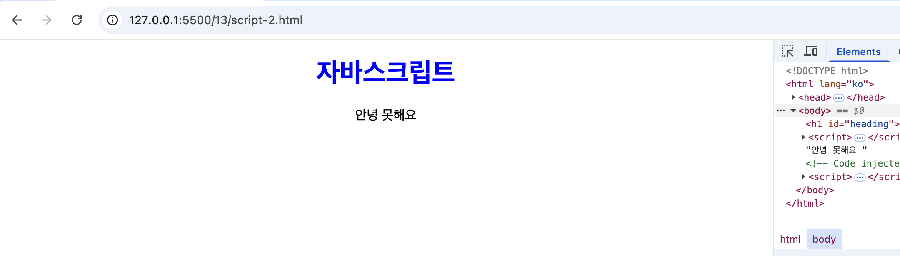
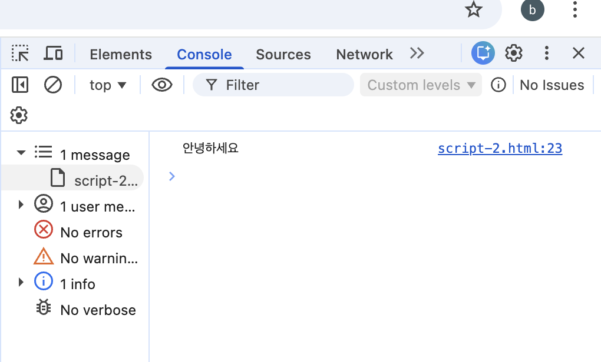

# alert: 서버 알림(판업창)

---

```html
<script>
  var toDay = new Date();
  alert(toDay);
</script>
```



# confirm: 확인/취소 버튼

---

***return true false***

```html
<script>
  confirm('배경 이미지를 바꾸시겠습니까?');
</script>
```



# prompt: 사용자 텍스트 입력 

---

*입력 필드가 있는 알림창으로 사용자 입력 반환*

```html
<script>
  prompt('당신의 이름을 알려주세요.');
</script>
```



# document.write: 페이지 출력

---

```html
<script>
	document.write('안녕 못해요');
</script>
```



# console.log: 디버깅을 위한 출력

---

```html
<script>
  console.log('안녕하세요');
</script>
```



