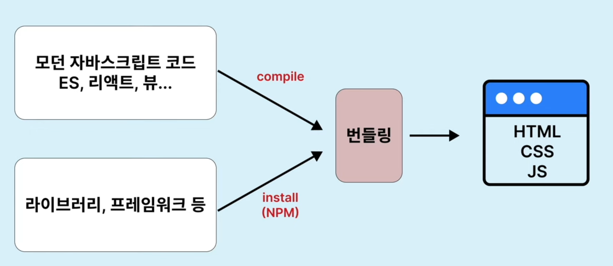

[https://www.youtube.com/playlist?list=PLg-yFEMmilBBc23fH9McDtG3za4o5TbP_](https://www.youtube.com/playlist?list=PLg-yFEMmilBBc23fH9McDtG3za4o5TbP_)

```powershell
vue create movie-info // 뷰 프로젝트 생성
npm run serve // 개발 서버 시작
```



*npm run server 이후 command + s를 통해 저장하면 자동으로 화면 동안 갱신된다(VS 코드 live server 비슷)*

# SPA(Single Page Application)

---

***하나의 HTML 페이지로 동작하는 웹 애플리케이션***

***"URL은 바뀌지만, 페이지는 새로 고치지 않는다”***

### 전통적인 웹 (MPA)

```
/        → index.html
/login   → login.html
/user    → user.html
```

- *페이지 이동 시*
- *서버에 요청*
  - ***HTML 전체 새로 로드***
  - *화면 깜빡임 발생*

### SPA 방식

```
index.html  (딱 1개)
```

- *최초 1번만 HTML 로드*
- *이후*
- ***JS가 화면을 바꿔 끼움***
  - *서버는* ***데이터만(JSON)*** *반환*

***페이지 이동 = 화면 교체***

***HTML 재요청 없음***

# SPA에서 Router란?

---

### Router의 역할

***Router:*** *URL과 화면(View)을 연결해주는 관리자*

| 역할 | 설명 |
| --- | --- |
| URL 감지 | /login, /user/1 |
| 컴포넌트 매칭 | 어떤 화면을 보여줄지 |
| 화면 전환 | 새로고침 없이 변경 |
| 히스토리 관리 | 뒤로가기 / 앞으로가기 |

### Vue Router의 핵심 개념

```html
{
  path: '/login',
  component: LoginView
}
```

***URL(path)*** *↔* ***화면(component)***

### <router-view />는 무엇인가?

```
<template>
  <router-view />
</template>
```

**화면이 바뀌는 자리**

- *현재 URL에 맞는 컴포넌트가 이 위치에* ***동적으로 끼워짐***

# Vue 프로젝트 구조

---

- ***node_modules***
- *설치한 라이브러리들이 있다*
  - *package.json 기반으로 자동 생성(직접 수정 X)*
- ***package.json***
- *프로젝트 설정의 핵심*
  - *의존성, 스크립트, 버전 관리*
- ***index.html***
- *SPA의 단 하나의 HTML*
  - *Vue 앱이 마운트되는 진입점*
- ***src/main.js***
- *앱의 시작점(Entry Point)*
  - *Vue 인스턴스 생성*
- ***src/App.vue***
- *최상위 컴포넌트*
  - *공통 레이아웃, 헤더, 푸터 위치*
- ***assets/***
- *정적 리소스*
  - *이미지, 폰트, 전역 CSS*
- ***components/***
- *재사용 가능한 컴포넌트*
  - *버튼, 카드*
- ***views/*** 
- *페이지 단위 컴포넌트*
  - *router와* ***1:1 매칭,*** *URL 단위 화면*
- ***router/***
- 라우팅 설정
  - *SPA의 url 관리, 화면 전환 담당*

# main.js

---

*Vue 애플리케이션의 시작지점*

```html
브라우저
 ↓
index.html
 ↓
main.js
 ↓
Vue App 생성
 ↓
Router / Store 연결
 ↓
App.vue 렌더링
```

# **App.vue**

---

```html
<template>
  <h1>영화 정보</h1>
  <div>
    <h3>{{ title }}</h3>
    <p>개봉: {{ year }}</p>
    <p>장르: {{ category }}</p>
  </div>
</template>

<script>
export default {
  name: 'App',
  data() {
    return {
      title: '노량',
      year: 2023,
      category: '액션, 드라마',
    };
  },
};
</script>

<style>
.bg-yellow {
  background-color: yellow;
}
</style>
```

- *<template> HTML 작성*
- *<script> JS  작성*
- *<style> CSS를 작성*

# Vue 코드 맛보기

---

### export default {} 과 data() 함수

```html
<script>
export default {
  name: 'App',
  data() {
    return {
      foods: ['김밥', '순대', '만두'],
      title: '노량',
      year: 2023,
      category: '액션, 드라마',
      textRed: 'color: red',
    };
  },
};
</script>
```

- *name: 컴포넌트 이름*
- *date() 함수*
- *반응형 데이터*
  - *값이 바뀌면 화면 자동 갱신*
  - ***예약어:*** *이름 변경 시 기본 함수 취급*

```html
data: { count: 1 }
```

  - *이렇게 사용하면 모든 컴포넌트가 공유해서 사용하기 때문에* *`data() { return { } }`* *형식으로 사용해야 한다.*

### 보간법과 동적 스타일 바인딩(v-bind)

```html
<h3 class="bg-yellow" :style="textRed">{{ title }}</h3>
```

- `{{ title }}`
- ***보간법(Interpolation)***
  - *data()의 title 값을 화면에 출력한다.*
- `:style="textRed"`
- *동적 스타일 바인딩*
  - *`: = v-bind`*
  - *textRed 값 → color: red*

### v-for 반복 랜더링

```html
<ul>
  <li>{{ foods[0] }}</li>
  <li>{{ foods[1] }}</li>
  <li>{{ foods[2] }}</li>
</ul>
<hr />
<p v-for="(item, i) in foods" :key="i">{{ item }}</p>
```

- *ul 태그쪽 출력하는 데이터는 JS 배열을 인덱스를 통해 직접 접근한다.*
- *`v-for`* *을 활용하면 코드 수정없이 간편하게 반복 랜더링이 가능하다*
- item: 값 
  - i: 인덱스
- *`:key="i"`* 
- *Vue가 DOM을 효율적으로 관리하기 위한* ***식별자***
  - *리스트 렌더링 시* ***필수***

### 이벤트 v-on

```javascript
<button @:click="like++">좋아요</button> <span> {{ like }}</span>
<!--<button v-on:click="like++">좋아요</button> <span> {{ like }}</span>-->
```

- *`v-on`* *또는* *`@`* *를 통해 이벤트를 만들 수 있다.*
- *현재는 간단하게 버튼을 누르면 like가 1 올라간다.*

### 함수 methods

```html
// 생략 ...
<button @:click="increaseLike">좋아요</button> <span>{{ like }}</span>
</template>

<script>
export default {
  name: 'App',
  data() {
    return {
      // 생략 ...
    };
  },
  methods: {
    increaseLike() {
      // like += 1;
      this.like += 1;
    }
  },
};
</script>
```

- *함수는 methods: {} 안에 정의한다.*
- *data() 안에 있는 변수들은 상태 변수로서 <template>안에서 this 키워드 없이 사용이 가능하지만 함수 안에서는 this 키워드가 필요하다.*
- *즉, 이를 통해 template 안에서는 vue 프레임워크가 자동으로 this 인스턴스 상태 변수에 this 키워드를 자동으로 바인딩 해주는 것을  알 수 있다. 꼭 함수 안에서는 this 키워드를 붙이자*

```html
<button @:click="increaseLike(item)">좋아요</button>
<span>{{ item.like }}</span>

<script>
// 생략 ..
methods: {
    increaseLike(item) {
      item.like++;
    },
  },
</script>  
```

