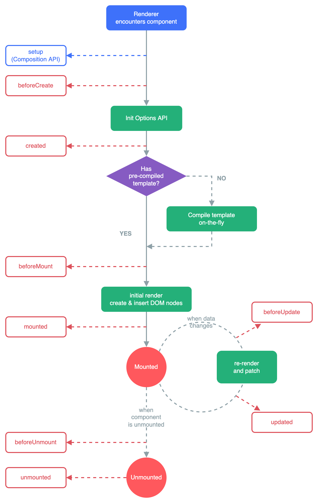
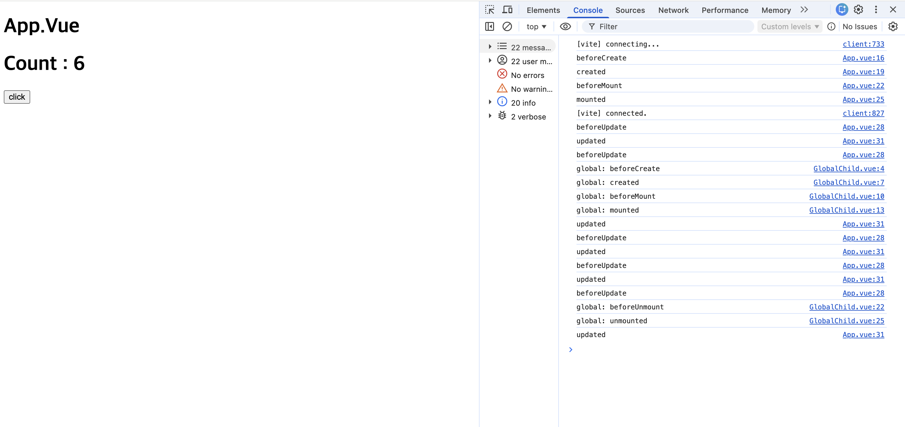
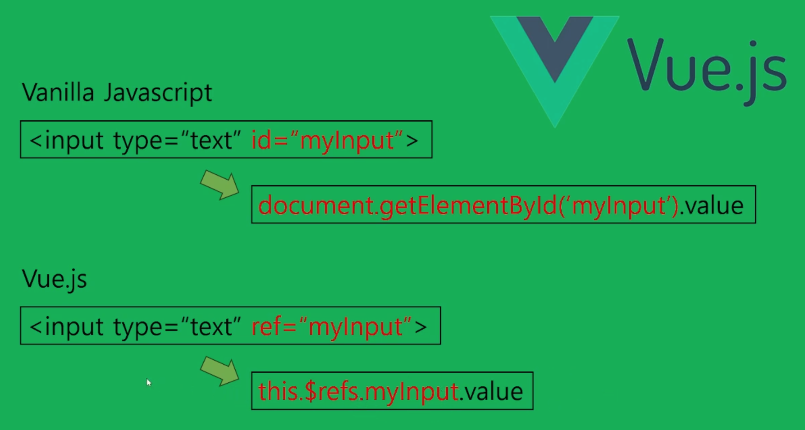
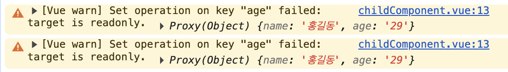
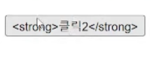
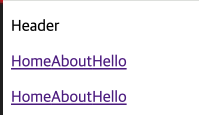
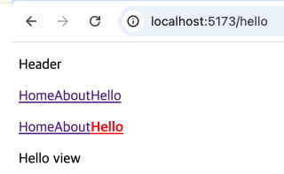
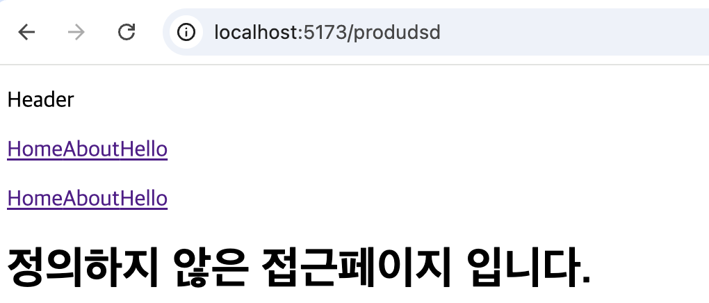
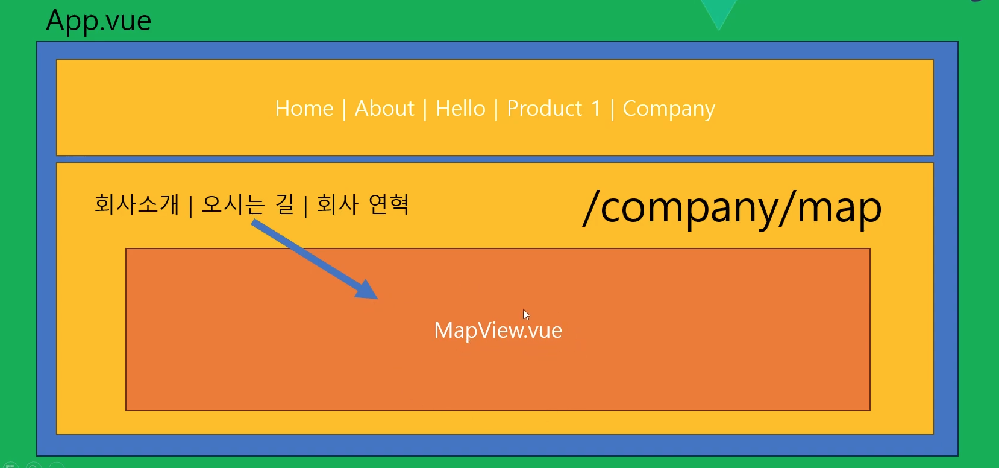

## Vue Application init flow 

---

```html
브라우저
  ↓
main.js (앱 시작점)
  ↓
App.vue (최상위 컴포넌트)
  ↓
하위 컴포넌트들 (Local / Global)
```

## 왜 import 문에 @가 들어갈까?

---

```html
import LocalComponent from '@/components/LocalChild.vue';
```

***@는 src/ 디렉토리의 별칭(alias)***

## what is main.js ?

---

*main.js는 Vue 앱의 시작지점 즉, 엔트리 포인트이다.*

```javascript
import { createApp } from 'vue';
import App from './App.vue';

const app = createApp(App);
app.mount('#app');
```

  1. *Vue 엔진 가져오기*
  1. *App.Vue를 최상위 컴포넌트로 지정*
  1. *Vue 앱 인스턴스 생성*
  1. *DOM에 붙이기*

```javascript
app.component('GlobalChild', GlobalChild);
```

*앱 전체에 영향을 주는 즉, 전역 컴포넌트 등록 같은 설정은 그래서 엔트리 포인트인 main.js에서 한다.*

[https://github.com/kingchobo2022](https://github.com/kingchobo2022)

[https://www.youtube.com/watch?v=7l9PzzU111w&list=PLTb3qGCzYjS1lkhdZL1z4uZJ72F7b5gIr&index=2](https://www.youtube.com/watch?v=7l9PzzU111w&list=PLTb3qGCzYjS1lkhdZL1z4uZJ72F7b5gIr&index=2)

## data

---

```html
<script>
export default {
  data() {
    return {
      channel: '<b>왕초보 홈페이지만들기<b>',
      subscribe: 2677,
    };
  },
};
</script>
```

## Text Interpolation

---

```html
<h1>채널명: {{ channel }}</h1>
```

  - *문자 보간법이라고도 부른다, 가장 기본적인 데이터 바인딩 방식*
  - *HTML 태그는 이스케이프 처리하여 일반 텍스트로 처리된다.*

## Basic Directive(지시자)

---

```html
// channel: '<b>왕초보 홈페이지만들기<b>',

<h2 v-text="subscribe"></h2>
<p v-html="channel"></p>
<h2 v-pre>구독자수: {{ subscribe }}</h2>
```

  - ***v-text:*** *text interpolation과 기능적으로 유사하지만, 태그 전체 내용을 덮어쓰는 점이 다르다.*
  - ***v-html:*** *데이터를 HTML로 해석하여 랜더링한다. 즉, <b> 같은 태그가 실제 스타일링으로 적용된다.*
  - ***v-pre:*** *Vue 템플릿 문법 {{ }}, 지시자 등을 처리하지 않고 그대로 랜더링한다.*

## v-if, v-show Directive

---

```html
<h1 v-if="score >= 90">평점: A</h1>
<h1 v-else-if="score >= 80">평점: B</h1>
<h1 v-else>평점: C</h1>

<h1 v-show="score != 60">이 영역은 v-show에서 처리하고 있습니다.</h1>
```

  - *else-if, else는 if와 다르게 단독으로 사용이 불가능하다.*
  - *v-if, v-show 모두 비슷하게 동작하지만 v-show 같은 경우 결과가 false인 경우 style = display none으로 처리되지만 v-if 같은 경우 태그 자체가 사라진다.*
  - *즉, 추후에 display 값 변경을 통해 데이터 표시가 필요한 경우 v-show를 선택하자*

## v-for 

---

```html
// sports: ['Baseball', 'Football', 'Volleyball', 'Swimming']
<template>
  <ul>
    <li v-for="(sport, index) in sports" :key="sport">
	    {{ index }} {{ sport }}
    </li>
  </ul>
</template>
```

  - *(값, 인덱스), (값, 키, 인덱스) 형태로 사용할 수 있다.*
  - ***:key 필수***
  - *현재 데이터 속성을 보면 이름만 있어서 키를 스포츠 이름으로 하고 있는데 나중에 데이터베이스 ID 같은 데이터를 받으면 key로 사용하는게 좋다.*

```html
<li v-for="(item, index) in items" :key="item.id">
  {{ index }} - {{ item.name }}
</li>
```

  - *(item, index) in items* 
- *item: Array 요소*
    - *items: Array*
    - *index: 인덱스(0부터 시작 )*

## v-on 이벤트 핸들링

---

```html
<template>
  <p>{{ 'count : ' + count }}</p>
  <button v-on:click="count++">숫자 증가</button>
  <button v-on:click="count--">숫자 감소</button>
  <button v-on:mouseover="count = 0">0으로 초기화</button>
</template>
```

## v-on 문법

---

```html
<button @click="count--">숫자 감소</button>
<button @mouseover="count = 0">0으로 초기화</button>
```

  - *기본 문법: v-on:click* 
  - *축약형 문법: @click*

## methods 옵션, 사용자 함수/ 메서드 만들기

---

```html
<script>
export default {
  methods: {
    greeting() {
      return 'Hi, there' + `My name is ${this.userName}`;
    },
  },
  data() {
    return {
      userName: '왕초보',
    };
  },
};
</script>

<template>
  <h1>{{ greeting() }}</h1>
</template>
```

  - *v-on 같은 directive에서는 argument가 없는 경우 greeting 이런식으로 괄호를 생략할 수 있다.*

## modifier 수정자

---

### 목표

*클릭 버튼을 한번만 누를수 있도록 만들어라, 클릭 버튼을 누르면 판업창으로 경고문이 나온다.*

### modifier 적용 BEFORE

```html
<script>
export default {
  data() {
    return {
      can_click: true,
    };
  },
  methods: {
    do_alrt() {
      if (this.can_click) {
        alert('경고문 출력');
        this.can_click = false;
      }
    },
  },
};
</script>
<template>
  <button v-on:click="do_alrt">클릭</button>
</template>
```

  - *can_click을 통해서 접근을 한번만 하도록 제어한다.*

### modifier 적용 After

```html
<script>
export default {
  methods: {
    do_alrt() {
      alert('경고문');
    },
  },
};
</script>
<template>
  <button v-on:click.once="do_alrt">버튼</button>
</template>
```

  - *v-on:click → v-on:click.once를 통해 한번만 접근하도록 만들었다.*
  - *별도의 상태변수 없이 더욱 간단하다.*

### 수많은 modifier 

```html
<input type="text" v-on:keydown.alt.s="getKey"?>
```

  - *v-on: vue 이벤트 핸들링 문법*
  - *keydown: 키보드 입력 이벤트*
  - *alt, s: modifier 즉, alt + s 를 동시에 누르는 경우 getKey() function이 실행된다.*

```
Vue는 다양한 키 modifier를 제공하며 체이닝으로 조합 가능합니다.

일반 키: .enter, .tab, .delete (Delete/Backspace), .esc, 
.space, .up, .down, .left, .right

시스템 키: .ctrl, .alt, .shift, .meta (Windows/Command 키)

마우스 버튼: .left, .right, .middle

기타: .exact (정확한 키 조합만), .once (한 번만 실행)
```

## 마우스 좌표 출력하기

---

```html
<script>
export default {
  data() {
    return {
      x: 0,
      y: 0,
      msg: '',
    };
  },
  methods: {
    mousePos(e) {
      console.log(e);
      this.x = e.offsetX;
      this.y = e.offsetY;
    },
    mouseClick(e) {
      this.msg += this.x + ',' + this.y + '\n';
    },
  },
};
</script>
<template>
  <div id="display" v-on:mousemove="mousePos" v-on:click.right="mouseClick">
    x: {{ x }} <br />
    y: {{ y }}
  </div>
  <textarea>{{ msg }}</textarea>
</template>

```

  - *v-on:mousemove → 마우스 이동시 발생하는 이벤트 핸들링*
  - *v-on:click.right → 마우스 우클릭하면 발생하는 이벤트 핸들링*
  - *mousePos 메서드에서보면  이벤트 객체를 직접 argument로 넘겨주지 않아도 자동으로 넘어가는것을 확인할 수 있었다.*

## v-model 기본

---

```html
<script>
export default {
  data() {
    return {
      inputName: '홍길동',
    };
  },
};
</script>
<template>
  <input type="text" v-model="inputName" />
  <p>{{ inputName }}</p>
</template>
<style></style>
```

  - *입력값이 inputName에 실시간으로 반영, 또한 입력창에도 업데이트된다.*
- *이게 양방향 바인딩*

## v-model checkbox 활용

---

```html
<script>
export default {
  data() {
    return {
      agree: false,
    };
  },
};
</script>
<template>
  <p>이 약관에 동의하십니까?</p>
  <input type="checkbox" v-model="agree" />
  <button v-show="agree">회원가입</button>
</template>
```

  - *<input type=”checkbox” v-model=”agree”>: 실시간으로 양방향 바인딩 된다.*
- *agree = false → before check*
    - *agree = true → after check*
  - *<button v-show=”agree”>: agree 값에 따라서 실시간으로 버튼 display on/off* 

## v-model <select>, <form> 활용

---

```html
<script>
export default {
  data() {
    return {
      item: null,
      itemCnt: 1,
      itemList: [{ name: '감귤', cnt: 2 }],
    };
  },
  methods: {
    addItem() {
      let item = {
        name: this.item,
        cnt: this.itemCnt,
      };
      this.itemList.push(item);
    },
  },
};
</script>
<template>
  <form v-on:submit="addItem">
    <p>
      품목 : <input type="text" required placeholder="사과" v-model="item" />
    </p>
    <p>
      수량 :
      <select v-model="itemCnt">
        <option value="1">1개</option>
        <option value="2">2개</option>
        <option value="3">3개</option>
        <option value="4">4개</option>
        <option value="5">5개</option>
      </select>
    </p>
    <button>상품추가</button>
    <hr />
    <p>{{ itemList }}</p>
  </form>
</template>
<style></style>

```

  - *<form v-on:submit="addItem">: 제출하는 순간 페이지 리로딩이 일어난다.*
- *action 속성에 해당하는 경로로 동작하는데 현재는 action 속성이 없기 때문에 현재 페이지에 새로고침*
    - *<form v-on:submit.prevent="addItem"> prevent modifier를 통해 제출을 안하고 addItem 메서드만 동작하게 할 수 있다.*
  - *this.itemList.push(item): Array에 element 추가*
  - *v-model을 활용하여 데이터 양방향 바인딩을 하고있다.*

## v-bind가 필요한 이유

---

*Vue.js에서 v-bind가 필요한 이유는 정적 HTML 속성으로는 동적 데이터 반영이 불가능하기 때문이다.*

*일반 HTML 속성(src="image.jpg")은 하드코딩되어 데이터 변경 시 자동 업데이트되지 않는다.*

*v-bind(또는 :)를 사용하면 Vue의 반응형 데이터가 DOM 속성에 실시간으로 바인딩되어 변경사항이 즉시 반영*

```html
xml<!-- 정적: 데이터 변경해도 이미지 안 바뀜 -->


<!-- v-bind: 데이터 변경 시 새 이미지로 업데이트 -->
  <!-- imageUrl = 'new.jpg'로 바뀌면 즉시 반영 -->
```

## v-bind 문법

---

```html
<script>
export default {
  data: function () {
    return {
      site_name: 'Daum',
      url: 'https://daum.net',
    };
  },
};
</script>

<template>
  <a v-bind:href="url">{{ site_name }}으로 이동하기</a>
</template>
```

  - *<a v-bind:href="url">: 가장 기본형태* 
  - *<a :href=”url”>: v-bind 생략 가능*

## vue class 바인딩 기초

---

```html
<script>
export default {
  data() {
    return {
      isActive: true,
      hasError: true,
    };
  },
};
</script>

<template>
  <div class="border" :class="{ bg: isActive, 'text-danger': hasError }">
    Warning
  </div>
</template>

<style>
.border {
  border: 2px solid red;
}
.bg {
  background-color: gray;
}
.text-danger {
  color: red;
}
</style>

```

  - *border 속성: 테두리*
  - *class=”border”: 기본적인 CSS 적용 문법*
  - *:class="{ bg: isActive, 'text-danger': hasError }"*
- ***Vue에서 상태값(Boolean)에 따라 클래스를 조건부로 적용하는 문법***
    - *‘text-danger’의 경우 클래스명 중간에* *`-`* *이 들어가기 때문에* *`'`* *사용하여 문자열로 작성\*

## classObject 를 사용해 여러 클래스를 한 번에 관리

---

```html
<script>
export default {
  data() {
    return {
      classObject: {
        bg: true,
        'text-danger': true
      },
    };
  },
};
</script>

<template>
  <div class="border" :class="classObject">Warning</div>
</template>
```

## class 바인딩 배열 문법

---

```html
<div class="border" :class="['bg', 'text-danger']">Warning</div>
```

  - *2개의 class를 조건없이 바인딩한다.*

```html
<template>
  <div class="border" :class="[isActive ? bgClass : '', erClass]">Warning</div>
</template>
```

  - *이렇게 3항 연산자 사용도 가능하다*

## Style 바인딩

---

```html
<script>
export default {
  data() {
    return {
      width: 200,
      initWidth: 200,
    };
  },
  methods: {
    increase() {
      this.width += 100;
    },
    init() {
      this.width = this.initWidth;
    },
  },
};
</script>

<template>
  <div class="basic" @mouseover="init" :style="{ width: width + 'px' }"></div>
  <button @click="increase">증가</button>
</template>

<style>
.basic {
  width: 200px;
  height: 200px;
  background-color: blueviolet;
  border: 2px solid black;
}
</style>

```

  - *:style="{ width: width + 'px' }"* 
- *해당 문법을 통해 스타일을 동적으로 변경할 수 있다.*
    - *클래스가 아닌 CSS 속성 자체를 직접 제어할 때 사용*
  - *:class vs :style*
- *:class: 미리 정의된 스타일 묶음을 토글할 때*
    - *:style: 수치, 색상 등 값을 직접 변경해야 할 때*

## computed 주요특징 

---

  1. *Caching*
  1. *Reactive*
  1. *기본적으로 읽기 전용이지만 getter / setter 를 이용하여 읽기/쓰기도 가능하다* 

## computed 문법 

---

```html
<script>
export default {
  data() {
    return {
      chk: false,
    };
  },
  computed: {
    yesNo() {
      if (this.chk) {
        return '예';
      }
      return '아니오';
    },
  },
};
</script>

<template><input type="checkbox" v-model="chk" /> {{ yesNo }}</template>

<style></style>

```

  - *computed는 상태를 기반으로 계산된 값이다*
  - *여기서는 chk라는 반응형 데이터를 기반으로 화면에 사용할 새로운값을 만든다.*
  - *computed는 의존하는 값이 바뀔 때만 다시 계산되기 때문에 화면이 다시 랜더링 되어도 chk 값이 바뀌지 않으면 이전 계산 결과를 재사용한다*

## watch: 

---

*반응형 속성이 변경될 때마다 함수를 트리거 할 수 있다.*

## basic watch: 

---

```html
<script>
export default {
  data() {
    return {
      count: 0,
      y: '짝수',
    };
  },
  watch: {
    // function name is equal to data variable
    count(newVal, oldVal) {
      console.log(`count changed from ${oldVal} to ${newVal}`);
      if (newVal % 2 === 0) {
        this.y = '짝수';
        return;
      }
      this.y = '홀수';
    },
  },
};
</script>

<template>
  <div>{{ count }}</div>
  <button @:click="count++">increment</button>
  <p>{{ y }}</p>
</template>

<style></style>

```

  - *count 값이 변경될 때마다 watch의 count(newVal, oldVal) 함수가 호출된다.*
  - *기본 watch 규칙: watch 함수 이름 = 감시할 상태 변수이름*

## once watch: 

```html
watch: {
  count: {
    handler(newVal, oldVal) {
      console.log(`Count changed from ${oldVal} to ${newVal}`);
      if (newVal % 2 === 0) {
        this.y = '짝수';
        return;
      }
      this.y = '홀수';
    },
    once: true, // 한번만 handler 트리거 실행
  },
},
```

  - *once 속성을 통해서 한번만 handler가 실행되게 할 수 있다.*

***once 뿐만 아니라 다양한 watcher가 존재한다.***

## component?

---

*Vue 컴포넌트는 UI를 구성하는 독립적인 재사용 가능 블록이다.*

*재사용, 유지보수, 단순화*

*컴포넌트는 지역 등록 또는 전역 등록이 가능하고,* 

*HTML 태그 형태로 사용할 곳에 삽입한다.*

*component 같은 경우 src 폴더 하위에 별도의 cmponents 폴더를 만들어서 해당 폴더 아래에 생성한다.*

## Local component

---

**LocalChild.vue**

```html
<template>
  <h1>지역 컴포넌트</h1>
  <p>지역 컴포넌트입니다.</p>
</template>
```

**App.vue**

```html
<script>
import LocalComponent from '@/components/LocalChild.vue';

export default {
  components: {
    LocalComponent,
  },
};
</script>

<template>
  <h1>App.Vue</h1>
  <LocalComponent> </LocalComponent>
</template>

<style></style>

```

  - *지역 컴포넌트의 경우 import를 통해서 추가하고 export default에 components 등록을 한다.*
  - *<LocalComponent>와 같이 태그 형식으로 사용한다.*

## Global component

---

**GlobalChild.vue**

```html
<template>
  <h1>전역 컴포넌트</h1>
  <p>전역 컴포넌트 입니다.</p>
</template>
```

**main.js**

```javascript
import { createApp } from 'vue';
import App from './App.vue';
import GlobalChild from '@/components/GlobalChild.vue';

const app = createApp(App);
app.component('GlobalChild', GlobalChild);
app.mount('#app');
```

  - *전역 컴포넌트의 경우 먼저 main.js에 등록한다.*
  - *지역 컴포넌트와 마찬가지로 import문이 필요하고, mount 이전에 컴포넌트를 등록하는 작업이 필요하다.*

**App.vue**

```html
<script>
import LocalComponent from '@/components/LocalChild.vue';

export default {
  components: {
    LocalComponent,
  },
};
</script>

<template>
  <h1>App.Vue</h1>
  <LocalComponent> </LocalComponent>
  <GlobalChild></GlobalChild>
</template>

<style></style>

```

  - *지역 컴포넌트와 다르게 import, export default components에 추가 없이 바로 태그 형식으로 사용이 가능하다.*

## components with CSS

---

```html
<template>
  <h1>전역 컴포넌트</h1>
  <p>전역 컴포넌트 입니다.</p>
</template>


<style>
h1 {
  color: red;
}
p {
  color: blue;
}
</style>
```

  - *이렇게 전역 컴포넌트에 style을 적용하면 모든 컴포넌트와 App.vue 스타일도 바뀌는 것을 알 수 있다.*
  - *만약 해당 컴포넌트(지역 또는 전역)에만 적용하고 싶다면 <style scoped>를 통해 제한할 수 있다.*

## hook?

---

*생명주기마다 사용할 수 있는 method가 존재하는데 그걸 hook 이라고 말한다.*

## Component Life Cycle

---



*사용 가능한 훅 종류*

  - *beforeCreated, created* 
  - *beforeMount, mounted*
  - *beforeUpdate, updated*
  - *beforeUnmount, unmounted*

## Component Life Cycle & hook example

---

**GlobalChild.vue**

```javascript
<script>
export default {
  beforeCreate() {
    console.log('global: beforeCreate');
  },
  created() {
    console.log('global: created');
  },
  beforeMount() {
    console.log('global: beforeMount');
  },
  mounted() {
    console.log('global: mounted');
  },
  beforeUpdate() {
    console.log('global: beforeUpdate');
  },
  updated() {
    console.log('global: updated');
  },
  beforeUnmount() {
    console.log('global: beforeUnmount');
  },
  unmounted() {
    console.log('global: unmounted');
  },
};
</script>
<template>
  <h1>전역 컴포넌트</h1>
  <p>전역 컴포넌트 입니다.</p>
</template>

<style scoped>
h1 {
  color: red;
}
p {
  color: blue;
}
</style>

```

  - *전역 컴포넌트로 등록*

**App.vue**

```javascript
<script>
import GlobalChild from './components/GlobalChild.vue';

export default {
  data() {
    return {
      cnt: 1,
    };
  },
  methods: {
    counter() {
      this.cnt++;
    },
  },
  beforeCreate() {
    console.log('beforeCreate');
  },
  created() {
    console.log('created');
  },
  beforeMount() {
    console.log('beforeMount');
  },
  mounted() {
    console.log('mounted');
  },
  beforeUpdate() {
    console.log('beforeUpdate');
  },
  updated() {
    console.log('updated');
  },
  beforeUnmount() {
    console.log('beforeUnmount');
  },
  unmounted() {
    console.log('unmounted');
  },
};
</script>

<template>
  <h1>App.Vue</h1>
  <h1>Count : {{ cnt }}</h1>
  <GlobalChild v-if="cnt >= 3 && cnt <= 5"></GlobalChild>
  <button @:click="counter">click</button>
</template>

<style></style>

```

  - *cnt 3 ~ 5 사이면 전역 컴포넌트가 마운트* 
  - *cnt는 1에서 시작하여 클릭을 통해 3이되면 전역 컴포넌트가 등록되서 cnt가 6에 도착하면 전역 컴포넌트는 언마운트된다.*



## ref?

---

*DOM 요소에 고유한 참조자를 제공하는 특별한 속성*



  - *ref*
  - *this.$refs*

## ref 예제 

---

```javascript
<script>
export default {
  methods: {
    logInput() {
      console.log(this.$refs.myInput.value);
    },
  },
};
</script>

<template>
  <div>
    <input type="text" ref="myInput" />
    <button v-on:click="logInput">Log</button>
  </div>
</template>

```

## props?

---

*부모 컴포넌트에서 자식 컴포넌트로의 데이터 전달 수단*

*단방향 데이터 흐름*

*부모 컴포넌트에서의 데이터 수정은 자식 컴포넌트로 영향이 가지만 반대로 자식 컴포넌트의 데이터 수정은 부모 컴포넌트에 영향이 가지 않는다.*

## props example

---

### **App.vue(부모 컴포넌트)**

```javascript
<script>
import childComponent from '@/components/childComponent.vue';
export default {
  components: {
    childComponent,
  },
};
</script>

<template>
  <h1>나는 부모</h1>
  <childComponent name="홍길동" age="29"></childComponent>
</template>
```

  - *현재 App.vue를 보면 부모 컴포넌트이고 import, export dafault + components를 통해 childComponent를 마운트하고 있다.*
  - *<childComponent name="홍길동" age="29"></childComponent>*
- *name, age 데이터를 단방향으로 보낸다.*

### childComponent.vue(자식 컴포넌트)

```javascript
<script>
export default {
  props: ['name', 'age'],
  created() {
    console.log(this.name);
  },
};
</script>
<template>
  <h1>child component</h1>
  <p>Name: {{ name }}</p>
  <p>Age: {{ age }}</p>
  <button @click="age++">클릭</button>
</template>
```

  - *export default + props를 통해 name, age 데이터를 받는다.*
  - *현재 자식 컴포넌트의 버튼을 보면 클릭하면 age를 증가하도록 한다.*
- *이 버튼은 누르면 아래 사진과 같이 vue에서 경고를 한다.*

    - ***부모 컴포넌트로부터 props로 받은 데이터는 데이터 조작이 불가능하기 때문이다.***

### 부모 컴포넌트 데이터 조작하기

```javascript
<script>
import childComponent from '@/components/childComponent.vue';
export default {
  components: {
    childComponent,
  },
  data() {
    return {
      name: '홍길동',
      age: 29,
    };
  },
};
</script>

<template>
  <h1>나는 부모</h1>
  <childComponent v-bind:name="name" :age></childComponent>
  <button @click="age++">버튼</button>
</template>

```

  - *v-bind:name=”name” 축약형 → :name*
  - *부모 컴포넌트에서의 age 조작 버튼은 데이터 조작이 가능하다.*
  - ***왜 v-model이 아닌 v-bind를 사용?***
```javascript
v-model은 양방향 데이터 바인딩을 수행한다.
v-model=에 정의된 변수와 Vue 인스턴스의 데이터 속성 변수를 연결하고, 
둘 중 하나가 바뀌면 다른 하나도 바뀐다.

v-bind는 data 인스턴스 변수 값이 변경되면 v-bind:value 값도 따라 변경 된다.
Vue 인스턴스 데이터 -> html 속성 단반향 전용
```

    - *이러한 속성 때문에 현재 부모 컴포넌트의 변화만 자식 컴포넌트의 age에 변화를 주려면 v-bind 단방향 성질을 이용하는게 맞다.*
    - *이러한 특징 때문에 v-model은 props 에서 사용하지 않는다.*

## emit

---

*자식 컴포넌트에서 부모 컴포넌트로 데이터를 전달하거나 Trigger 할 수 있는 방법을 제공한다.*

### emit trigger 동작 순서

  1. *자식 컴포넌트에서 $emit(부모 컴포넌트에 정의된 이벤트) 실행*
  1. *부모 컴포넌트에서 이벤트 수신*
  1. *연결된 메서드 실행*

## emit example1

---

### App.vue(parent component)

```javascript
<script>
import childComponent from '@/components/childComponent.vue';
export default {
  components: {
    childComponent,
  },
  methods: {
    callFunction() {
      alert('자식 컴포넌트에서 보낸 이벤트 수신');
    },
  },
};
</script>

<template>
  <h1>나는 부모</h1>
  <childComponent @create-post="callFunction"></childComponent>
</template>
```

  - *부모 컴포넌트에서 이벤트를 수신하는 경우 @ + 케밥 케이스로 이벤트를 수신하고 연결된 메서드명을 써준다.*
- *@create-post=”callFunction”*

### chiledComponent.vue(child component)

```javascript
<template>
  <h1>child component</h1>
  <button @click="$emit('createPost')">부모 이벤트 호출</button>
</template>
```

  - *자식 컴포넌트에서 $emit을 통해 부모 컴포넌트의 이벤트를 호출하는 경우 카멜케이스로 부모 함수(메서드)를 호출한다.*
- *@click=$emit(’createPost’)*

## emit example2

---

```javascript
<script>
import childComponent from '@/components/childComponent.vue';
export default {
  components: {
    childComponent,
  },
  methods: {
    callFunction(value) {
      alert(`자식 컴포넌트에서 보낸 이벤트 수신 ${value}`);
    },
  },
};
</script>

<template>
  <h1>나는 부모</h1>
  <childComponent @create-post="callFunction"></childComponent>
</template>
```

  - *부모 컴포넌트에서는 자식 컴포넌트가 보낸 argument를 받는다.*

```javascript
<template>
  <h1>child component</h1>
  <input type="text" ref="myInput" />
  <button @click="$emit('createPost', $refs.myInput.value)">
    부모 이벤트 호출
  </button>
</template>
```

  - *ref 통한 데이터 전달 → 입력한 데이터를 부모컴포넌트의 createPost 이벤트로 전달한다.*

## props의 단점

---

*ex: 부모컴포넌트, 자식컴포넌트, 손자컴포넌트*

*이렇게 3개의 계층 컴포넌트가 존재할 때 필요없는 중간 단계의 컴포넌트에서도 props를 이용해 계속 자식에게 전달해줘야 하는 번거로움이 발생한다.*

*즉, 특정 상위 컴포넌트로부터 전달해야하는 하위 컴포넌트 사이에 100개가 있다면 props를 100번 반복해야 하는 문제가 발생한다.*

## provide, inject를 통해 해결

---

*처음 값을 전달하는 부모 컴포넌트에서 provide에 정의를 해주고,* 

*최종적으로 그 변수나, 함수를 사용하는 자손 컴포넌트에서 inject로 받아서 사용하면 된다.*

## provide, inject 문법

---

### 상위 컴포넌트: provide

```javascript
<scirpt>
	export default {
		provide() {
			return {
				gift: this.gift,
			}
		}
	}
</script>
```

### 하위 컴포넌트: inject

```javascript
<scirpt>
	export default {
		injext: ["gift"]
	}
</script>
```

## slot ?

---

### 왜 사용할까?

  1. *컴포넌트의 재사용성 증가*
  1. *유연한 레이아웃 구성*
  1. *명확한 컴포넌트 구조*

## slot 적용 BEFORE (props 사용)

---

### FancyButton.vue (하위 컴포넌트)

```javascript
<script>
export default {
  props: ['buttonname'],
};
</script>
<template>
  <button class="fancy-btn">{{ buttonname }}</button>
</template>

```

  - *props: ['buttonname']*

### App.vue(상위 컴포넌트)

```javascript
<script>
import FancyButton from '@/components/FancyButton.vue';
export default {
  components: {
    FancyButton,
  },
};
</script>

<template>
  <h1>I am App.vue</h1>
  <FancyButton buttonname="클릭2"> </FancyButton>
</template>

```

  - *props를 활용하여 buttonname 전달*
  - 만약 buttonname을 강조하고 싶어서 <strong>클릭2<strong> 이렇게 보낸다고 하면?

  - *이렇게 코드가 그대로 들어가게 된다.*

```
태그 뿐만 아니라, props를 활용해서 자식 또는 자손 컴포넌트로의 데이터전달은
많은 데이터 전달의 효율성이 떨어진다.(가독성이 떨어진다.)
=> 슬롯을 활용한다.
```

## slot 적용 AFTER

---

### App.vue

```html
<script>
import FancyButton from '@/components/FancyButton.vue';
export default {
  components: {
    FancyButton,
  },
};
</script>

<template>
  <h1>I am App.vue</h1>
  <FancyButton>
    <strong>클릭3</strong>
  </FancyButton>
</template>
```

  - ***before*** *props 전달: <FancyButton buttoname=”버튼2”>*
  - ***after*** *<slot> 활용: <FancyButton> 태그 사이에 전달하고자 하는 데이터 포함*

### FancyButton.vue

```html
<script>
export default {
  methods: {
    alert() {
      alert('버튼 클릭');
    },
  },
};
</script>
<template>
  <button class="fancy-btn" @click="alert">
    <slot></slot>
  </button>
</template>
```

  - *export default 쪽 props를 없애고 button 사이에 <slot>을 추가*


    - *결과를 보면 클릭 버튼에 <strong> 강조 태그가 성공적으로 들어가졌다.*

## slot 활용

---

### MainLayout.vue(하위 컴포넌트)

```html
<template>
  <slot name="header"></slot>
  <slot name="contents"></slot>
  <slot name="footer"></slot>
</template>
```

  - *현재 컴포넌트를 보면 총 3개의 슬롯이 존재한다.* 
  - *같은 컴포넌트에 서로 다른 슬롯이 3개 존재하기 때문에 name을 통해 식별한다.*

### App.vue

```html
<script>
import FancyButton from '@/components/FancyButton.vue';
import MainLayout from '@/components/MainLayout.vue';
export default {
  components: {
    FancyButton,
    MainLayout,
  },
};
</script>

<template>
  <h1>I am App.vue</h1>
  <MainLayout>
    <template v-slot:header>
      <h1>Header</h1>
    </template>
    <template #contents>
      <h1>Contents</h1>
    </template>
    <template #footer>
      <h1>Footer</h1>
    </template>
  </MainLayout>

  <FancyButton>
    <strong>클릭3</strong>
  </FancyButton>
</template>
```

  - *<MainLayout> 태그(컴포넌트)에 총 3개의 Template을 만든다.*
  - ***v-slot:name*** *또는* ***#name*** *문법을 통해서 하위 컴포넌트 슬롯 name에 맞게 데이터를 전달한다.*

## default name slot

---

```html
<template>
  <slot name="header"></slot>
  <slot></slot>
  <slot name="footer"></slot>
</template>
```

  - *header 슬롯과 footer 슬롯 가운데에 있는 슬롯은 현재 지정된 name이 없다. 이를 default 슬롯으로 부른다.*
  - *default 슬롯의 경우 부모 컴포넌트에서 #name 또는 v-slot:name을 지정할 필요없다.*

## default data slot

---

```html
<FancyButton>
   
</FancyButton>
```

  - *현재 코드를 보면 FancyButton 하위 컴포넌트에 데이터 전달을 하지 않고 있다.*
  - *이런 경우 하위 컴포넌트에서 default 값을 사용하도록 할 수 있다.*

```html
<slot>default data</slot>
```

  - *이렇게 슬롯 태그 사이에 default 데이터를 넣으면 된다.*

### TodoInput.vue

```html
<script>
export default {
  data() {
    return {
      msg: '',
    };
  },
  methods: {
    todoInput() {
      this.$emit('todoInput', this.msg);
      this.msg = '';
    },
  },
};
</script>
<template>
  <form id="todo-form">
    <input
      type="text"
      id="todo-input"
      placeholder="Enter a new task"
      v-model="msg"
    />
    <button type="button" @click="todoInput">Add</button>
  </form>
</template>
```

  - *<input>에서는 v-model을 통해 상태 변수인 msg와 양방향 바인딩*
  - *사용자가 클릭버튼을 누르면 todoInput() 메서드가 실행된다.*
  - *todoInput() 메서드에서는 $emit을 통해 부모 컴포넌트인 App.vue의 이벤트인 @todo-input을 트리거한다. 이때 argument로 사용자가 작성한 todo(할일)도 함께 보낸다.*

### App.vue

```html
<script>
import TodoInput from '@/components/TodoInput.vue';
import TodoList from './components/TodoList.vue';
import { v4 as uuidv4 } from 'uuid';
export default {
  components: {
    TodoInput,
    TodoList,
  },
  data() {
    return {
      todoList: [],
    };
  },
  methods: {
    todoInput(msg) {
      const item = {
        id: uuidv4(),
        msg: msg,
        completed: false,
      };
      this.todoList.push(item);
      console.log(JSON.stringify(this.todoList));
    },
    todoUpdate(id) {
      console.log('도착' + id);
      console.log(this.todoList);
      this.todoList = this.todoList.map((v) =>
        v.id === id ? { ...v, completed: !v.completed } : v,
      );
      console.log(this.todoList);
      console.log('끝');
    },
  },
};
</script>

<template>
  <div class="todo-container">
    <h1>TODO List</h1>
    <TodoInput @todo-input="todoInput"></TodoInput>
    <TodoList v-bind:todo-list="todoList" @todo-update="todoUpdate"></TodoList>
  </div>
</template>
```

  - *<TodoInput @todo-input="todoInput"></TodoInput>*
- *TodoInput 컴포넌트가 마운트된다.*
    - *하위 컴포넌트에서 이벤트 트리거 시 todoInput 메서드가 호출된다.*
    - *해당 메서드에서는 item 객체로 만들고 id를 uuidv4()를 통해 생성하고 할당한다.*
- *uuid 같은 경우 npm uuid install을 통해 다운받고 import { v4 as uuidv4 } from 'uuid'; 가 필요하다.*
    - *item 객체를 todoList에 push*
  - *<TodoList v-bind:todo-list="todoList" @todo-update="todoUpdate"></TodoList>*
- *하위 컴포넌트에 v-bind:todo-list=”todoList” 단방향 바인딩 props를 통해 현재 todoList 객체를 전달한다.*
    - *@todo-update 같은 경우 마찬가지로 TodoList 하위 컴포넌트에서 $emit으로 트리거하는 이벤트를 받고 todoUpdate 메서드를 실행한다.*

### TodoList.vue

```html
<script>
export default {
  props: ['todoList'],
  methods: {
    todoUpdate(id) {
      this.$emit('todoUpdate', id);
    },
  },
};
</script>
<template>
  <ul id="todo-list">
    <li
      v-for="todo in todoList"
      :key="todo.id"
      :class="{ completed: todo.completed }"
    >
      {{ todo.msg }}
      <button type="button" @click="todoUpdate(todo.id)">Delete</button>
    </li>
  </ul>
</template>

```

  - *props: [’todoList’]*
- *상위 컴포넌트에서 넘겨주는 todoList를 v-for 반복문 문법을 통해 랜더링한다.*
  - *v-for & :class="{ completed: todo.completed }" class 바인딩 문법을 사용*

### ***아래부터는 Composition API*** 

## Composition API?

---

*Vue3에서 새롭게 등장한 함수 기반의 API로 컴포넌트 로직을 유연하게 구성하도록 지원하여 코드의 재사용성과*

*가독성을 높여준다.*

## Composition API VS Options API

---

### Options API

*지금까지 배운 것, 컴포넌트 로직을 data, methods, computed, watch 등의 옵션에 담아서 구분*

### Composition API

*Vue3에서 새로 도입된 방식, 함수형 프로그래밍 스타일과 유사 관련 로직을 setup hook에 정의하여 사용*

*코드 재사용성이 높아져서 큰 프로젝트에 적합하다*

### **Options API 방식**

```html
<script>
export default {
  data: function () {
    return {
      cnt: 0,
    };
  },
  computed: {
    oddEven() {
      return this.cnt % 2 ? '홀수' : '짝수';
    },
  },
  methods: {
    counter() {
      this.cnt++;
    },
  },
};
</script>

<template>
  <p>{{ cnt }}</p>
  <p>홀짝 판별 : {{ oddEven }}</p>
  <button @click="counter">클릭</button>
</template>
```

### Composition API 방식1

```html
<script>
import { ref, computed } from 'vue';
export default {
  setup() {
    const cnt = ref(0);
    const oddEven = computed(() => (cnt.value % 2 ? '홀수' : '짝수'));
    const counter = () => cnt.value++;

    return {
      cnt,
      oddEven,
      counter,
    };
  },
};
</script>

<template>
  <p>{{ cnt }}</p>
  <p>홀짝 판별 : {{ oddEven }}</p>
  <button @click="counter">클릭</button>
</template>
```

### Composition API 방식2

```html
<script setup>
import { ref, computed } from 'vue';

const cnt = ref(0);
const oddEven = computed(() => (cnt.value % 2 ? '홀수' : '짝수'));
const counter = () => cnt.value++;

</script>

<template>
  <p>{{ cnt }}</p>
  <p>홀짝 판별 : {{ oddEven }}</p>
  <button @click="counter">클릭</button>
</template>
```

## ref, reactive 기본 개념

***ref와 reactive는 Vue가 “값이 바뀌었음을 감지하고 화면을 다시 그리기 위해” 쓰는 반응형 API다.***

### ref

  - *하나의 값을 반응형으로 감싸는 래퍼(wrapper)*
  - *래퍼이기 때문에 스크립트(<script>) 내부에서 사용 시 값은 value로 접근해야 한다.*
  - *템플릿(<template>) 내부에서는 vue가 자동으로 언래핑 해주기 때문에 value로 접근할 필요없다.*
  - *원시타입에 주로 사용*
  - *String, Number, Boolean 등* 
  - *모든 타입에 사용 가능*

### reactive

  - *참조 타입에만 사용할 수 있다*
  - *Object, Array, Map, Set 같은 경우 사용 가능*

## ref, reactive 예제1

---

```html
<script setup>
import { reactive, ref } from 'vue';

const count = ref(0);
const obj1 = reactive({
  name: 'kim',
  age: 33,
});

const good = () => {
  count.value++;
  obj1.name = 'lee';
};
</script>

<template>
  <p>count: {{ count }}</p>
  <p>obj1: {{ obj1.name }} / {{ obj1.age }}</p>
  <button @click="good">클릭</button>
</template>

```

  - *count의 경우 ref 타입이기 때문에 value로 값 접근*
  - *reactive는 바로 접근한다.*

## ref, reactive 예제2

---

```html
<script setup>
import { ref } from 'vue';

const a = ref(null);
const good = () => {
  alert(a.value);
};
</script>

<template>
  <h1 ref="a">배제우 홈페이지</h1>
  <button @click="good">클릭</button>
</template>
```

  - *const a = ref(null)을 통해 초기화*
  - *랜더링 이후 a.value = <h1>배제우 홈페이지</h1>*
  - *그래서 현재 클릭버튼을 누르면 나오는 판업창은 [object HTMLHeadingElement]으로 나온다.*

```html
// BEFORE
const good = () => {
  alert(a.value);
};

// AFTER
const good = () => {
  alert(a.value.innerText);
};
```

  - *a.value.innerText: 배제우 홈페이지*

```html
<script setup>
import { ref } from 'vue';

const titleClass = ref('');

const good = () => {
  if (titleClass.value === 'title1') {
    titleClass.value = 'title2';
    return;
  }
  titleClass.value = 'title1';
};
</script>

<template>
  <h1 :class="titleClass">나를 바꿔보세요.</h1>
  <button @click="good">클릭</button>
</template>

<style>
.title1 {
  color: red;
}
.title2 {
  color: black;
}
</style>
```

  - *v-bind:class의 축약형이 :class* 
  - *초기 랜더링은 <h1 class=’’>나를 바꿔보세요.</h1>*
  - *클릭 버튼을 통해서 good 메서드(function)를 호출하면 상태에 따라 동적으로 class가 변경되어 css가 적용된다.*

```html
<script setup>
import { computed, ref } from 'vue';

const cnt = ref(10);
const counter = () => {
  cnt.value++;
};
// 
const oddEven = computed(() => {
  return cnt.value % 2 ? '홀수' : '짝수';
});
</script>

<template>
  <p>cnt: {{ cnt }}</p>
  <p>홀짝 판별: {{ oddEven }}</p>
  <button @click="counter">클릭</button>
</template>
```

  - *oddEven 같은 경우 computed를 사용했기 때문에 cnt가 바뀌지 않는다면 아래 계산은 다시하지 않는다.(캐싱)*

```html
<script setup>
import { ref, reactive, watch } from 'vue';
const cnt = ref(1);
const obj = reactive({ oldV: null, newV: null });

function counter() {
  cnt.value++;
}

watch(cnt, (newValue, oldValue) => {
  obj.oldV = oldValue;
  obj.newV = newValue;
});
</script>

<template>
  <p>cnt: {{ cnt }}</p>
  <p>old: {{ obj.oldV }} / new: {{ obj.newV }}</p>
  <button @click="counter">클릭</button>
</template>

```

  - *import { ref, reactive, watch } from 'vue';* 
- *watch 사용 시 import 필요*
  - *클릭 버튼을 통해 cnt값이 변경되면 watch가 동작한다.*

## immediate?

---

*immediate는 처음 값을 읽어 들이는 시점에 호출할 지 여부를 정한다.*

*생략하면 기본값은 false.*

*deep는 watch 대상의 데이터가 하위 속성을 가지고 있는 객체인 경우, 그 하위 속성을 감지할 지 여부를 정한다.*

*생략하면 기본값은 false*

*`watch`* *콜백 안에서는 이미* *`.value`**가 한 번 벗겨진 값이 들어온다.*

*그래서 .value로 접근할 필요가 없다.* 

## immediate option 예제 

---

```html
<script setup>
import { ref, watch } from 'vue';

const count = ref(0);
const counter = () => count.value++;

watch(
  count,
  (newV, oldV) => {
    console.log(`${oldV} => ${newV}`);
  },
  { immediate: false },
);
</script>

<template>
  <p>현재 값: {{ count }}</p>
  <button @click="counter">click</button>
</template>
```

  - *현재 watch의 immediate 옵션은 false 그래서 버튼을 눌러 count 값이 변경되기 전까지 console에는 아무것도 나오지 않는다.*
  - *만약 immediate 옵션이 true인 경우 처음 값을 읽어들어가는 시점에 동작한다.*
  - *즉, 클릭하지 않더라도 watch가 동작한다.* ***console: undefined ⇒ 0*** 

## deep 예제 

---

```html
<script setup>
import { ref, watch } from 'vue';

const obj = ref({ name: '홍길동', age: 30 });
const updateName = () => (obj.value.name = '배제우');
watch(
  obj,
  (newObj, oldObj) => {
    console.log(
      `이름 변경을 감지했습니다. 이전 이름: ${oldObj.name} 변경된 이름: ${newObj.name}`,
    );
  },
  { deep: false },
);
</script>

<template>
  <p>name: {{ obj.name }}</p>
  <p>age: {{ obj.age }}</p>
  <button @click="updateName">이름 변경</button>
</template>

```

  - *현재 watch deep을 보면 false이다.*
  - *현재 이름 변경 버튼을 눌러서 updateNamed을 눌러도 watch는 동작하지 않는다.*
  - *deep이 false이기 때문에 하위 속성에 대한 변경은 감지하지 않기 때문이다.*
  - *그래서 deep을 true로 바꾸고 다시 실행하면 동작한다.*
  - *console.log 결과 → 이름 변경을 감지했습니다. 이전 이름: 배제우 변경된 이름: 배제우*
- *이전 이름도 배제우, 변경된 이름도 배제우로 나오는데 같은 객체에 대한 참조이기 때문이다.*
    - *그래서 deep watch의 경우 newValue로만 사용하거나 또는 속성 단위로 watch를 건다.*

## watchEffect

---

```html
<script setup>
import { ref, watchEffect } from 'vue';
const count = ref(1);
const name = ref('홍길동');

const counter = () => count.value++;
const updateName = () =>
  (name.value = name.value == '홍길동' ? '전우치' : '홍길동');
  
watchEffect(() => {
  console.log(`count는 ${count.value} 입니다. 이름은 ${name.value} 입니다.`);
});
</script>

<template>
  <h1>watchEffect</h1>
  <p>count: {{ count }}</p>
  <p>name: {{ name }}</p>
  <button @click="counter">클릭</button>
  <button @click="updateName">이름 변경</button>
</template>
```

  - *watch와 다르게 watchEffect는 감시할 대상을 적지 않는다.*
  - *대신 call back 함수에 명시된 값이 변경 시 watchEffect가 동작한다.*
  - *watchEffect는 별도의 immediate 옵션이 존재하지 않는다. immediate true 같이 바로 1회 동작한다.*
  - *deep 옵션이 존재하지 않는다. 정확하게 명시된 값이 변경 시 watchEffect가 동작한다.*

```html
// App.cue
<script setup>
import ButtonCounter from '@/components/ButtonCounter.vue';

const post = {
  id: 1,
  title: '이것은 제목입니다.',
  mainContent: '이것은 본문입니다.',
};
</script>

<template>
  <h1>아래 있는 컴포넌트는 자식 컴포넌트입니다.</h1>
  <ButtonCounter
    v-bind:title="posㅊㅊㅊㅊㅊㅊㅊㅊㅊㅊㅊㅊㅊㅊㅊㅊㅊt.title"
    :mainContent="post.mainContent"
  ></ButtonCounter>
</template>

// ButtonCounter
<script setup>
import { onMounted, ref } from 'vue';

const props = defineProps ']);

const title = ref('');
const mainContent = ref('');

onMounted(() => {
  title.value = props.title;
  mainContent.value = props.mainContent;
});
</script>
<template>
  <p>title: {{ title }}</p>
  <p>content: {{ mainContent }}</p>
</template>

```

  - *v-bind:title=”post.title” 축약형 → :title=”post.title”*

```html
// 부모 컴포넌트
const data = { // 생략 ...}

// 자식 컴포넌트 
props = [data]
```

  - *vue에서 props 전달 시 부모 변수명과 자식 props가 이름이 같다면 <ButtonCounter :data> 같은 형태로 축약이 가능하다*
  - *const props = defineProps(['title', 'mainContent']);*
- *props: ['title', 'mainContent']와 동일하다 ㅎ*

```html
const props = defineProps({
  title: {
    type: String,
    required: true,
  },
  mainContent: {
    type: String,
    required: false
  }
})
```
  - *이렇게 defineProps에 type을 주어서 타입 안정성을 확보할 수 있다. =*

### child component.vue

```html
<script setup>
import { defineEmits } from 'vue';

const emit = defineEmits(['customEvent']);

const handleClick = () => {
  emit('customEvent', 'kk');
};
</script>

<template>
  <button @click="handleClick">click me</button>
</template>
```

  - *defineEmits을 통해 정의*
  - *emit 호출 emit(이름, 메시지 … )*

### App.vue

```html
<script setup>
import childComponent from '@/components/childComponent.vue';

const handleCustomEvent = (message) => {
  console.log(`Received event: ${message}`);
};
</script>

<template>
  <h1>아래 있는 컴포넌트는 자식 컴포넌트입니다.</h1>
  <childComponent @custom-event="handleCustomEvent"></childComponent>
</template>
```

  - *handleCustomEvent 함수를 통해 처리*

```shell
# 서버 설치
npm install - g json-server 

# 서버 실행
npx json-server db.json
```

## axios

---

*HTTP 클라이어언트 라이브러리*

*Node.js의 Http 모듈을 사용*

*브라우저에서 XMLHttpRequest 사용*

**axios 설치**

```shell
npm install axios
```

## axios를 활용한 데이터 전송

---

```html
<script setup>
import axios from 'axios';

const inputData = () => {
  axios
    .post('http://localhost:3000/member', {
      name: 'kang',
      email: 'kang@gmail.com',
    })
    .then((res) => {
      console.log(res);
    });
};
</script>

<template>
  <button @click="inputData">데이터 입력</button>
</template>
```

  - ***axios는 비동기적으로 동작한다***

```html
<script setup>
import axios from 'axios';
import { ref } from 'vue';

const members = ref([]);

const inputData = () => {
  axios
    .post('http://localhost:3000/member', {
      name: 'kang',
      email: 'kang@gmail.com',
    })
    .then((res) => {
      console.log(res);
    });
};

const getData = () => {
  axios.get('http://localhost:3000/member').then((res) => {
    members.value = res.data;
  });
};
</script>

<template>
  <button @click="inputData">데이터 입력</button>
  <button @click="getData">데이터 가져오기</button>
  <table v-if="members.length >= 1">
    <tr>
      <th>id</th>
      <th>name</th>
      <th>Email</th>
    </tr>
    <tr v-for="member in members">
      <td>{{ member.id }}</td>
      <td>{{ member.name }}</td>
      <td>{{ member.email }}</td>
    </tr>
  </table>
</template>

<style>
table {
  border-collapse: collapse;
}
table, th, td {
  border: 1px solid black;
  padding: 8px;
  margin: 10px;
}
</style>

```

## 부트스트랩 설치

---

```shell
npm install vue bootstrap bootstrap-vue-3

npm audit fix
npm audit fix --force
```

## main.js 적용

---

```shell
import { createApp } from 'vue';
import App from './App.vue';
import { BootstrapVue3 } from 'bootstrap-vue-3';
import 'bootstrap/dist/css/bootstrap.css';
import 'bootstrap-vue-3/dist/bootstrap-vue-3.css';

const app = createApp(App);
app.use(BootstrapVue3);
app.mount('#app');
```

*자바스크립트에서 비동기 처리를 쉽게 할 수 있게 해주는 구문*

*async 같은 경우 함수 앞에 붙여 사용하는데, 해당 함수가 비동기 함수임을 나타낸다.*

*await는 함수에서만 사용할 수 있고, 비동기 작업이 완료될 때까지 기다렸다가 그 결과 값을 받는다.*

*비동기 처리의 복잡성을 줄이고, 동기방식 코드처럼 가독성을 높여준다.*

```shell
const inputData = async () => {
  try {
    const res = await axios.post('http://localhost:3000/member', {
      name: 'bae',
      email: 'bae@gmail.com',
    });
  } catch (err) {
    console.log('서버에 이상이 있습니다.');
  }
};
```

```html
<script setup>
import axios from 'axios';
import { ref } from 'vue';

const members = ref([]);
const name = ref('');
const email = ref('');
const isInputMode = ref(false);

const inputData = async () => {
  try {
    const res = await axios.post('http://localhost:3000/member', {
      name: name.value,
      email: email.value,
    });
    name.value = '';
    email.value = '';
    isInputMode.value = false;
    alert('입력 완료');
    getData();
  } catch (err) {
    console.log('서버에 이상이 있습니다.');
  }
};

const getData = () => {
  axios.get('http://localhost:3000/member').then((res) => {
    members.value = res.data;
  });
};
</script>

<template>
  <div class="container">
    <button @click="isInputMode = true" class="btn btn-primary ms-3 mt-3">
      데이터 입력
    </button>
    <button @click="getData" class="btn btn-success ms-3 mt-3">
      데이터 가져오기
    </button>
    <div v-show="isInputMode">
      <form autocomplete="off">
        <label class="form-level">name</label>
        <input type="text" class="form-control" v-model="name" />
        <label class="form-level">email</label>
        <input type="email" class="form-control" v-model="email" />
        <button type="button" class="btn btn-success" @click="inputData">
          입력 확인
        </button>
        <button
          type="button"
          @click="isInputMode = false"
          class="btn btn-secondary"
        >
          취소
        </button>
      </form>
    </div>
  </div>
  <table v-if="members.length >= 1">
    <tr>
      <th>id</th>
      <th>name</th>
      <th>Email</th>
    </tr>
    <tr v-for="member in members">
      <td>{{ member.id }}</td>
      <td>{{ member.name }}</td>
      <td>{{ member.email }}</td>
    </tr>
  </table>
</template>

<style>
table {
  border-collapse: collapse;
}
table,
th,
td {
  border: 1px solid black;
  padding: 8px;
  margin: 10px;
}
</style>
```

### json-server API 

*GET /posts?_page=10&_per_page=25*

  - *per_page (default = 10)*

## Vue Router?

---

*Vue.js를 이용하여 Single Page Application를 구현할 때 사용하는 Vue.js의 공식라우터* 

*URI에 따라서 어떤 컴포넌트를 보여줄 지 매핑해주는 라이브러리*

*예를들어 브라우저에 /hello의 경로로 접속을 하면 Hello.vue 컴포넌트를 화면에 띄우게 하는 역할을 수행한다*

```shell
npm create vue@latest

npm install

npm run dev

npm install vue-router
```

## Vue Router 예제

---

### src/components/…  3개

```html
<template>
  <p>Home View</p>
</template>
```

*HomeView, HelloView, AboutView*

### src/layouts/…  

**TheHeader.vue**

```javascript
<template>
  <p>Header</p>
</template>

```

**TheBody.vue**

```html
<template>
  <RouterView></RouterView>
</template>
```

  - ***<RouterView>를 통해서 경로에 따라 다른 view를 보여준다.***

### src/router/index.js

```javascript
import { createRouter, createWebHistory } from 'vue-router';
import HomeView from '@/components/HomeView.vue';
import AboutView from '@/components/AboutView.vue';
import HelloView from '@/components/HelloView.vue';

const routes = [
  {
    path: '/',
    component: HomeView,
  },
  {
    path: '/about',
    component: AboutView,
  },
  {
    path: '/hello',
    component: HelloView,
  },
];

 
```

  - *routes를 통해 경로와 component를 연결한다.*

### src/App.vue

```html
<script setup>
import TheHeader from '@/layouts/TheHeader.vue';
import TheBody from '@/layouts/TheBody.vue';
</script>

<template>
  <TheHeader></TheHeader>
  <TheBody></TheBody>
</template>
```

  - *Header와 Body 컴포넌트를 사용*
- *Body 컴포넌트는 <RouterView>를 통해서 SPA 기능 동작*
    - *즉, Header는 고정이고 경로에 따라 TheBody 부분이 바뀐다.*

### src/main.js

```javascript
import { createApp } from 'vue';
import App from './App.vue';
import router from '@/router';

createApp(App).use(router).mount('#app');
```

## RouterLink VS a 태그

```javascript
<template>
  <p>Header</p>
  <p>
    <a href="/">Home</a>
    <a href="/about">About</a>
    <a href="/Hello">Hello</a>
  </p>
  <p>
    <RouterLink to="/">Home</RouterLink>
    <RouterLink to="/about">About</RouterLink>
    <RouterLink to="/hello">Hello</RouterLink>
  </p>
</template>
```

  - *a태그를 활용하는 링크는 클릭 시 페이지가 새롭게 로딩된다. → SPA X*
  - *RouterLink 같은 경우 페이지 리로딩이 아닌 Header 컴포넌트에 해당하는 부분만 데이터가 동적으로 바뀐다. → SPA*

## Route & Router?

---

*router = 이동시키는애* 

*route = 지금 어디 있는지 정보*

### router 

```javascript
import { useRouter } from 'vue-router';

const router = useRouter();

router.push('/about');      // 이동
router.replace('/login');   // 히스토리 안 남기고 이동
router.back();              // 뒤로가기
```

  - *라우터를 조작시키는 객체*
  - *즉, 어디로 갈지 결정하는 컨트롤러*

### route

```javascript
import { useRoute } from 'vue-router';

const route = useRoute();

route.path      // '/hello'
route.params    // { id: '1' }
route.query     // { page: '2' }
route.name
route.fullPath  // '/hello?page=2'
```

  - *현재 라우트 상태 정보*

## Route & Router 예제

---

### Route

```html
<template>
  <p>About View</p>
  <!-- 현재 경로를 출력 -->
  <p>{{ $route.path }}</p>
  <p>{{ $route }}</p>
  <button @click="$router.push('/hello')">Hello 페이지로 이동</button>
</template>

<script setup>
import { useRoute } from 'vue-router';

const route = useRoute();

console.log('route.path :' + route.path);
</script>
```

  - ***import {useRoute} from ‘vue-router’*** *→ route 객체 사용을 의미*
- *<template> 안에서는 $route를 통해 접근*
    - *$route.path를 통해 현재 경로를 알 수 있다.*
  - *<script> 안에서는 useRoute()를 통해 route 객체를 생성할 수 있다* 

### Router

```javascript
<template>
  <p>Hello view</p>
  <button @click="moveAboutView">About Page로 이동</button>
</template>

<script setup>
import { useRouter } from 'vue-router';
const router = useRouter();
const moveAboutView = () => {
  router.push('/about');
};
</script>
```

  - ***import { useRouter } from ‘vue-router’*** *→ router 객체 사용을 의미*
- *<template> 안에서는 $router를 통해 접근*
    - *$router.push를 통해 페이지 이동이 가능하다*

## 추가 설명

---

```
template에서는 $route, $router로 접근 가능하지만
script setup에서는 useRoute(), useRouter()를 사용하는 것이 권장된다.

router는 라우팅을 “조작”하는 객체이고,
route는 현재 라우트의 “상태 정보”를 담은 반응형 객체다.
```

## 적용 BEFORE 

```html
<template>
  <p>Header</p>
  <p>
    <a href="/">Home</a>
    <a href="/about">About</a>
    <a href="/Hello">Hello</a>
  </p>
  <p>
    <RouterLink to="/">Home</RouterLink>
    <RouterLink to="/about">About</RouterLink>
    <RouterLink to="/hello">Hello</RouterLink>
  </p>
</template>
```



*현재는 내가 어떤 경로에 있는지 알 수 없다* 

## **router-link-active 속성**

*→ 현재 활성화된 RouterLink에 Vue Router가 자동으로 붙여주는 클래스*

*→ 기본 동작, 현재 경로와 매칭되면 자동 적용*

```css
.router-link-active {
  font-weight: bold;
  color: red;
}
```

```html
<script setup>
import TheHeader from '@/layouts/TheHeader.vue';
import TheBody from '@/layouts/TheBody.vue';
import '@/asset/css/style.css';
</script>

<template>
  <TheHeader></TheHeader>
  <TheBody></TheBody>
</template>

```

  - src/css/style.css CS 적용



  - 적용 이후

### router/index.js 

```javascript
const routes = [
  {
    path: '/product/:id',
    name: 'ProductPage',
    component: ProductView,
  },
];
```

### ProductView.vue 

```javascript
<template>
  <div>Product {{ $route.params.id }}</div>
</template>

<script setup>
import { useRoute } from 'vue-router';
const route = useRoute();
console.log(route.params);
console.log(route.query);
</script>
```

***존재하지 않은 경로/리소스에 접근 시 처리 방법***

**components/NotFoundView.vue**

```html
<template>
  <h1>정의하지 않은 접근페이지 입니다.</h1>
</template>
```

**router/index.js**

```javascript
import { createRouter, createWebHistory } from 'vue-router';
import NotFoundView from '@/components/NotFoundView.vue';

const routes = [
  {
    path: '/:pathMatch(.*)*',
    name: 'NotFoundPage',
    component: NotFoundView,
  },
];

const router = createRouter({
  history: createWebHistory('/'),
  routes,
});

export default router;
```

  - ***path: ‘/:pathMatch(.*)*을 통해 적용***



### TheHeader.vue

```javascript
<template>
  <p>Header</p>
  <p>
    <RouterLink to="/hello" active-class="on">Hello</RouterLink>
    <RouterLink :to="{ name: 'HomePage' }" active-class="on">Home</RouterLink>
    <RouterLink :to="{ name: 'AboutPage' }" active-class="on">About</RouterLink>
    <RouterLink
      :to="{ name: 'ProductPage', params: { id: '1' }, query: { lang: 'ko' } }"
      active-class="on"
      >Product</RouterLink
    >
  </p>
</template>
```

  - *<RouterLink to=”/hello>Hello</RouterLink>*
- ***이 경우 index.js의 HelloPage 컴포넌트의 경로가 바뀔 경우 해당 경로도 수정해야 한다.***
  - *<RouterLink :to="{ name: 'HomePage' }">Home</RouterLink>*
- *route 객체의 name 속성을 활용하기 때문에 index.js의 HomePage 컴포넌트가 경로가 수정되어도 name으로 매핑되기 때문에 수정할 필요가 없다.*
    - *즉, index.js 의 변경이 해더에 영향이 없다.*
  - *<RouterLink :to="{ name: 'ProductPage', params: { id: '1' }, query: { lang: 'ko' } }">* 
- *이렇게 name 뿐만 아니라 params(path variable), query(query string) 또한 활용할 수 있다.*



### router/index.js

```javascript
import { createRouter, createWebHistory } from 'vue-router';
import NotFoundView from '@/components/NotFoundView.vue';

const routes = [
  {
    path: '/company',
    name: 'CompanyPage',
    component: () => import('@/components/company/CompanyView.vue'),
    children: [
      {
        path: '/company/intro',
        name: 'company-intro',
        component: () => import('@/components/company/IntroView.vue'),
      },
      {
        path: 'map',
        name: 'company-map',
        component: () => import('@/components/company/MapView.vue'),
      },
      {
        path: 'history',
        name: 'company-history',
        component: () => import('@/components/company/HistoryView.vue'),
      },
    ],
  },
  {
    path: '/:pathMatch(.*)*',
    name: 'NotFoundPage',
    component: NotFoundView,
  },
];

const router = createRouter({
  history: createWebHistory('/'),
  routes,
});

export default router;
```

  - *router의 component들을 모두 import 할 수 있지만 아래와 같이도 가능하다.*
- *component: () => import('@/components/company/CompanyView.vue'),*
  - *children을 통해 중첩구조를 적용시킬 수 있다.*

### components/company/CompanyView.vue

```html
<template>
  <h1>Company</h1>
  <p>
    <RouterLink :to="{ name: 'company-intro' }" active-class="on"
      >회사소개</RouterLink
    >
    <RouterLink :to="{ name: 'company-map' }" active-class="on"
      >오시는 길</RouterLink
    >
    <RouterLink :to="{ name: 'company-history' }" active-class="on"
      >회사연혁</RouterLink
    >
  </p>
  <RouterView></RouterView>
</template>
```

  - *<RouterLink>를 통해 3가지 Component를 보여준다.*
  - *<RouterView>를 통해 동적으로 중첩 구조를 보여준다.*

### CompanyView.vue

```html
<template>
  <h1>Company</h1>
  <p>
    <RouterLink :to="{ name: 'company-intro' }" active-class="on"
      >회사소개</RouterLink
    >
    <RouterLink :to="{ name: 'company-map' }" active-class="on"
      >오시는 길</RouterLink
    >
    <RouterLink :to="{ name: 'company-history' }" active-class="on"
      >회사연혁</RouterLink
    >
  </p>
  <RouterView name="header"></RouterView>
  <RouterView name="body"></RouterView>
  <RouterView name="footer"></RouterView>
</template>
```

  - *현재 <RouterView>를 보면 총3개가 있다.*
  - *이런 경우 각 RouterView에 대한 구분이 필요해서 name 속성을 사용한다*

### index.js

```javascript
import { createRouter, createWebHistory } from 'vue-router';
// 생략 ...
import NotFoundView from '@/components/NotFoundView.vue';

const routes = [
   // 생략 ...
  {
    path: '/company',
    name: 'CompanyPage',
    component: () => import('@/components/company/CompanyView.vue'),
    children: [
      {
        path: 'intro',
        name: 'company-intro',
        components: {
          header: () =>
            import('@/components/company/layouts/CompanyHeaderView.vue'),
          body: () => import('@/components/company/IntroView.vue'),
          footer: () =>
            import('@/components/company/layouts/CompanyFooterView.vue'),
        },
      },
      {
        path: 'map',
        name: 'company-map',
        components: {
          header: () =>
            import('@/components/company/layouts/CompanyHeaderView.vue'),
          body: () => import('@/components/company/MapView.vue'),
          footer: () =>
            import('@/components/company/layouts/CompanyFooterView.vue'),
        },
      },
      {
        path: 'history',
        name: 'company-history',
        components: {
          header: () =>
            import('@/components/company/layouts/CompanyHeaderView.vue'),
          body: () => import('@/components/company/HistoryView.vue'),
          footer: () =>
            import('@/components/company/layouts/CompanyFooterView.vue'),
        },
      },
    ],
  },
  {
    path: '/:pathMatch(.*)*',
    name: 'NotFoundPage',
    component: NotFoundView,
  },
];

const router = createRouter({
  history: createWebHistory('/'),
  routes,
});

export default router;
```

  - *여러 컴포넌트 등록을 위해 components 문법을 사용하고 각 RouterView name 속성에 맞게 import 해준다.*

## redirect 

---

*사이트 개편 같은 작업을 통해 이전에 사용하던 경로가 바뀐 경우*

*개편된 경로로 연결시켜주기 위해 주로 사용된다*

```html
{
  path: '/abouts',
  redirect: '/about',
},
{
  path: '/about',
  name: 'AboutPage',
  component: AboutView,
},
```

  - */abouts → /about으로 리다이렉트 → AboutView 접근*
  - *경로가 바뀐다*

## alias

---

*같은 페이지를 다른 경로로 접근하도록 해준다*

```html
{
  path: '/about',
  name: 'AboutPage',
  alias: '/aboutMe'
  component: AboutView,
},
```

  - */about → AboutView 접근*
  - */aboutMe → AboutView 접근*
  - *경로는 그대로*

*리다렉션하거나 취소하여 네비게이션을 보호하는 용도로 사용*

  1. *전역적으로 적용하는 가드*
1. *로그인 여부 체크*
    1. *권한(관리자 / 사용자) 체크*
  1. *컴포넌트에 적용하는 가드*
  1. *라우터에 적용하는 가드*

***전역 가드는 전체 통제, 라우트 가드는 페이지 단위 통제, 컴포넌트 가드는 화면 단위 통제다.***

## 전역 가드

---

***router/index.js*** 

```javascript
const router = createRouter({
  history: createWebHistory('/'),
  routes,
});

// 전역 가드
router.beforeEach((to, from, next) => {
  console.log(to);
  console.log(from);
  if(to.fullPath !== '/company') {
    next();
  }
});
```

  - *사용 방법 next()를 조건부로 호출하여 접근을 막는다.*
  - */company를 제외하고는 모두 접근이 가능하다.*

## 컴포넌트 가드

---

```javascript
<script setup>
import { useRouter, onBeforeRouteLeave } from 'vue-router';

onBeforeRouteLeave((to, from, next) => {
  console.log('onBeforeRouteLeave');
  if (to.fullPath !== '/company') {
    next();
  }
});
</script>
```

  - *onBeforeRouteLeave를 import 받는다.*
  - *사용법은 전역 가드와 동일 해당 가드는 현재 컴포넌트에서 다른 컴포넌트로 넘어갈 때 호출된다.*

## 라우터 가드

---

```javascript
{
  path: '/about',
  name: 'AboutPage',
  alias: '/aboutMe',
  component: AboutView,
  beforeEnter: (to, from, next) => {
    console.log('라우터별 가드 : beforeEnter');
    next()
  }
},
```

  - 특정 라우트만 보호
  - 관리자 페이지
  - 로그인 페이지 접근 제한

*애플리케이션 상태를 관리하기 위한 Vue 공식 라이브러리,* 

*Vuex의 후속 버전*

