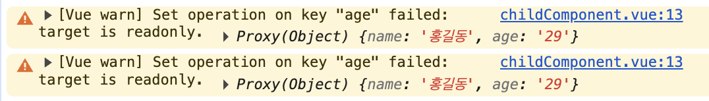

## props?

---

*부모 컴포넌트에서 자식 컴포넌트로의 데이터 전달 수단*

*단방향 데이터 흐름*

*부모 컴포넌트에서의 데이터 수정은 자식 컴포넌트로 영향이 가지만 반대로 자식 컴포넌트의 데이터 수정은 부모 컴포넌트에 영향이 가지 않는다.*

## props example

---

### **App.vue(부모 컴포넌트)**

```javascript
<script>
import childComponent from '@/components/childComponent.vue';
export default {
  components: {
    childComponent,
  },
};
</script>

<template>
  <h1>나는 부모</h1>
  <childComponent name="홍길동" age="29"></childComponent>
</template>
```

- *현재 App.vue를 보면 부모 컴포넌트이고 import, export dafault + components를 통해 childComponent를 마운트하고 있다.*
- *<childComponent name="홍길동" age="29"></childComponent>*
- *name, age 데이터를 단방향으로 보낸다.*

### childComponent.vue(자식 컴포넌트)

```javascript
<script>
export default {
  props: ['name', 'age'],
  created() {
    console.log(this.name);
  },
};
</script>
<template>
  <h1>child component</h1>
  <p>Name: {{ name }}</p>
  <p>Age: {{ age }}</p>
  <button @click="age++">클릭</button>
</template>
```

- *export default + props를 통해 name, age 데이터를 받는다.*
- *현재 자식 컴포넌트의 버튼을 보면 클릭하면 age를 증가하도록 한다.*
- *이 버튼은 누르면 아래 사진과 같이 vue에서 경고를 한다.*

  - ***부모 컴포넌트로부터 props로 받은 데이터는 데이터 조작이 불가능하기 때문이다.***

### 부모 컴포넌트 데이터 조작하기

```javascript
<script>
import childComponent from '@/components/childComponent.vue';
export default {
  components: {
    childComponent,
  },
  data() {
    return {
      name: '홍길동',
      age: 29,
    };
  },
};
</script>

<template>
  <h1>나는 부모</h1>
  <childComponent v-bind:name="name" :age></childComponent>
  <button @click="age++">버튼</button>
</template>

```

- *v-bind:name=”name” 축약형 → :name*
- *부모 컴포넌트에서의 age 조작 버튼은 데이터 조작이 가능하다.*
- ***왜 v-model이 아닌 v-bind를 사용?***
```javascript
v-model은 양방향 데이터 바인딩을 수행한다.
v-model=에 정의된 변수와 Vue 인스턴스의 데이터 속성 변수를 연결하고, 
둘 중 하나가 바뀌면 다른 하나도 바뀐다.

v-bind는 data 인스턴스 변수 값이 변경되면 v-bind:value 값도 따라 변경 된다.
Vue 인스턴스 데이터 -> html 속성 단반향 전용
```

  - *이러한 속성 때문에 현재 부모 컴포넌트의 변화만 자식 컴포넌트의 age에 변화를 주려면 v-bind 단방향 성질을 이용하는게 맞다.*
  - *이러한 특징 때문에 v-model은 props 에서 사용하지 않는다.*

