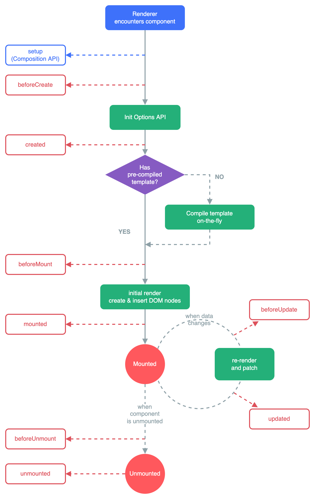
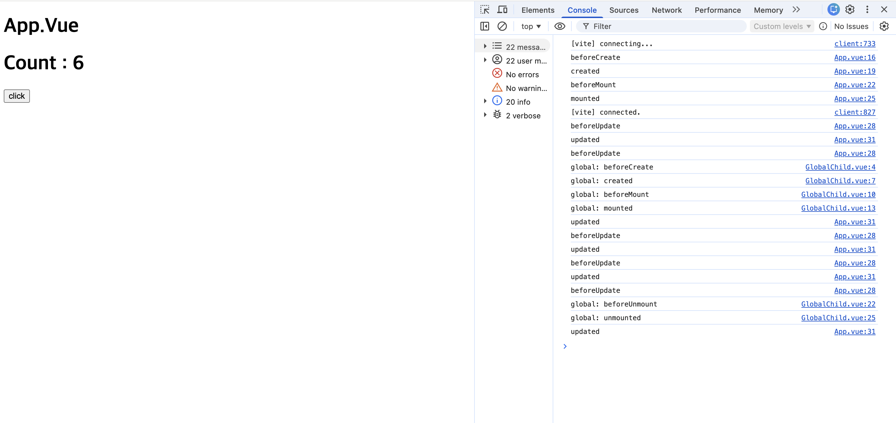

## hook?

---

*생명주기마다 사용할 수 있는 method가 존재하는데 그걸 hook 이라고 말한다.*

## Component Life Cycle

---



*사용 가능한 훅 종류*

- *beforeCreated, created* 
- *beforeMount, mounted*
- *beforeUpdate, updated*
- *beforeUnmount, unmounted*

## Component Life Cycle & hook example

---

**GlobalChild.vue**

```javascript
<script>
export default {
  beforeCreate() {
    console.log('global: beforeCreate');
  },
  created() {
    console.log('global: created');
  },
  beforeMount() {
    console.log('global: beforeMount');
  },
  mounted() {
    console.log('global: mounted');
  },
  beforeUpdate() {
    console.log('global: beforeUpdate');
  },
  updated() {
    console.log('global: updated');
  },
  beforeUnmount() {
    console.log('global: beforeUnmount');
  },
  unmounted() {
    console.log('global: unmounted');
  },
};
</script>
<template>
  <h1>전역 컴포넌트</h1>
  <p>전역 컴포넌트 입니다.</p>
</template>

<style scoped>
h1 {
  color: red;
}
p {
  color: blue;
}
</style>

```

- *전역 컴포넌트로 등록*

**App.vue**

```javascript
<script>
import GlobalChild from './components/GlobalChild.vue';

export default {
  data() {
    return {
      cnt: 1,
    };
  },
  methods: {
    counter() {
      this.cnt++;
    },
  },
  beforeCreate() {
    console.log('beforeCreate');
  },
  created() {
    console.log('created');
  },
  beforeMount() {
    console.log('beforeMount');
  },
  mounted() {
    console.log('mounted');
  },
  beforeUpdate() {
    console.log('beforeUpdate');
  },
  updated() {
    console.log('updated');
  },
  beforeUnmount() {
    console.log('beforeUnmount');
  },
  unmounted() {
    console.log('unmounted');
  },
};
</script>

<template>
  <h1>App.Vue</h1>
  <h1>Count : {{ cnt }}</h1>
  <GlobalChild v-if="cnt >= 3 && cnt <= 5"></GlobalChild>
  <button @:click="counter">click</button>
</template>

<style></style>

```

- *cnt 3 ~ 5 사이면 전역 컴포넌트가 마운트* 
- *cnt는 1에서 시작하여 클릭을 통해 3이되면 전역 컴포넌트가 등록되서 cnt가 6에 도착하면 전역 컴포넌트는 언마운트된다.*



