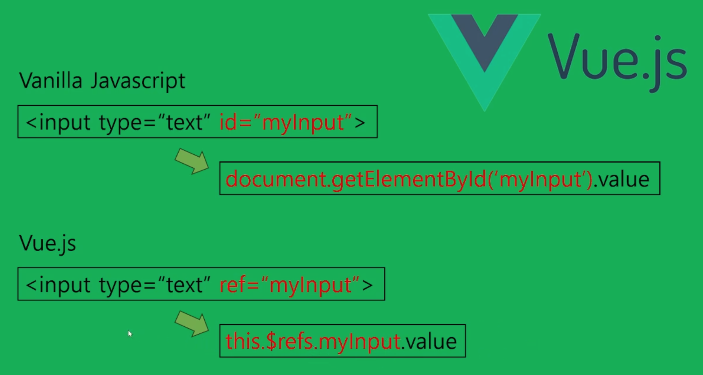

## ref?

---

*DOM 요소에 고유한 참조자를 제공하는 특별한 속성*



- *ref*
- *this.$refs*

## ref 예제 

---

```javascript
<script>
export default {
  methods: {
    logInput() {
      console.log(this.$refs.myInput.value);
    },
  },
};
</script>

<template>
  <div>
    <input type="text" ref="myInput" />
    <button v-on:click="logInput">Log</button>
  </div>
</template>

```

