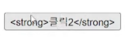
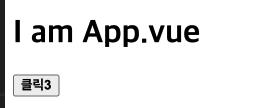

## slot ?

---

### 왜 사용할까?

1. *컴포넌트의 재사용성 증가*
1. *유연한 레이아웃 구성*
1. *명확한 컴포넌트 구조*

## slot 적용 BEFORE (props 사용)

---

### FancyButton.vue (하위 컴포넌트)

```javascript
<script>
export default {
  props: ['buttonname'],
};
</script>
<template>
  <button class="fancy-btn">{{ buttonname }}</button>
</template>

```

- *props: ['buttonname']*

### App.vue(상위 컴포넌트)

```javascript
<script>
import FancyButton from '@/components/FancyButton.vue';
export default {
  components: {
    FancyButton,
  },
};
</script>

<template>
  <h1>I am App.vue</h1>
  <FancyButton buttonname="클릭2"> </FancyButton>
</template>

```

- *props를 활용하여 buttonname 전달*
- 만약 buttonname을 강조하고 싶어서 <strong>클릭2<strong> 이렇게 보낸다고 하면?

- *이렇게 코드가 그대로 들어가게 된다.*

```
태그 뿐만 아니라, props를 활용해서 자식 또는 자손 컴포넌트로의 데이터전달은
많은 데이터 전달의 효율성이 떨어진다.(가독성이 떨어진다.)
=> 슬롯을 활용한다.
```

## slot 적용 AFTER

---

### App.vue

```html
<script>
import FancyButton from '@/components/FancyButton.vue';
export default {
  components: {
    FancyButton,
  },
};
</script>

<template>
  <h1>I am App.vue</h1>
  <FancyButton>
    <strong>클릭3</strong>
  </FancyButton>
</template>
```

- ***before*** *props 전달: <FancyButton buttoname=”버튼2”>*
- ***after*** *<slot> 활용: <FancyButton> 태그 사이에 전달하고자 하는 데이터 포함*

### FancyButton.vue

```html
<script>
export default {
  methods: {
    alert() {
      alert('버튼 클릭');
    },
  },
};
</script>
<template>
  <button class="fancy-btn" @click="alert">
    <slot></slot>
  </button>
</template>
```

- *export default 쪽 props를 없애고 button 사이에 <slot>을 추가*


  - *결과를 보면 클릭 버튼에 <strong> 강조 태그가 성공적으로 들어가졌다.*

## slot 활용

---

### MainLayout.vue(하위 컴포넌트)

```html
<template>
  <slot name="header"></slot>
  <slot name="contents"></slot>
  <slot name="footer"></slot>
</template>
```

- *현재 컴포넌트를 보면 총 3개의 슬롯이 존재한다.* 
- *같은 컴포넌트에 서로 다른 슬롯이 3개 존재하기 때문에 name을 통해 식별한다.*

### App.vue

```html
<script>
import FancyButton from '@/components/FancyButton.vue';
import MainLayout from '@/components/MainLayout.vue';
export default {
  components: {
    FancyButton,
    MainLayout,
  },
};
</script>

<template>
  <h1>I am App.vue</h1>
  <MainLayout>
    <template v-slot:header>
      <h1>Header</h1>
    </template>
    <template #contents>
      <h1>Contents</h1>
    </template>
    <template #footer>
      <h1>Footer</h1>
    </template>
  </MainLayout>

  <FancyButton>
    <strong>클릭3</strong>
  </FancyButton>
</template>
```

- *<MainLayout> 태그(컴포넌트)에 총 3개의 Template을 만든다.*
- ***v-slot:name*** *또는* ***#name*** *문법을 통해서 하위 컴포넌트 슬롯 name에 맞게 데이터를 전달한다.*

