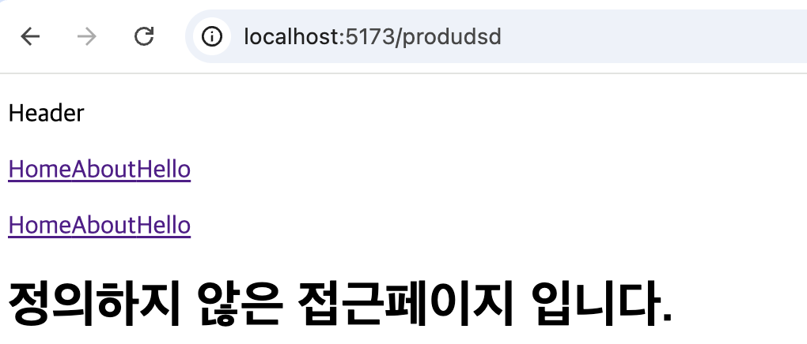

***존재하지 않은 경로/리소스에 접근 시 처리 방법***

**components/NotFoundView.vue**

```html
<template>
  <h1>정의하지 않은 접근페이지 입니다.</h1>
</template>
```

**router/index.js**

```javascript
import { createRouter, createWebHistory } from 'vue-router';
import NotFoundView from '@/components/NotFoundView.vue';

const routes = [
  {
    path: '/:pathMatch(.*)*',
    name: 'NotFoundPage',
    component: NotFoundView,
  },
];

const router = createRouter({
  history: createWebHistory('/'),
  routes,
});

export default router;
```

- ***path: ‘/:pathMatch(.*)*을 통해 적용***



