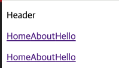
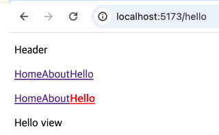

## 적용 BEFORE 

```html
<template>
  <p>Header</p>
  <p>
    <a href="/">Home</a>
    <a href="/about">About</a>
    <a href="/Hello">Hello</a>
  </p>
  <p>
    <RouterLink to="/">Home</RouterLink>
    <RouterLink to="/about">About</RouterLink>
    <RouterLink to="/hello">Hello</RouterLink>
  </p>
</template>
```



*현재는 내가 어떤 경로에 있는지 알 수 없다* 

## **router-link-active 속성**

*→ 현재 활성화된 RouterLink에 Vue Router가 자동으로 붙여주는 클래스*

*→ 기본 동작, 현재 경로와 매칭되면 자동 적용*

```css
.router-link-active {
  font-weight: bold;
  color: red;
}
```

```html
<script setup>
import TheHeader from '@/layouts/TheHeader.vue';
import TheBody from '@/layouts/TheBody.vue';
import '@/asset/css/style.css';
</script>

<template>
  <TheHeader></TheHeader>
  <TheBody></TheBody>
</template>

```

- src/css/style.css CS 적용



- 적용 이후

