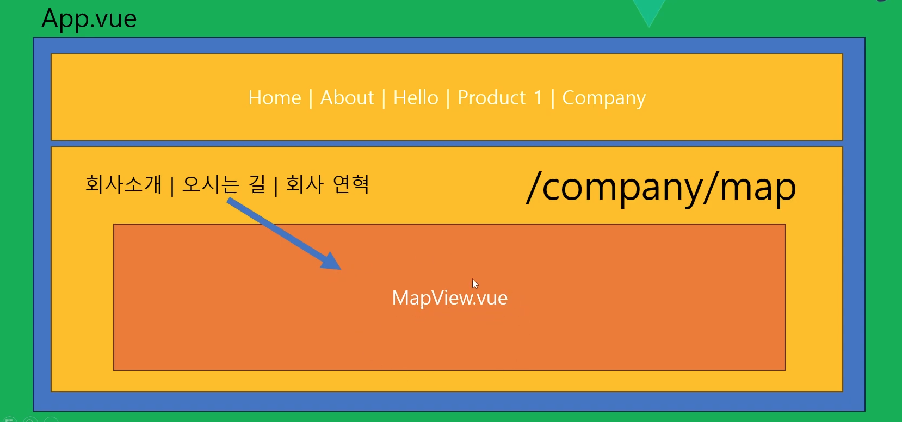



### router/index.js

```javascript
import { createRouter, createWebHistory } from 'vue-router';
import NotFoundView from '@/components/NotFoundView.vue';

const routes = [
  {
    path: '/company',
    name: 'CompanyPage',
    component: () => import('@/components/company/CompanyView.vue'),
    children: [
      {
        path: '/company/intro',
        name: 'company-intro',
        component: () => import('@/components/company/IntroView.vue'),
      },
      {
        path: 'map',
        name: 'company-map',
        component: () => import('@/components/company/MapView.vue'),
      },
      {
        path: 'history',
        name: 'company-history',
        component: () => import('@/components/company/HistoryView.vue'),
      },
    ],
  },
  {
    path: '/:pathMatch(.*)*',
    name: 'NotFoundPage',
    component: NotFoundView,
  },
];

const router = createRouter({
  history: createWebHistory('/'),
  routes,
});

export default router;
```

- *router의 component들을 모두 import 할 수 있지만 아래와 같이도 가능하다.*
- *component: () => import('@/components/company/CompanyView.vue'),*
- *children을 통해 중첩구조를 적용시킬 수 있다.*

### components/company/CompanyView.vue

```html
<template>
  <h1>Company</h1>
  <p>
    <RouterLink :to="{ name: 'company-intro' }" active-class="on"
      >회사소개</RouterLink
    >
    <RouterLink :to="{ name: 'company-map' }" active-class="on"
      >오시는 길</RouterLink
    >
    <RouterLink :to="{ name: 'company-history' }" active-class="on"
      >회사연혁</RouterLink
    >
  </p>
  <RouterView></RouterView>
</template>
```

- *<RouterLink>를 통해 3가지 Component를 보여준다.*
- *<RouterView>를 통해 동적으로 중첩 구조를 보여준다.*

