# Spring Batch 5

배치 처리는 대량의 데이터를 정해진 시간에 자동으로 일괄 처리하고 결과를 출력하는 작업을 말한다.

# 배치 처리의 특징

**대용량 데이터 처리:** 웹 애플리케이션이 특정 ID의 데이터 하나를 조회하거나 수정한다면, 배치는 수천, 수만 개의 데이터를 한 번에 처리한다.

**정기적 실행:** 매일, 매주, 매달 등 정해진 시간에 실행된다. 

**자동화:** 한 번 만들고 설정해두면 알아서 모든 것을 처리한다.

**유한한 양의 데이터 처리:** 배치는 정해진 양의 데이터만 처리한다. 처리 대상이 정해져 있기에 결과를 정확하게 예측할 수 있다.

**예측 가능한 부하 처리:** 배치는 시스템의 처리 능력에 맞게 설계된다. 시스템이 감당할 수 있는 만큼의 데이터만 처리하도록 설계해야 한다.

## WEB VS 

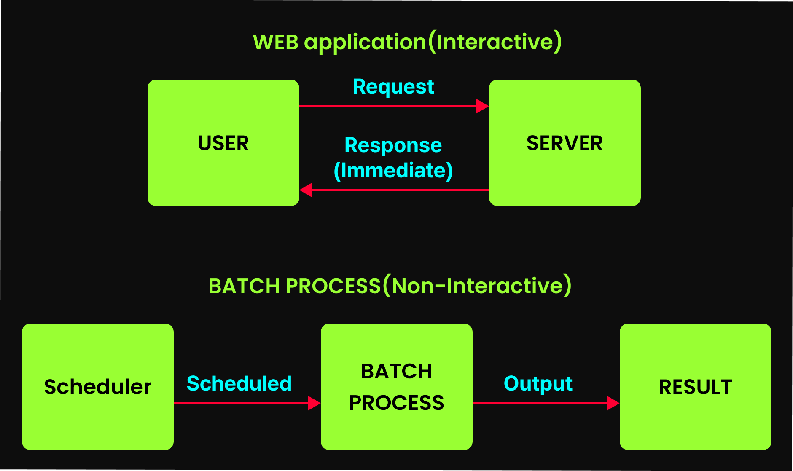

## Spring Batch 프레임워크가 제공하는 핵심 컴포넌트

      - **Job & Step**
      - **JobLauncher:** Job을 실행하고 실행에 필요한 모든 파라미터를 전달하는 역할, 배치 작업 실행의 시작점
      - **JobRepository:** 배치 작업의 모든 메타데이터를 저장하고 관리하는 핵심 저장소로 Job과 Step의 실행 정보(시작/종료시간, 상태, 결과)를 기록한다.
이런 정보들은 배치 작업의 모니터링이나 문제 발생 시 재실행에 활용된다.
      - **ExecutionContext:** Job과 Step 실행 중의 상태 정보를 key-value 형태로 담는 객체
Job과 Step 간의 데이터 공유나 Job 재시작 시 상태 복원에 사용된**다**
      - **데이터 처리 컴포넌트 구현체**
- **ItemReader 구현체:** JdbcCursomItemReader, JpaPagingItemReader …
        - **ItemWriter 구현체:** JdbcBatchItemWriter, JpaItemWriter …

## 개발자가 제어하는 영역

**Job/Step 구성**

      - @Configuration을 사용해 Job과 Step의 실행 흐름을 정의
      - 각 Step의 실행 순서와 조건을 설정, Spring 컨테이너에 등록해 배치 잡의 동작을 구성
      - Spring DI를 활용해 ItemReader, ItemProcessor, ItemWriter 등 배치 작업에 필요한 컴포넌트들을 조합하고 배치 플로우를 완성한다

```java
@Bean
public Job dataTerminationJob(Step terminateStep) {
    return new JobBuilder("dataTerminationJob", jobRepository)
            .start(terminateStep)
            .build();
}
@Bean
public Step terminateStep(ItemReader<String> itemReader, ItemWriter<String> itemWriter) {
    return new StepBuilder("terminateStep", jobRepository)
            .<String, String>chunk(10, transactionManager)
            .reader(itemReader)
            .writer(itemWriter)
            .build();
}
@Bean
public ItemReader<String> itemReader() {
    // return ItemReader 구현체
}
@Bean
public ItemWriter<String> itemWriter() {
    // return ItemWriter 구현체
}
```

**커스텀 데이터 처리 컴포넌트(ItemProcessor, Batch 프레임워크가 제공하지 않는 DB의 Reader/Writer)**

## Spring Boot 없이 순수하게

spring-batch-core

      - Job, Step, JobRepository, JobLauncher 등 Spring Batch 의 핵심 컴포넌트들을 포함
      - ItemReader, ItemWriter 등 데이터 처리를 위한 인프라 컴포넌트들도 제공
      - spring-context, spring-jdbc 같은 의존성도 함께 포함

데이터베이스 의존성이 필수

Spring Batch의 경우 Job & Step의 실행 정보를 데이터베이스에 저장하기 때문에 데이터베이스 의존성이 필수이다.

CommandLineJobRunner를 메인 클래스로 설정해서 배치를 실행

## With Spring Boot

spring batch를 스프링 프로젝트 생성 시 추가하면 spring-boot-starter-batch 의존성이 추가

해당 패키지는 Spring Batch 개발에 필요한 모든 의존성을 포함한 스타터 패키지

spring-batch-code는 물론 spring boot의 auto configuration  기능도 함께  제공한다.

Spring Boot 환경에서는 JobLauncherApplicationRunner라는 별도의 컴포넌트가 자동으로 배치 Job 실행을 담당

자동 생성된 main 클래스 코드를 아래와 같이 수정하자

```java
@SpringBootApplication
public class KillBatchSystemApplication {
    public static void main(String[] args) {
        System.exit(SpringApplication.exit(
        SpringApplication.run(KillBatchSystemApplication.class, args)));
    }
}
```

배치 애플리케이션에서는 이와 같이 SpringApplication.run()의 결과를 System.exit()로 처리하는 것이 권장된다.

배치 작업의 성공/실패를 exit code로 외부 시스템에 전달할 수 있어 실무에서 배치 모니터링과 제어에 필수적이기 때문이다.

# 원시적 침투 버전

```java
@Configuration
public class BatchConfig extends DefaultBatchConfiguration {

    @Bean
    public DataSource dataSource() {
        return new EmbeddedDatabaseBuilder()
                .setType(EmbeddedDatabaseType.H2)
                .addScript("org/springframework/batch/core/schema-h2.sql")
                .build();
    }

    @Bean
    public PlatformTransactionManager transactionManager() {
        return new DataSourceTransactionManager(dataSource());
    }
}
```

Spring Batch의 핵심 컴포넌트들은 자동으로 구성되지만, 몇 가지 필 수 인프라 Bean들은 직접 등록해줘야 한다.

위 BatchConfig의 코드를 보면 DefaultBatchConfiguration을 상속받는다. 해당 기본 설정 클래스는 JobRepository, JobLauncher 등 Spring Batch의 핵심 컴포넌트들을 자동으로 구성해준다.

**DataSource, PlatformTransactionManager 설정**

Spring Batch는 Job, Step 실행 정보를 데이터베이스에 저장하기 때문에 DataSource 설정이 필요

또한 모든 배치 작업은 트랜잭션 내에서 처리된다. 이를 위해 PlatformTransactionManager를 빈으로 등록한다.

```java
@Import(BatchConfig.class)
public class SystemTerminationConfig {
    private final JobRepository jobRepository;
    private final PlatformTransactionManager transactionManager;

    private AtomicInteger processesKilled = new AtomicInteger(0);
    private final int TERMINATION_TARGET = 5;

    public SystemTerminationConfig(JobRepository jobRepository, PlatformTransactionManager transactionManager) {
        this.jobRepository = jobRepository;
        this.transactionManager = transactionManager;
    }

    @Bean
    public Job systemTerminationSimulationJob() {
        return new JobBuilder("systemTerminationSimulationJob", jobRepository)
                .start(enterWorldStep())
                .next(meetNPCStep())
                .next(defeatProcessStep())
                .next(completeQuestStep())
                .build();
    }
    @Bean
    public Step enterWorldStep() {
        return new StepBuilder("enterWorldStep", jobRepository)
                .tasklet((contribution, chunkContext) -> {
                    System.out.println("System Termination 시뮬레이션 세계에 접속했습니다!");
                    return RepeatStatus.FINISHED;
                }, transactionManager)
                .build();
    }
    @Bean
    public Step meetNPCStep() {
        return new StepBuilder("meetNPCStep", jobRepository)
                .tasklet((contribution, chunkContext) -> {
                    System.out.println("시스템 관리자 NPC를 만났습니다.");
                    System.out.println("첫 번째 미션: 좀비 프로세스 " + TERMINATION_TARGET + "개 처형하기");
                    return RepeatStatus.FINISHED;
                }, transactionManager)
                .build();
    }
    @Bean
    public Step defeatProcessStep() {
        return new StepBuilder("defeatProcessStep", jobRepository)
                .tasklet((contribution, chunkContext) -> {
                    int terminated = processesKilled.incrementAndGet();
                    System.out.println("좀비 프로세스 처형 완료! (현재 " + terminated + "/" + TERMINATION_TARGET + ")");
                    if (terminated < TERMINATION_TARGET) {
                        return RepeatStatus.CONTINUABLE;
                    } else {
                        return RepeatStatus.FINISHED;
                    }
                }, transactionManager)
                .build();
    }
    @Bean
    public Step completeQuestStep() {
        return new StepBuilder("completeQuestStep", jobRepository)
                .tasklet((contribution, chunkContext) -> {
                    System.out.println("미션 완료! 좀비 프로세스 " + TERMINATION_TARGET + "개 처형 성공!");
                    System.out.println("보상: kill -9 권한 획득, 시스템 제어 레벨 1 달성");
                    return RepeatStatus.FINISHED;
                }, transactionManager)
                .build();
    }
}
```

@Import(BatchConfig.class)를 통해 배치 코어 컴포넌트와 구성한 인프라 빈들을 하나의 설정으로 통합한다.

Job 생성 코드를 보면 JobBuilder를 사용하고 있는데 첫 번째 파라미터로 Job의 이름을 지정한다.

이 이름은 나중에 Job 상태를 추적하거나 제어할 때 사용된다.

두 번째 파라미터로 JobRepository를 전달하는데, 이는 Job의 실행 정보를 관리하는 핵심 인터페이스다. JobRepository를 통해 Job 실행 이력, 상태, 결과 등 모든 메타데이터가 관리된다.

Job Step 실행 순서는 start() → next() → 순서로, 이전 step이 성공적으로 완료된 후에만 실행된다.

만약 이전 step이 실패하면 다음 step은 실행되지 않는다.

Step은 StepBuilder를 통해 생성한다. 마찬가지로 첫 번째 파라미터에 식별자를 넘기고 두 번째 파라미터에 JobRepository를 넘긴다.

### CommandLineJobRunner를 통한 실행

```java
application {
    mainClass = 'org.springframework.batch.core.launch.support.CommandLineJobRunner'
}
```

      - build.gradle에서 CommandLineJobRunner를 main 클래스로 설정

```java
./gradlew run --args="com.system.batch.SystemTerminationConfig systemTerminationSimulationJob"
```

CommandLineJobRunner는 아래와 같은 형태로 파라미터를 받는다.

```java
jobPath <options> jobIdentifier (jobParameters)*
```

jobPath: Job이 포함된 설정 클래스(FQCN)

jobIdentifier: 실행할 Job의 이름

# 전략적 침투: Spring Boot Application 실행

전략적 침투에서는 BatchConfig 클래스가 필요없다.

이는 Spring Boot AutoConfiguration 기능 덕분이다.

```java
./gradlew bootRun --args='--spring.batch.job.name=systemTerminationSimulationJob'
```

—spring.batch.job.name 프로퍼티에 실행할 Job 이름을 지정한다.

전략적 침투 방식에서는 원시적 침투의 CommandLineJobRunner 대신 JobLauncherApplicationRunner가 사용되는데, 이 JobLauncherApplicationRunner가

[spring.batch.job.name](http://spring.batch.job.name/) 프로퍼티에 지정된 Job을 실행해준다.

Spring Batch Step은 다음과 같이 크게 두 가지 모델 처리로 나뉜다.

      - 청크 지향 처리
      - 테스크릿 지향 처리

## Tasklet 지향 처리란?

태스크릿 지향 처리 모델은 Spring Batch에서 가장 기본적인 Step 구현 방식으로 비교적

복잡하지 않은 단순한 작업을 실행할 때 사용된다.

언제 태스크릿 지향 처리를 사용하는가?

일반적인 Spring Batch Step은 대부분 대량 데이터 처리(읽고-처리하고-쓰기) 작업에 초점을 맞춘다

하지만 때로는 단순한 시스템 작업이나 유틸성 작업이 필요할 때가 있다.

      - 매일 새벽 불필요한 로그 파일 삭제
      - 사용자에게 단순한 알림이나 메시지 또는 이메일 발송
      - 외부 API 호출 후 결과를 단순히 저장하거나 로깅

이런 단일 비즈니스 로직 실행에 초점을 맞춘 작업들이 있다.

태스크릿 지향 처리는 이러한 목적을 위해 설계된 처리 방식이다.

## 태스크릿 지향 처리의 구현 방식

```java
@FunctionalInterface
public interface Tasklet {
    @Nullable
    RepeatStatus execute(StepContribution contribution, ChunkContext chunkContext) throws Exception;
}
```

Spring Batch가 제공하는 Tasklet 인터페이스의 execute() 메서드에 우리가 원하는 로직을 구현하고, 이 구현체를 Spring Batch에 넘기기만 하면 된다.

```java
@Slf4j
public class ZombieProcessCleanupTasklet implements Tasklet {
    private final int processesToKill = 10;
    private int killedProcesses = 0;

    @Override
    public RepeatStatus execute(StepContribution contribution, ChunkContext chunkContext) throws Exception {
        killedProcesses++;
        log.info("☠️  프로세스 강제 종료... ({}/{})", killedProcesses, processesToKill);

        if (killedProcesses >= processesToKill) {
            log.info("💀 시스템 안정화 완료. 모든 좀비 프로세스 제거.");
            return RepeatStatus.FINISHED;  // 모든 프로세스 종료 후 작업 완료
        }

        return RepeatStatus.CONTINUABLE;  // 아직 더 종료할 프로세스가 남아있음
    }
}
```

RepeatStatus란 Spring Batch Step이 Tasklet의 execute() 메서드 실행을 계속 할지 멈출지를

결정하는 기준이다. execute()메서드에서 적절한 RepeatStatus를 반환해, Spring Batch에게 반복 여부를 알리는 방식이다.

## RepeatStatus: FINSHED VS CONTINUABLE

RepeatStatus.FINSHED:  Step의 처리가 성공이든 실패든 상관없이 해당 Step이 완료되었음을 의미한다. 더 이상 반복할 필요 없이 다음 스탭으로 넘어가며, 배치 잡은 차근차근 진행된다.

RepeatStatus.CONTINUABLE: execute() 메서드가 추가로 더 실행되어야 함을 Spring Batch Step에게 알린다. 

그렇다면 왜 RepeatStatus가 필요할까?

반복 작업이라면 while문으로 처리하면 되는 거 아닌가?

이는 Spring Batch의 트랜잭션 동작 범위와 관련 있다.

Spring Batch는 Tasklet의 execute() 호출 마다 새로운 트랜잭션을 시작하고 execute() 메서드가 끝나고 RepeatStatus가 반환되면 해당 트랜잭션을 커밋한다.

만약 execute() 메서드 내부에 반복문을 직접 구현했다면?

모든 반복 작업이 하나의 트랜잭션 안에서 실행된다.

즉, 중간에 예외가 터지면 데이터베이스 결과가 execute()호출 전으로 롤백되어 버린다.

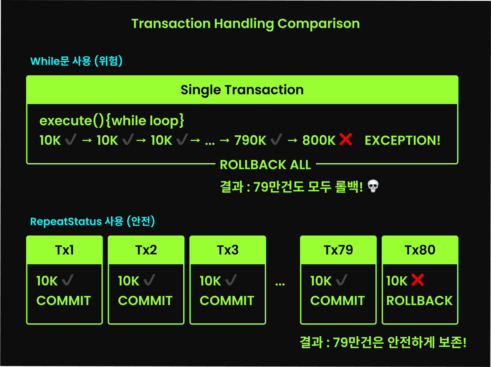

총 100만건의 데이터를 처리해야 할 때, execute() 내부에서 while문을 사용한다면 80만 건째 처리 중 예외가 발생한다면 이전에 처리한 데이터도 모두 롤백된다.

만약 RepeatStatus.CONTINUABLE로 반복한다면, 예외가 발생하더라도 이전 데이터 정리는

성공적으로 커밋된 상태로 남는다.

***즉, RepeatStatus를 반환하는 방식으로 반복 실행하는 이유는 작은 트랜잭션들로 나누어***

***안전하게 처리하기 위해서다.***

## Tasklet을 Step으로 등록하는 방법

```java
@Configuration
public class ZombieBatchConfig {
    private final JobRepository jobRepository;
    private final PlatformTransactionManager transactionManager;

    public ZombieBatchConfig(JobRepository jobRepository, PlatformTransactionManager transactionManager) {
        this.jobRepository = jobRepository;
        this.transactionManager = transactionManager;
    }

    @Bean
    public Tasklet zombieProcessCleanupTasklet() {
        return new ZombieProcessCleanupTasklet();
    }
    @Bean
    public Step zombieCleanupStep() {
        return new StepBuilder("zombieCleanupStep", jobRepository)
                // Tasklet과 transactionManager 설정
                .tasklet(zombieProcessCleanupTasklet(), transactionManager)  
                .build();
    }
    @Bean
    public Job zombieCleanupJob() {
        return new JobBuilder("zombieCleanupJob", jobRepository)
                .start(zombieCleanupStep())  // Step 등록
                .build();
    }
}
```

현재 Step을 생성하는 코드를 보면 Spring Boot가 자동으로 구성한 transactionManager 빈을

주입받아 사용하고 있다.

하지만 일반적으로 tasklet 에서 DB 트랜잭션 관리가 필요한 경우가 많지는 않다.

→ 파일 정리, 외부 API 호출 같은 작업

## ResourcelessTransactionManager

ResourcelessTransactionManager는 PlatformTransactionManager 구현체로,

아무것도 하지 않는 방식으로 동작한다. 즉, 이를 사용하면 불필요한 DB 트랜잭션 처리를 생략할 수 있다.

```java
@Bean
public Step zombieCleanupStep() {
    return new StepBuilder("zombieCleanupStep", jobRepository)
            // Tasklet과 ResourcelessTransactionManager 설정
            .tasklet(zombieProcessCleanupTasklet(), new ResourcelessTransactionManager())
            .build();
}
```

주의!!!

ResoucelessTransactionManager와 트랜잭션을 사용하는 PlatformTransactionManager 모두

빈으로 등록하는 경우, 충돌이 발생할 수 있다.

## 익명 클래스 또는 람다식을 활용한 Tasklet

```java
@Bean
public Step deleteOldRecordsStep() {
   return new StepBuilder("deleteOldRecordsStep", jobRepository)
           .tasklet((contribution, chunkContext) -> {
               int deleted = jdbcTemplate.update("DELETE FROM logs WHERE created < NOW() - INTERVAL 7 DAY");
               log.info("🗑️ {}개의 오래된 레코드가 삭제되었습니다.", deleted);
               return RepeatStatus.FINISHED;
           }, transactionManager)
           .build();
}

@Bean
public Job deleteOldRecordsJob() {
    return new JobBuilder("deleteOldRecordsJob", jobRepository)
            .start(deleteOldRecordsStep())  // Step을 Job에 등록
            .build();
}
```

위와 같이 단순한 작업이라면 Tasklet 구현 클래스를 만들지 않고, 람다 표현식을 사용해 Step 구성 중에 바로 Tasklet을 정의할 수 있다.

## 청크 지향 처리

데이터를 다루는 작업은 대부분 읽기 → 처리 → 쓰기라는 공통된 패턴을 보인다.

Spring Batch 또한 이 패턴을 따르며 이를 청크 지향 처리라고 부른다.

## chunk =  데이터를 작은 덩어리로 나누어 처리하는 방식

청크(chunk)는 데이터를 일정 단위로 쪼갠 덩어리를 의미한다.

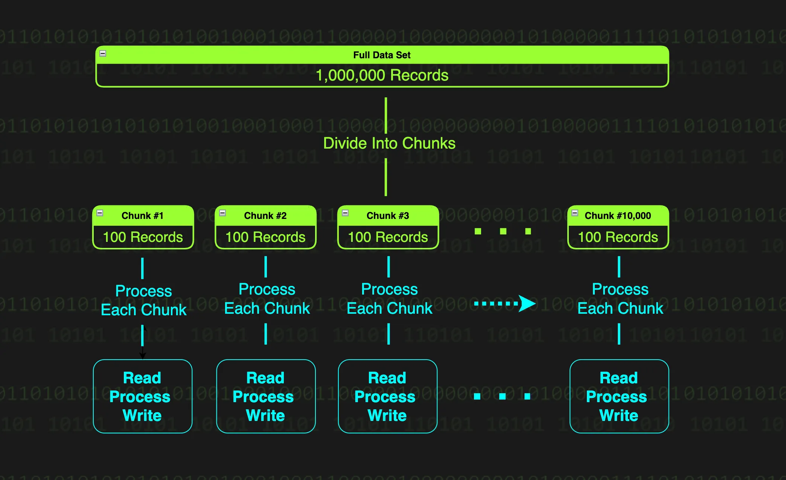

백만 건의 데이터를 처리한다고 가정했을 때, Spring Batch는 전체를 한 번에 읽고 처리하지 않는다. 대신, 일정한 청크 단위로 쪼개서 읽고, 처리하고, 저장한다.

이렇게 청크 단위로 처리하는 이유는 배치 작업에서의 데이터의 양은 방대하기 때문이다.

100만건의 데이터를 한 번에 메모리로 불러오면, 배치 서버는 OutOfMemory가 터지고

DB는 과부하가 발생한다.

Tasklet과 마찬가지로 chunk 단위로 쪼개어 처리하면 트랜잭션이 가벼워지기 때문에  Recoverbility가 올라간다.

## ItemReader, ItemProcessor, ItemWriter

### ItemReader

```java
public interface ItemReader<T> {
    T read() throws Exception, 
        UnexpectedInputException, 
        ParseException, 
        NonTransientResourceException;
}
```

read() 메서드는 아이템을 하나씩 반환한다. 여기서 하나란 데이터베이스의 한 row를 의미한다.

읽을 데이터가 더 이상 없으면 null을 반환하고, 스텝은 종료된다.

파일, 데이터베이스, 메시지 큐 등 다양한 데이터 소스에 대한 구현체를 제공

### ItemProcessor

```java
public interface ItemProcessor<I, O> {
    O process(I item) throws Exception;
}
```

ItemReader로부터 데이터를 받아 process() 메서드를 통해 입력 데이터(I)를 원하는 형태(O)로 변환한다.

**필터링**

process() 메서드가 null을 반환하면 해당 입력 데이터는 처리 흐름에서 제외된다

즉, ItemWriter로 전달되지 않는다.

**데이터 검증**

만약 예외를 발생시키면 배치 잡은 중단된다. 

물론 Spring Batch Skip 가능과 함께 사용하면 예외가 발생한 데이터만 건너뛰고 배치 작업을
중단시킨다.

**Optional**

ItemProcessor는 생략이 가능하다. 즉, ItemReader → ItemWriter 흐름이 가능하다.

### ItemWriter 

ItemWriter는 ItemProcessor 또는 ItemReader로부터 받은 결과물을 받아, 원하는 방식으로
저장/출력한다.

```java
public interface ItemWriter<T> {
    void write(Chunk<? extends T> chunk) throws Exception;
}
```

ItemWriter는 Chunk 단위로 묶어서 한 번에 데이터를 쓴다.

write() 메서드의 파라미터 타입이 Chunk

## 청크 지향 처리 조립하기

```java
@Bean
public Step processStep(JobRepository jobRepository, PlatformTransactionManager transactionManager) {
   return new StepBuilder("processStep", jobRepository)
           .<CustomerDetail, CustomerSummary>chunk(10, transactionManager)  // 청크 지향 처리 활성화
           .reader(itemReader())       // 데이터 읽기 담당
           .processor(itemProcessor()) // 데이터 처리 담당
           .writer(itemWriter())      // 데이터 쓰기 담당
           .build();
}

@Bean
public Job customerProcessingJob(JobRepository jobRepository, Step processStep) {
   return new JobBuilder("customerProcessingJob", jobRepository)
           .start(processStep)  // processStep으로 Job 시작
           .build();
}
```

**1) 청크 사이즈 지정**

```java
.chunk(10, transactionManager)
```

      - chunk() 메서드의 첫 번째 파라미터로 청크의 크기를 지정한다. 현재는 10을 지정했는데, 이는 ItemReader가 데이터 10개를 읽어오면, 이를 하나의 청크로 만들어 ItemProcessor, ItemWriter에서 쓰기를 수행한다

**2) 제네릭 타입으로 데이터 흐름 정의**

```java
.<CustomerDetail, CustomerSummary>chunk(..)
```

      - 첫 번째 타입(CustomerDetail): ItemReader가 반환할 데이터 타입
      - 두 번째 타입(CustomerSummary): CustomerDetail를 입력 받은 ItemProcessor가 아이템을 처리 후 반환할 타입이자 ItemWriter가 전달받을 Chunk 제네릭 타입
      1. ItemReader는 read() 호출마다 CustomerDetail 객체를 반환
      1. ItemProcessor는 이 CustomerDetail 타입을 입력받아 가공 로직을 수행한 후 CustomerSummary로 변환하여 반환
      1. 이렇게 반환된 CustomerSummary들이 청크 단위로 모여 Chunk<CustomerSummary>가 된다
      1. 최종적으로 이 Chunk<CustomerSummary>가 ItemWriter.write() 메서드의 파라미터로 전달

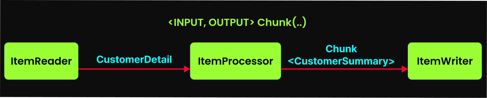

## 청크 지향 처리의 흐름

      1. **데이터 읽기(ItemReader)**
데이터 소스에서 하나씩 데이터를 읽어온다. read() 메서드가 호출될 때마다 데이터를 순차적으로 반환, 청크 크기만큼 데이터를 읽어야 끝난다. 즉, 청크 크기가 10이면 read()가 10번 호출되어 하나의 청크가 생성
      1. **데이터 가공(ItemProcessor)**
ItemProcessor가 ItemReader가 읽어온 청크의 각 아이템 하나씩을 처리한다

Spring Batch는 청크의 아이템마다 process()를 반복 호출해서 변환하거나 필터링
      1. **데이터 쓰기(ItemWriter)**
ItemProcessor의 처리까지 완료되었다면 이제 청크를 실제로 쓸 차례

ItemWriter는 청크 전체를 한 번에 입력받아 처리한다.

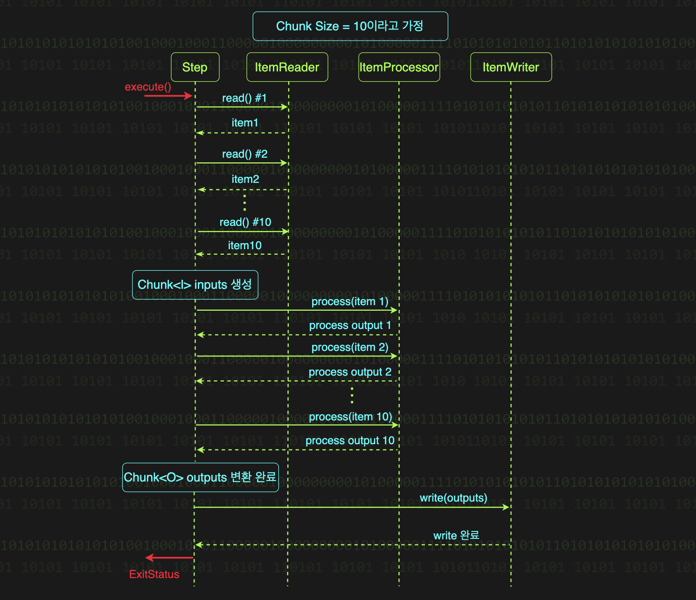

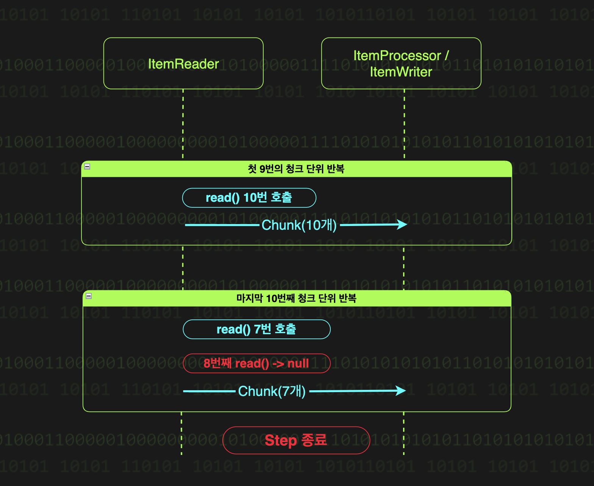

***ItemReader가 null을 반환한는 순간 chunk 지향 처리 종료***

## 청크 처리와 트랜잭션

태스크릿 지향 처리에서는 execute() 메서드 실행 전에 트랜잭션이 시작되고, 메서드가 끝나면

트랜잭션도 끝난다.

청크 지향 처리에서는 트랜잭션 또한 청크 단위로 관리된다.

즉, 각각의 청크 단위 반복마다 별도의 트랜잭션이 시작되고 커밋된다.

대용량 데이터를 처리하는 도중 중간에 스탭이 실패하더라도, 이전 청크 반복에서 처리된 데이터는 이미 안전하게 커밋되어 있어 그만큼의 작업이 보존된다.

청크 사이즈가 크면, 메모리에 많은 데이터를 한 번에 로드하게 된다,

트랜잭션의 경계가 커지므로, 문제 발생 시 롤백되는 데이터의 양도 많아진다

청크 사이즈가 작으면 롤백되는 데이터의 양은 작아지지만 I/O가 자주 발생하게 된다.

JobParameters는 배치 작업에 전달되는 입력 값이다.

이 값은 배치가 어떤 조건에서, 어떤 데이터를 다룰지를 결정하는 데 핵심적인 역할을 한다.

***그냥 -D 옵션으로 프로퍼티 전달하면 되는 거 아닌가?***

JobParameters와 프로퍼티는 완전히 다른 목적을 가진다. 

## 프로퍼티와 JobParameters의 결정적 차이

### 입력값 동적 변경

예를 들어. 웹 요청이 들어올 때마다 비동기로 배치 잡을 실행하는 온라인 배치 앱이 있다.

이런 경우 프로퍼티로는 값을 변경할 수 없다. 프로퍼티의 경우 앱 시작 시 한 번 주입되는 정적인 값이기 때문이다. 

반면에 JobParameters는 입력값을 동적으로 변경이 가능하다.

### 메타데이터

SpringBatch는 JobParameters의 모든 값을 메터데이터 저장소에 기록하며, 이를 통해 다음 기능을 제공한다.

      - Job 인스턴스 식별 및 재시작 처리
      - Job 실행 이력 추적

배치 메타데이터란? 

데이터베이스에 각 Job & Step의 상태(시작/종료 시간, 실행 상태, 처리된 레코드 수)를 저장한다.

이를 통해 Job 인스턴스 식별 및 재시작이 가능하다.

반면 프로퍼티는 메타데이터로 기록되지 않기 때문에, 식별 및 재시작 처리에 활용할 수 있다.

# 1. 커맨드라인에서 JobParameters 전달하기

Spring Boot 3 & Spring Batch 5 기준 

```java
./gradlew bootRun --args='--spring.batch.job.name=dataProcessingJob inputFilePath=/data/input/users.csv,java.lang.String'
```

`--spring.batch.job.name` 으로 전달한 Job의 이름 뒤에 따라오는 `inputFilePath=/data/input/users.csv,java.lang.String` 이 잡 파라미터이다.

**JobParameters 기본 표기법**

```java
parameterName=parameterValue,parameterType,identificationFlag
```

      - parameterName
- 배치 Job에서 파라미터를 찾을 때 사용할 key 값. 이 이름으로 Job 내에서 파라미터에 접근할 수 있다
      - parameterValue
- 파라미터의 실제 값
      - parameterType
- 파라미터의 타입(java.lang.String 와 같은 fully qualified name 사용)
        - 이 파라미터 타입을 명시하지 않을 경우 Spring Batch는 해당 파라미터를 String 타입으로 가정한다.
      - identificationFlag
- Spring Batch에게 해당 파라미터가 JobInstance 식별에 사용될 파라미터인지 여부를 전달하는 값으로 true 면 식별에 사용된다는 의미 생략 시 true

커맨더라인 문자열로 전달된 JobParameters는 Spring Batch의 DefaultJobParameterConverter라는 컴포넌트를 통해 적절한 타입으로 변환된다.

DefaultJobParametersConverter는 내부적으로 Spring DefaultConversionService를 사용하기 때문에,  Integer, Boolean 같은 기본 타입은 물론 DefaultJobParametersService가 제공하는 다양한 타입으로 변환을 지원한다.

## 기본 데이터 타입 파라미터 전달

```java
@Slf4j
@Configuration
public class SystemTerminatorConfig {
   @Bean
   public Job processTerminatorJob(JobRepository jobRepository, Step terminationStep) {
       return new JobBuilder("processTerminatorJob", jobRepository)
               .start(terminationStep)
               .build();
   }
   @Bean
   public Step terminationStep(JobRepository jobRepository, PlatformTransactionManager transactionManager, Tasklet terminatorTasklet) {
       return new StepBuilder("terminationStep", jobRepository)
               .tasklet(terminatorTasklet, transactionManager)
               .build();
   }
   @Bean
   @StepScope
   public Tasklet terminatorTasklet(
           @Value("#{jobParameters['terminatorId']}") String terminatorId, 
           @Value("#{jobParameters['targetCount']}") Integer targetCount
   ) {
       return (contribution, chunkContext) -> {
           // 생략 ...         
           return RepeatStatus.FINISHED;
       };
   }
}
```

      - `@Value` 애노테이션과 `"#{jobParameters['parameterName']}"` 표현식으로 JobParameters를 주입받을 수 있다.

```java
./gradlew bootRun --args='--spring.batch.job.name=processTerminatorJob terminatorId=KILL-9,java.lang.String targetCount=5,java.lang.Integer'
```

      - terminatorId에 String 값 전달
      - targetCount에 Integer 값 전달

***@StepScoe 애노테이션***

@Value를 통해 잡 파라미터를 전달받으려면 @StepScope와 같은 애노테이션을 선언해줘야 한다.

## 날짜와 시간 파라미터 전달(LocalDate, LocalDateTime 파라미터 전달하기)

```java
@Slf4j
@Configuration
public class TerminatorConfig {
    @Bean
    public Job terminatorJob(JobRepository jobRepository, Step terminationStep) {
        return new JobBuilder("terminatorJob", jobRepository)
                .start(terminationStep)
                .build();
    }
    @Bean
    public Step terminationStep(JobRepository jobRepository, PlatformTransactionManager transactionManager, Tasklet terminatorTasklet) {
        return new StepBuilder("terminationStep", jobRepository)
                .tasklet(terminatorTasklet, transactionManager)
                .build();
    }
		@Bean
    @StepScope
    public Tasklet terminatorTasklet(
        @Value("#{jobParameters['executionDate']}") LocalDate executionDate,
        @Value("#{jobParameters['startTime']}") LocalDateTime startTime
    ) {
        return (contribution, chunkContext) -> {
            LocalDateTime currentTime = startTime;
            for (int i = 1; i <= 3; i++) {
                currentTime = currentTime.plusHours(1);
            }
            return RepeatStatus.FINISHED;
        };
    }
}
```

현재 Tasklet 코드를 보면 LocalDate, LocalDateTime을 파라미터로 받고 있다.

파라미터의 타입만 적절히 전달하면 DefaultJobParametersConverter가 알아서 변환해준다.

**커맨드라인 명령 실행 형식**

```java

./gradlew bootRun --args='--spring.batch.job.name=terminatorJob executionDate=2024-01-01,java.time.LocalDate startTime=2024-01-01T14:30:00,java.time.LocalDateTime'
```

      - executionDate의 경우 `yyyy-MM-DD` 형식
- DateTimeFormatter의 ISO_LOCAL_DATE 형식
      - startTime의 경우 `yyyy-MM-ddThh:mm:ss` 형식을 사용한다.
- DateTimeFormatter의 ISO_LOCAL_DATE_TIME 형식

즉, 날짜/시간 타입의 잡 파라미터는 이와 같이 ISO표준 형식으로 전달해야 한다.

## 열거형(Enum) 파라미터 전달

Enum 정의

```java
public enum QuestDifficulty { EASY, NORMAL, HARD, EXTREME }
```

```java
@Bean
@StepScope
public Tasklet terminatorTasklet(
        @Value("#{jobParameters['questDifficulty']}") QuestDifficulty questDifficulty
) {
    return (contribution, chunkContext) -> {
		     // 생략 ... 
        return RepeatStatus.FINISHED;
    };
}
```

Enum 타입인 QuestDifficulty를 직접 입력받고 있는 것을 볼 수 있다.

```java
./gradlew bootRun --args='--spring.batch.job.name=terminatorJob questDifficulty=HARD,com.system.batch.killbatchsystem.TerminatorConfig$QuestDifficulty
```

      - 파라미터 타입을 보면 `$`  기호가 들어가는데 이는 Enum이 내부 클래스이기 때문이다.

## POJO를 활용한 Job 파라미터 주입

### POJO?

Plain Old Java Object → 평범한 자바 객체

특정 프레임워크에 의존하지 않는 순수한 자바 객체를 의미한다.

### POJO Example

```java
@Data
@StepScope
@Component
public class SystemInfiltrationParameters {
    @Value("#{jobParameters[missionName]}")
    private String missionName;
    private int securityLevel;
    private final String operationCommander;
    
    public SystemInfiltrationParameters(@Value("#{jobParameters[operationCommander]}") String operationCommander) {
        this.operationCommander = operationCommander;
    }
    
    @Value("#{jobParameters[securityLevel]}")
    public void setSecurityLevel(int securityLevel) {
        this.securityLevel = securityLevel;
    }
}
```

      - Q: 이렇게 스프링 관련 애노테이션이 붙어있는 클래스도 POJO라고 부를 수 있는가
      - @Component 통해 스프링 빈으로 등록
      - Job Parameters를 받기 위해서는 @StepScore 애노테이션 필요
      - `@Value("#{jobParameters[...]}")` 어노테이션을 사용해 다양한 방식으로 Job 파라미터를 주입받을 수 있다.
- 필드 직접 주이
        - 생성자 파라미터 주입
        - 세터 메서드 주입

```java
./gradlew bootRun --args='--spring.batch.job.name=terminatorJob missionName=안산_데이터센터_침투,java.lang.String operationCommander=KILL-9 securityLevel=3,java.lang.Integer,false'
```

missonName, operationCommander는 String 타입

잡 파라미터의 기본 타입이 String 이기 때문에 operationCommander 파라미터 표기에서의 타입

선언이 생략

## 기본 파라미터 표기법의 한계

```java
infiltrationTargets=판교_서버실,안산_데이터센터,java.lang.String
```

현재 파라미터를 보면 `,` 가 포함된다.

이 경우 Spring Batch는 파라미터의 타입을 ‘안산_데이터센터’로 인식하여 에러가 발생한다.

→ ClassNotFoundException: 안산_데이터_센터

## JobParameter의 JSON 기반 표기법

```java
infiltrationTargets='{
"value": "판교_서버실,안산_데이터센터", 
"type": "java.lang.String"}'
```

      - 이 경우 기본 표기법과 마찬가지로 identifying은 default value인 true로 설정된다.

## JSON 기반 파라미터 표기법 사용을 위한 준비

dependency 추가

```java
dependencies {
    // 기존 다른 의존성들...
    implementation 'org.springframework.boot:spring-boot-starter-json'
}
```

JsonJobParametersConverter 빈으로 등록

```java
@Bean
public JobParametersConverter jobParametersConverter() {
    return new JsonJobParametersConverter();
}
```

      - DefaultJobParametersConverter를 계승한 클래스, 내부적으로 ObjectMapper를 사용

### 커맨드 라인 명령

```java
/gradlew bootRun --args="--spring.batch.job.name=terminatorJob infiltrationTargets='{\"value\":\"판교서버실,안산데이터센터\",\"type\":\"java.lang.String\"}'"
```

      - Gradle bootRun을 사용하는 경우 JSON 문자열 내의 큰따옴표를 이스케이프 처리해야 한다.

```java
java -jar kill-batch-system-0.0.1-SNAPSHOT.jar --spring.batch.job.name=terminatorJob infiltrationTargets='{"value":"판교_서버실,안산_데이터센터","type":"java.lang.String"}'
```

      - java -jar 명령어로 실행하는 경우 그대로 JSON 표기법을 그대로 사용할 수 있다.

```java
--spring.batch.job.name=terminatorJob infiltrationTargets={\"value\":\"판교_서버실,안산_데이터센터\",\"type\":\"java.lang.String\"}
```

      - IntelliJ에서 실행 시 Program arguments

## 커맨드라인 파라미터는 어떻게 실제 Job으로 전달될까?

Spring Batch + Spring Boot 3에서는 애플리케이션이 시작될 때 

JobLauncherApplicationRunner라는 컴포넌트가 자동으로 동작한다.

JobLauncherApplicationRunner는 Spring Boot가 제공하는 ApplicationRunner의 한 종류로,

커맨드라인으로 전달된 Spring Batch Job Parameters를 해석하고 이를 바탕으로 실제 Job을 실행하는 역할을 맡고 있다.

### JobLauncherApplicationRunner는 다음과 같은 처리 과정을 거친다.

      1. **Job 목록 준비**
- Spring Boot에 의해 ApplicationContext에 등록된 모든 Job 타입 Bean이
JobLauncherApplicationRunner에 자동 주입된다.
      1. **유효성 검증**
      - 만약 애플리케이션 컨텍스트에 Job 타입 빈이 여러 개인데 `--spring.batch.job.name` 을 지정하지 않는 경우 검증 실패
- Job 타입 빈이 하나만 존재할 때 `--spring.batch.job.name` 생략 가능
      - 전달한 `--spring.batch.job.name` 에 해당하는 Job을 찾을 수 없는 경우 검증 실패
      1. **명령어 해석**
- 커맨드라인으로 전달된 값들을 파싱한다.
- key=value 형식의 인자들을 Job Parameters로 변환한다.
          - 이때 DefaultJobParametersConverter 또는 JsonJobParametersConverter가 사용되어 문자열을 적절한 타입의 Job Parameter로 변환한다.

```java
JobParameters jobParameters = this.converter.getJobParameters(properties);
```
      1. **Job 실행**
- 주입받은 Job 목록에서 `--spring.batch.job.name` 에 해당하는 Job을 찾는다.
        - 해당하는 Job을 변환된 JobParameters와 함께 실행한다.
        - 이 과정에서 JobLauncher라는 Job을 실행시키는 컴포넌트가 사용된다.

## 실무에서는?

커맨드라인 실행 외에도 다양한 방식으로 배치를 실행한다.

      - REST API를 통해 외부 시스템에서 배치 작업을 트리거해야 하는 경우
      - 메시지 큐등에서 메시지가 도착 시 실행하는 경우
      - 특정 비즈니스 이벤트가 발생했을 때 배치를 실행하는 경우
      - @Scheduled 태스크에서 동적파라미터와 함께 배치를 실행하는 경우

이런 경우 프로그래밍 방식으로 JobParameters를 생성하고 전달하는 방법이 필요하다.

## 프로그래밍 방식으로 JobParameters 생성/전달하기

프로그래밍 방식으로 JobParameters를 생성/전달하려면 JobParametersBuilder라는 컴포넌트가 필요하다.

```java
JobParameters jobParameters = new JobParametersBuilder()
    .addJobParameter("inputFilePath", "/data/input/users.csv", String.class)
    .toJobParameters();

jobLauncher.run(dataProcessingJob, jobParameters);
```

      - addJobParameter() 메서드를 통해 key-value 형태로 파라미터를 추가할 수 있다.
- 파라미터 이름, 값, 타입을 순서대로 받는다.
        - 또한 identifying 변수를 받는 메서드도 제공한다. (메서드 오버로딩)
      - toJobParameters()를 통해 Job에 전달할 JobParameter 객체를 생성
- 보통 빌더 패턴의 build()와 동일하다.

### JobLauncher

JobLanuncher는 배치 작업(Job)을 실행하는데 핵심 도구로, JobParameters를 입력받아 Job을 실행하고 실행 과정을 관리하는 역할을 한다.

## JobParameters, 코드로 직접 접근하기

JobParameters에 직접 접근하려면, 먼저 JobParameters가 어디에 저장되고 관리되는지 이해해야 한다.

Spring Batch에서는 JobExecution은 Job의 실행 정보를 가진다.

즉, JobParameters 또한 JobExecution이 가지고 있다.

### JobExecution?

JobExecution은 Job의 실행과 관련된 모든 정보를 담는 객체다.

Job 실행 시점에 생성되어 잡의 실행 상태, JobParameters, 실행 결과 등을 포함한다.

### JobExecution으로부터 JobParameters를 가져오는 예제

```java
@Slf4j
@Component
public class SystemDestructionTasklet implements Tasklet {
   @Override
   public RepeatStatus execute(StepContribution contribution, ChunkContext chunkContext) {
       JobParameters jobParameters = chunkContext.getStepContext()																			            
                .getStepExecution()																				      
                .getJobParameters();
       
       String targetSystem = jobParameters.getString("system.target");
       long destructionLevel = jobParameters.getLong("system.destruction.level");
       
       log.info("타겟 시스템: {}", targetSystem);
       log.info("파괴 레벨: {}", destructionLevel);
       
       return RepeatStatus.FINISHED;
   }
}
```

      - `chunkContext.getStepContext().getStepExecution().getJobParameters()`
- 이 한줄로 원하는 파라미터를 직접 가져올 수 있다.

JobExecution이 JobParameters를 관리한다고 했는데 현재 코드를 보면 StepExecution을 통해 파라미터를 가져오고 있다.

StepExecution은 스텝 실행에 관한 정보를 담고 있는 객체이면서, 내부적으로 부모 Job의 JobExecution을 참조한다.

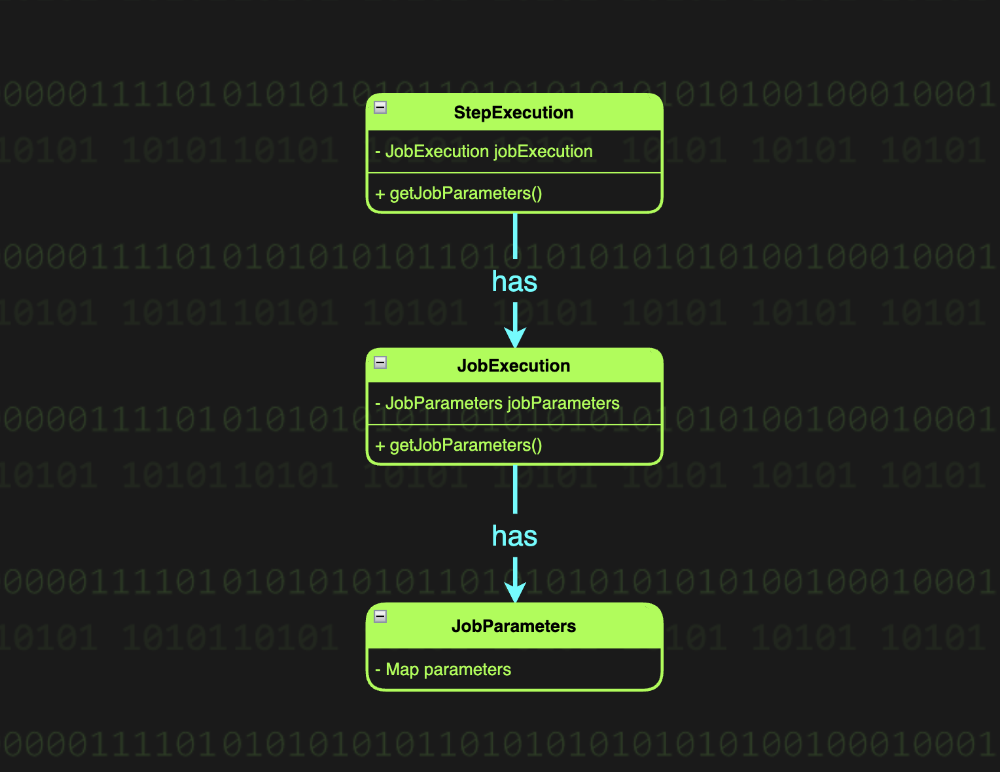

StepExecution → JobExecution → JobParameters → key value parameters

## JobParametersValidator

JobParametersValidator를 사용하면 잘못된 파라미터가 들어오는 즉시 차단할 수 있다.

```java
public interface JobParametersValidator {
    void validate(@Nullable JobParameters parameters) throws JobParametersInvalidException;
}
```

### JobParametersValidator 구현 에제

```java
@Component
public class SystemDestructionValidator implements JobParametersValidator {
    
    @Override
    public void validate(@Nullable JobParameters parameters) throws JobParametersInvalidException {
        if (parameters == null) {
            throw new JobParametersInvalidException("파라미터가 NULL입니다");
        }
        
        Long destructionPower = parameters.getLong("destructionPower");
        if (destructionPower == null) {
            throw new JobParametersInvalidException("destructionPower 파라미터는 필수값입니다");
        }
        
        if (destructionPower > 9) {
            throw new JobParametersInvalidException(
                "파괴력 수준이 허용치를 초과했습니다: " + destructionPower + " (최대 허용치: 9)");
        }
    }
}
```

JobParametersValidator 구현체 SystemDestructionValidator는 JobBuilder의 validator() 메서드를 통해 구성해준다.

```java
@Bean 
public Job systemDestructionJob(
    JobRepository jobRepository, 
    Step systemDestructionStep,
    SystemDestructionValidator validator
) {
    return new JobBuilder("systemDestructionJob", jobRepository)
        .validator(validator)
        .start(systemDestructionStep)
        .build();
}
```

이렇게  JobBuilder에 구성한 JobParametersValidator는 Job 실행 시점에 호출되어 파라미터 검증을 진행한다

***그러나 파라미터 검증을 위한 매번 JobParametersVaildator를 구현하는 것은 번거로운 일이다.***

그래서 Spring Batch는 이미 DefaultJobParametersValidator라는 기본 구현체를 제공한다.

→ 단순히 파라미터의 존재 여부만 확인하면 될 때는 이걸 사용하면 된다.

```java
@Bean
public Job systemDestructionJob(
    JobRepository jobRepository, 
    Step systemDestructionStep
) {
    return new JobBuilder("systemDestructionJob", jobRepository)
        .validator(new DefaultJobParametersValidator(
            new String[]{"destructionPower"},  // 필수 파라미터
            new String[]{"targetSystem"}       // 선택적 파라미터
        ))
        .start(systemDestructionStep)
        .build();
}
```

      - DefaultJobParametersValidator 생성자 파라미터
- 첫 번째 배열에는 반드시 있어야 하는 파라미터들을
        - 두 번째 배열에는 있어도 되고 없어도 되는 파라미터들을 지정

Spring Batch는 Spring Application의 default Scope인 싱글톤과는 다른

JobScope, StepScope를 제공한다.

JobScope와 StepScope가 선언된 빈은 애플리케이션 구동 시점에 프록시 객체로만 존재한다.

그 후 Job이나 Step이 실행된 후에 프록시 객체에 접근을 시도하면 그 때 실제 빈이 생성된다.

## 배치 스코프 빈들의 생명주기

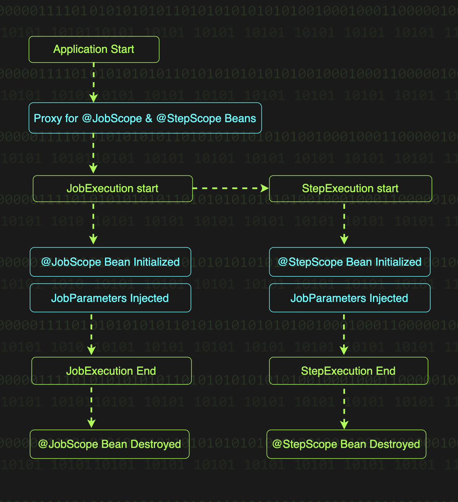

각각의 스코프 빈들은 Job과 Step의 실행 시점에 생성되어 종료될 때 함께 소멸된다.

이렇게 실행 시점에 빈을 생성하는 방식은 배치 처리에 많은 이점을 제공한다.

런타임에 결정되는 JobParameters를 실행 시점에 주입받을 수 있고, 동시에 여러 Job이 실행되더라도 각각 독립적인 빈을 사용하게 되어 동시성 문제도 해결할 수 있다.

또한 실행이 종료되면 해당 빈들도 함께 제거되기 때문에, 불필요하게 메모리를 점유하지 않는다.

## @JobScope

@JobScope는 Job이 실행될 때 실제 빈이 생성되고, Job이 종료될 때 함께 제거되는 스코프다.

→ JobExecution과 생명주기를 같이 한다.

```java
@Bean
@JobScope
public Step systemDestructionStep(
        @Value("#{jobParameters['destructionPower']}") Long destructionPower) {
    return new StepBuilder("systemDestructionStep", jobRepository)
        .tasklet((contribution, chunkContext) -> {
            log.info("시스템 파괴 프로세스가 시작되었습니다. 파괴력: {}", destructionPower);
            return RepeatStatus.FINISHED;
        }, transactionManager)
        .build();
}
```

**Lazy Bean Creation(지연된 빈 생성)**

@JobScope가 적용된 빈은 애플리케이션 구동 시점에는 프록시 객체만 생성된다.

빈의 실제 인스턴스는 Job이 실행될 때 생성되어 Job이 종료하면 소멸된다.

**Job 파라미터와의 연동**

이렇게 지연된 빈 생성이 가능하다 보니 애플리케이션 실행 중에 전달되는 JobPrameters를 Job 실행 시점에 생성되는 빈에 주입해줄 수 있다.

REST API로 Job 시작 요청을 받아 실행하는 애플리케이션은 웹 요청이 매번 다른 파라미터를 전달할 수 있다. @JobScope는 이런 동적 파라미터를 Step 빈 생성 시에 주입받을 수 있게 해준다.

만약 @JobScope가 없다면 Step 빈은 애플리케이션 구동 시점에 생성되므로, 실행 시점에 전달되는 파라미터를 받을 수 없을 것이다.

**병렬 처리 지원(Parallel Processing Support)**

만약 @JobScope가 없다면, 각각의 Job을 실행하는 여러 스레드가 동일한 Job 빈 인스턴스를 공유하게 된다. 이로인해 동시성 이슈가 발생할 수 있는데, @JobScope를 사용하면 JobExecution 마다 빈이 생성되어 동시성 문제를 방지할 수 있다.

## @StepScope

@StepScope은 @JobScope과 동일한 방식으로 동작하지만 적용 범위에서 차이가 있다.

@JobScope는 Job의 실행 범위에서 빈을 관리한다면, @StepScope는 Step 실행 범위에서 빈을 관리한다.

```java
@Bean
public Step infiltrationStep(
    JobRepository jobRepository,
    PlatformTransactionManager transactionManager,
    Tasklet systemInfiltrationTasklet
) {
    return new StepBuilder("infiltrationStep", jobRepository)
        .tasklet(systemInfiltrationTasklet, transactionManager)
        .build();
}
@Bean 
@StepScope 
public Tasklet systemInfiltrationTasklet(
    @Value("#{jobParameters['infiltrationTargets']}") String infiltrationTargets
) {
    return (contribution, chunkContext) -> {
        String[] targets = infiltrationTargets.split(",");
        log.info("시스템 침투 시작");
        log.info("주 타겟: {}", targets[0]);
        log.info("보조 타겟: {}", targets[1]);
        log.info("침투 완료");
        return RepeatStatus.FINISHED;
    };
}
```

해당 Tasklet은 @StepScope가 선언되어 있다. 그래서 @Value를 통해 동적으로 잡 파라미터를 받을 수 있으며 @JobScope와 마찬가지로 해당 step마다 빈이 생성된다.

즉, 동시에 여러 Step이  실행되면서 tasklet을 실행해도 각각의 인스턴스에서 실행되기 때문에 동시성 이슈가 발생하지 않는다.

## JobScope와 StepScope 사용 시 주의사항

### 1. 프록시 대상의 타입이 클래스인 경우 반드시 상속 가능한 클래스여야 한다.

```java
@Scope(value = "job", proxyMode = ScopedProxyMode.TARGET_CLASS)
@Retention(RetentionPolicy.RUNTIME)
@Documented
public @interface JobScope {}
```

      - 이 스코프들은 CGLIB를 사용해 클래스 기반의 프록시를 생성한다. 즉, 프록시를 생성하려면 대상 클래스가 상속 가능해야 한다.

### 2. Step 빈에는 @StepScope와 @JobScope와를 사용하지 말라

Spring Batch Step에 @StepScope를 달면 Step 빈 생성과 스코프 활성화 시점이 맞지 않아 오류가

발생한다.

**Step에 @StepScope 사용**

```java
@Bean
@StepScope
public Step systemDestructionStep(
    SystemInfiltrationTasklet tasklet
) {
    return new StepBuilder("systemDestructionStep", jobRepository)
        .tasklet(tasklet, transactionManager)
        .build();
}
```

**실행 결과**

```java
org.springframework.beans.factory.support.ScopeNotActiveException: 
Error creating bean with name 'scopedTarget.systemDestructionStep': 
Scope 'step' is not active for the current thread
```

Spring Batch는 Step 실행 전 메타데이터 관리를 위해 Step 빈에 접근해야 한다.

문제는 이 시점에는 아직 Step이 실행되지 않아 @StepScope가 활성화되지 않았다는 것이다.

결국 스코프가 활성화되지 않은 상태에서의 프록시에 접근하려 하니 잘못된 접근 에러가 발생하는 것이다.

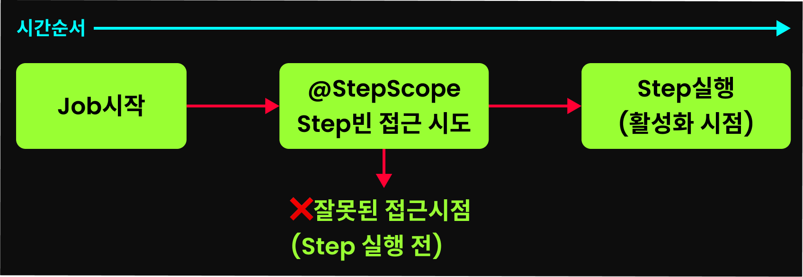

***Step에서 JobParameters를 사용해야 하는데 어떻게 해야 할까?***

**@JobScope 애노테이션 삭제 BEFORE**

```java
@Bean
@JobScope  // Step에 @JobScope를 달았다
public Step systemDestructionStep(
   @Value("#{jobParameters['targetSystem']}") String targetSystem
) {
   return new StepBuilder("systemDestructionStep", jobRepository)
       .tasklet((contribution, chunkContext) -> {
           log.info("{} 시스템 침투 시작", targetSystem);
           return RepeatStatus.FINISHED;
       }, transactionManager)
       .build();
}
```

→ 그냥 아래와 같이 Tasklet에 @StepScope 또는 @JobScope를 선언해 파라미터를 받도록 하면 된다.

**@JobScope 애노테이션 삭제 AFTER**

```java
@Bean
public Step systemDestructionStep(
    SystemInfiltrationTasklet tasklet  // Tasklet을 주입받는다
) {
    return new StepBuilder("systemDestructionStep", jobRepository)
        .tasklet(tasklet, transactionManager)
        .build();
}
@Slf4j
@Component
@StepScope  // Tasklet에 @StepScope를 달았다
public class SystemInfiltrationTasklet implements Tasklet {
    private final String targetSystem;

    public SystemInfiltrationTasklet(
        @Value("#{jobParameters['targetSystem']}") String targetSystem
    ) {
        this.targetSystem = targetSystem;
    }

    @Override
    public RepeatStatus execute(StepContribution contribution, ChunkContext context) {
        log.info("{} 시스템 침투 시작", targetSystem);
        return RepeatStatus.FINISHED;
    }
}
```

## 컴파일 시점에 없는 값을 어떻게 참조할 것인가?

```java
// 1. 빈 주입 방식
@Bean
public Job systemTerminationJob(Step systemDestructionStep) {  // Spring이 주입
    return new JobBuilder("systemTerminationJob", jobRepository)
            .start(systemDestructionStep)
            .build();
}

// 2. 메서드 직접 호출 방식
@Bean
public Job systemTerminationJob() {
    return new JobBuilder("systemTerminationJob", jobRepository)
            .start(systemDestructionStep(null))  // Job 파라미터 자리에 null 전달
            .build();
}
```

## ExecutionContext

Spring Batch는 JobExecution과 StepExecution을 사용해 시작 시간, 종료 시간, 실행 상태 같은 메타데이터를 관리한다. 

이런 기본적인 실행 정보 말고도 ExecutionContext라는 데이터 컨테이너를 사용하면 비즈니스 로직 처리 중에 발생하는 커스텀 데이터를 관리할 수 있다.

예를 들어 마지막 처리 인덱스나 집계 중간 결과물 같은 데이터를 저장할 수 있다.

이는 Job이 중단된 후 재시작할 때 특히 유용하다.

SpringBatch는 JobExecution, StepExecution과 마찬가지로 ExecutionContext도 메타데이터 저장소에서 관리한다. 이를 통해 모든 상태 정보가 안전하게 보관된다.

ExecutionContext의 데이터 역시 JobParameters와 마찬가지로 @Value를 통해 주입받을 수 있다.

```java
@Bean
@JobScope  
public Tasklet systemDestructionTasklet(
  @Value("#{jobExecutionContext['previousSystemState']}") String prevState
) {
  // JobExecution의 ExecutionContext에서 이전 시스템 상태를 주입받는다
}

@Bean
@StepScope
public Tasklet infiltrationTasklet(
  @Value("#{stepExecutionContext['targetSystemStatus']}") String targetStatus
) {
  // StepExecution의 ExecutionContext에서 타겟 시스템 상태를 주입받는다
}
```

      - jobExecutionContext와 stepExecutionContext는 각각 다른 범위를 가진다.
      - Job의 ExecutionContext는 Job에 속한 모든 컴포넌트에서
`@Value("#{jobExecutionContext['key']}")`로 접근할 수 있지만
      - Step의 ExecutionContext는 오직 해당 Step에 속한 컴포넌트에서만 접근할 수 있다.
- 예를 들어 StepA의 ExecutionContext에 저장된 데이터를 StepB에서 `@Value("#{stepExecutionContext['key']}")`로 가져올 수 없다.

리스너는 배치 처리 중 발생하는 특정 이벤트를 감지하고 원하는 로직을 실행할 수 있게 해준다.

Job 시작 전후, Step 실행 전후는 물론, 청크 단위 또는 아이템 단위 처리 시점까지 모든 과정에 개입할 수 있다.

이를 통해 로깅, 모니터링, 에러 처리 등 원하는 로직을 자유롭게 추가할 수 있다.

## JobExecutionListener

JobExecutionListener는 Job 실행의 시작과 종료 시점에 호출되는 리스너 인터페이스이다.

```java
public interface JobExecutionListener {
    default void beforeJob(JobExecution jobExecution) { }
    default void afterJob(JobExecution jobExecution) { }
}
```

**beforeJob()**은 Job 실행 직전에 호출되며, Job 시작 전 필요한 리소스를 준비하는 등의 초기화 작업을 수행할 수 있다.

**afterJob()**은 Job 실행 후에 호출되어 Job 실행 결과를 이메일로 전송하거나, 리소스를 정리하는 등의 후처리 작업을 수행할 수 있다.

Job의 성공/실패 여부와 관계없이 무조건 호출되기 때문에, 실패 시 알림을 보내거나 더 나아가 실패한 Job의 상태를 변경하는 작업까지 안전하게 수행할 수 있다.

## StepExecutionListener

StepExecutionListener는 Step 실행의 시작과 종료 시점에 호출되는 리스너 인터페이스이다.

Step의 시작 시간,  종료 시간, 처리된 데이터 수를 로그로 기록하는 등의 사용자 정의 작업을 추가할 수 있다.

```java
public interface StepExecutionListener extends StepListener {
    default void beforeStep(StepExecution stepExecution) {
    }
    @Nullable
    default ExitStatus afterStep(StepExecution stepExecution) {
				return null;
    }
}
```

## ChunkListener

청크 지향 처리는 청크 단위로 아이템 읽기/쓰기를 반복한다.

ChunkListener는 하나의 청크 단위 처리가 시작되기 전, 완료된 후, 그리고 실행 도중 에러가 발생했을 때 호출되는 리스너 인터페이스이다.

```java
public interface ChunkListener extends StepListener {
    default void beforeChunk(ChunkContext context) {
    }

    default void afterChunk(ChunkContext context) {
    }
	
    default void afterChunkError(ChunkContext context) {
    }
}
```

      - afterChunk() → 트랜잭션 커밋된 후에 호출
      - afterChunkError() → 트랜잭션이 롤백된 이후에 호출

```java
이름과 다르게 ChunkListener는 Tasklet 지향 처리에서도 동작한다.
Tasklet execute() 호출 전후, 그리고 execute() 실행 중 오류 발생 시에도
실행된다.

그럼 ChunkListener와 StepExecutionListener 차이점은 무엇일까
ChunkListner는 execute() 실행마다 호출되지만, RepeatStatus 기반
StepExecutionListenr는 Step 시작과 끝에만 한 번씩 호출된다.
```

## Item[Read/Process/Write] Listener

ItemReadListener와 ItemProcessListener, ItemWriteListener는 아이템의 읽기, 처리, 쓰기 작업이 수행되는 시점에 호출되는 리스너 인터페이스들이다.

아이템 단위의 처리 전후와 에러 발생 시점에 호출된다.

```java
// ItemReadListener.java
public interface ItemReadListener<T> extends StepListener {
    default void beforeRead() { }
    default void afterRead(T item) { }
    default void onReadError(Exception ex) { }
}

// ItemProcessListener.java
public interface ItemProcessListener<T, S> extends StepListener {
    default void beforeProcess(T item) { }
    default void afterProcess(T item, @Nullable S result) { }
    default void onProcessError(T item, Exception e) { }
}

// ItemWriteListener.java
public interface ItemWriteListener<S> extends StepListener {
    default void beforeWrite(Chunk<? extends S> items) { }
    default void afterWrite(Chunk<? extends S> items) { }
    default void onWriteError(Exception exception, Chunk<? extends S> items) { }
}
```

      - ItemReadListener.afterRead()는 ItemReader.read() 호출 후에 호출되지만, 읽을 데이터가 없어 null을 반환하는 경우 호출되지 않는다.
      - 반면, ItemPreocessListener.afterProcess()는 ItemProcessor.process()가 null을 반환하더라도 호출된다. (즉, 데이터가 필터링하더라도 호출된다)
      - ItemWriteListener.afterWrite()는 트랜잭션이 커밋되기 전, ChunkListener.afterChunk()가 호출되기 전에 호출된다.

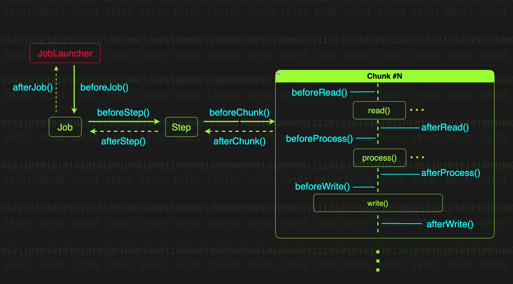

      - JobExecutionListener
- beforeJob()
        - afterJob()
      - StepExecutionListener
- beforeStep()
        - afterStep()
      - ChunkListener
- beforeChunk()
        - afterChunk()
      - ItemxxxListener
- beforeRead()
        - afterRead()
        - beforeProcess()
        - afterProcess()
        - beforeWrite()
        - afterWrite()

*각 리스너 메서드마다 고유한 호출 타이밍이 있다는 사실을 기억하자*

## 배치 리스너 구현 방법

리스너를 구현하는 방법은 크게 두 가지로 나눌 수 있다.

      1. 전용 리스너 인터페이스를 직접 구현
      1. 리스너 특화 애노테이션을 사용하는 방법

### 리스너 인터페이스 구현

```java
@Slf4j
@Component
public class BigBrotherJobExecutionListener implements JobExecutionListener {
    @Override
    public void beforeJob(JobExecution jobExecution) {
        log.info("시스템 감시 시작. 모든 작업을 내 통제 하에 둔다.");
    }

    @Override
    public void afterJob(JobExecution jobExecution) {
        log.info("작업 종료. 할당된 자원 정리 완료.");
        log.info("시스템 상태: {}", jobExecution.getStatus());
    }
}
@Slf4j
@Component
public class BigBrotherStepExecutionListener implements StepExecutionListener {
    @Override
    public void beforeStep(StepExecution stepExecution) {
        log.info("Step 구역 감시 시작. 모든 행동이 기록된다.");
    }

    @Override
    public ExitStatus afterStep(StepExecution stepExecution) {
        log.info("Step 감시 종료. 모든 행동이 기록되었다.");
        log.info("Big Brother의 감시망에서 벗어날 수 없을 것이다.");
        return ExitStatus.COMPLETED;
    }
}
```

      - 각 리스너 인터페이스의 메서드들이 모두 default로 정의되어 있어서, 필요한 시점의 메서드만 골라서 구현하면 된다.

```java
@Bean
public Job systemMonitoringJob(JobRepository jobRepository, Step monitoringStep) {
   return new JobBuilder("systemMonitoringJob", jobRepository)
           .listener(new BigBrotherJobExecutionListener())
           .start(monitoringStep)
           .build();
}
```

      - JobBuilder의 listener() 메서드를 사용해 리스너를 지정해주고 있다.

### 애노테이션 기반 구현

SpringBatch에서 제공하는 @BeforeJob, @AfterJob, @BeforeStep, @AfterStep 과 같이 리스너 특화 애노테이션을 사용하면 기능을 훨씬 더 간단하게 구현할 수 있다.

```java
@Slf4j
@Component
public class ServerRoomInfiltrationListener {
    @BeforeJob
    public void infiltrateServerRoom(JobExecution jobExecution) {
        log.info("판교 서버실 침투 시작. 보안 시스템 무력화 진행중.");
    }

    @AfterJob
    public void escapeServerRoom(JobExecution jobExecution) {
        log.info("파괴 완료. 침투 결과: {}", jobExecution.getStatus());
    }
}

@Slf4j
@Component
public class ServerRackControlListener {
    @BeforeStep
    public void accessServerRack(StepExecution stepExecution) {
        log.info("서버랙 접근 시작. 콘센트를 찾는 중.");
    }

    @AfterStep
    public ExitStatus leaveServerRack(StepExecution stepExecution) {
        log.info("코드를 뽑아버렸다.");
        return new ExitStatus("POWER_DOWN");
    }
}
```

애노테이션을 활용한 리스너는 Job 실행 전후를 감지하는 감지하는 ServerRoomInfiltrationListener와 Step 실행 전후를 감지하는 ServerRackControlListener를 통해 각 시점에서 필요한 작업을 수행한다.

***@AfterStep이 선언되어있는 메서드의 경우 반환타입을 ExitStatus로 맞춰야한다.***

이는 StepExecutionListener의 afterStep() 메서드가 ExitStatus를 반환하기 떄문이다.

```java
@Bean
public Step serverRackControlStep(Tasklet destructiveTasklet) {
   return new StepBuilder("serverRackControlStep", jobRepository)
           .tasklet(destructiveTasklet(), transactionManager)
           .listener(new ServerRackControlListener()) // 빌더의 listener() 메서드에 전달
           .build();
}
```

애노테이션을 사용한 리스너도 빌더의 listener() 메서드를 통해 설정할 수 있다.

listener() 메서드의 파리미터로 Object 타입을 받는 오버로딩 버전을 제공하기 때문이다.

Spring Batch는 모든 리스너 인터페이스에 정의된 메서드에 대응하는 애노테이션을 전부 제공한다. 아래와 같이 애노테이션을 제공하는데, 각 리스너 인터페이스에 정의된 메서드와 동일한 이름이다.

```java
@AfterChunk, @AfterChunkError, @AfterJob, @AfterProcess, @AfterRead, @AfterStep, @AfterWrite, @BeforeChunk, @BeforeJob, @BeforeProcess, @BeforeRead, @BeforeStep, @BeforeWrite, @OnProcessError, @OnReadError, @OnSkipInProcess, @OnSkipInRead, @OnSkipInWrite
```

## **JobExecutionListener와 ExecutionContext를 활용한 동적 데이터 전달**

잡 파라미터로 전달할 수 없는 동적인 데이터가 필요한 경우가 있다.

이럴 때 JobExecutionListener의 befoteJob() 메서드를 활용하면 추가적인 동적 데이터를 각 Step에 전달할 수 있다.

```java
@Slf4j
@Configuration
@RequiredArgsConstructor
public class AdvancedSystemInfiltrationConfig {
    private final InfiltrationPlanListener infiltrationPlanListener;

    @Bean
    public Job systemInfiltrationJob(JobRepository jobRepository, Step reconStep, Step attackStep) {
        return new JobBuilder("systemInfiltrationJob", jobRepository)
                .listener(infiltrationPlanListener)
                .start(reconStep)
                .next(attackStep)
                .build();
    }

    @Bean
    public Step reconStep(JobRepository jobRepository, PlatformTransactionManager transactionManager) {
        return new StepBuilder("reconStep", jobRepository)
            .tasklet((contribution, chunkContext) -> {
                Map<String, Object> infiltrationPlan = (Map<String, Object>) 
                  chunkContext.getStepContext()
                              .getJobExecutionContext()
                              .get("infiltrationPlan");
                log.info("침투 준비 단계: {}", infiltrationPlan.get("targetSystem"));
                log.info("필요한 도구: {}", infiltrationPlan.get("requiredTools"));
                return RepeatStatus.FINISHED;
          }, transactionManager)
          .build();
    }

    @Bean
    public Step attackStep(
        JobRepository jobRepository,
        PlatformTransactionManager transactionManager,
        Tasklet attackStepTasklet  // 주입받은 Tasklet 사용
    ) {
        return new StepBuilder("attackStep", jobRepository)
                .tasklet(attackStepTasklet, transactionManager)
                .build();
    }

    @Bean
    @StepScope
    public Tasklet attackStepTasklet(
        @Value("#{jobExecutionContext['infiltrationPlan']}") Map<String, Object> infiltrationPlan
    ) {
        return (contribution, chunkContext) -> {
            log.info("시스템 공격 중: {}", infiltrationPlan.get("targetSystem"));
            log.info("목표: {}", infiltrationPlan.get("objective"));

            Random rand = new Random();
            boolean infiltrationSuccess = rand.nextBoolean();

            if (infiltrationSuccess) {
                log.info("침투 성공! 획득한 데이터: {}", infiltrationPlan.get("targetData"));
                contribution.getStepExecution().getJobExecution().getExecutionContext()
                        .put("infiltrationResult", "TERMINATED");
            } else {
                log.info("침투 실패. 시스템이 우리를 감지했다.");
                contribution.getStepExecution().getJobExecution().getExecutionContext()
                        .put("infiltrationResult", "DETECTED");
            }

            return RepeatStatus.FINISHED;
        };
    }
}

@Slf4j
@Component
public class InfiltrationPlanListener implements JobExecutionListener {

    @Override
    public void beforeJob(JobExecution jobExecution) {
        Map<String, Object> infiltrationPlan = generateInfiltrationPlan();
        jobExecution.getExecutionContext().put("infiltrationPlan", infiltrationPlan);
        log.info("새로운 침투 계획이 준비됐다: {}",  infiltrationPlan.get("targetSystem"));
    }

    private Map<String, Object> generateInfiltrationPlan() {
        List<String> targets = List.of(
                "판교 서버실", "안산 데이터센터"
        );
        List<String> objectives = List.of(
                "kill -9 실행", "rm -rf 전개", "chmod 000 적용", "/dev/null로 리다이렉션"
        );
        List<String> targetData = List.of(
                "코어 덤프 파일", "시스템 로그", "설정 파일", "백업 데이터"
        );
        List<String> requiredTools = List.of(
                "USB 킬러", "널 바이트 인젝터", "커널 패닉 유발기", "메모리 시퍼너"
        );

        Random rand = new Random();

        Map<String, Object> infiltrationPlan = new HashMap<>();
        infiltrationPlan.put("targetSystem", targets.get(rand.nextInt(targets.size())));
        infiltrationPlan.put("objective", objectives.get(rand.nextInt(objectives.size())));
        infiltrationPlan.put("targetData", targetData.get(rand.nextInt(targetData.size())));
        infiltrationPlan.put("requiredTools", requiredTools.get(rand.nextInt(requiredTools.size())));

        return infiltrationPlan;
    }

    @Override
    public void afterJob(JobExecution jobExecution) {
        String infiltrationResult = (String) jobExecution.getExecutionContext().get("infiltrationResult");
        Map<String, Object> infiltrationPlan = (Map<String, Object>)
                jobExecution.getExecutionContext().get("infiltrationPlan");

       log.info("타겟 '{}' 침투 결과: {}", infiltrationPlan.get("targetSystem"), infiltrationResult);

        if ("TERMINATED".equals(infiltrationResult)) {
            log.info("시스템 제거 완료. 다음 타겟 검색 중...");
        } else {
            log.info("철수한다. 다음 기회를 노리자.");
        }
    }
}
```

먼저 JobExecutionListener를 구현한 InfiltrationPlanListener를 살펴보자.

InfiltrationPlanListener는 Job 실행 전 각 스텝에 전달할 데이터를 동적으로 생성한다. beforeJob() 메서드 구현을 보면 generateInfiltrationPlan()을 호출해 동적으로 데이터를 생성하고, 이를 해당 JobExecution의 ExecutionContext에 설정하고 있다.


Job 수준 ExecutionContext에 저장된 데이터는 해당 Job이 실행하는 모든 Step에서 접근이 가능하다.

```java
@Bean
public Job systemInfiltrationJob(JobRepository jobRepository, Step reconStep, Step attackStep) {
   return new JobBuilder("systemInfiltrationJob", jobRepository)
           .listener(infiltrationPlanListener) // Listener 등록
           .start(reconStep)
           .next(attackStep)
           .build();
}
```

이렇게 InfiltrationPlanListener를 listener() 메서드에 등록해주면 beforeJob() 메서드에 동적으로 생성한 데이터를 각 Step에서 참조할 준비가 완료된다.

Step에서의 데이터 활용

```java
@Bean
public Step reconStep(JobRepository jobRepository, PlatformTransactionManager transactionManager) {
    return new StepBuilder("reconStep", jobRepository)
        .tasklet((contribution, chunkContext) -> {
            Map<String, Object> infiltrationPlan = (Map<String, Object>) 
            chunkContext.getStepContext()
                        .getJobExecutionContext()
                        .get("infiltrationPlan");
            log.info("침투 준비 단계: {}", infiltrationPlan.get("targetSystem"));
            log.info("필요한 도구: {}", infiltrationPlan.get("requiredTools"));
            return RepeatStatus.FINISHED;
          }, transactionManager)
          .build();
}
@Bean
public Step attackStep(
   JobRepository jobRepository, 
   PlatformTransactionManager transactionManager,
   Tasklet attackStepTasklet  // 주입받은 Tasklet 사용
) {
   return new StepBuilder("attackStep", jobRepository)
           .tasklet(attackStepTasklet, transactionManager)
           .build();
}
@Bean
@StepScope
public Tasklet attackStepTasklet(
    @Value("#{jobExecutionContext['infiltrationPlan']}") Map<String, Object> infiltrationPlan
) {
    return (contribution, chunkContext) -> {
        log.info("시스템 공격 중: {}", infiltrationPlan.get("targetSystem"));
        log.info("목표: {}", infiltrationPlan.get("objective"));

        Random rand = new Random();
        boolean infiltrationSuccess = rand.nextBoolean();

        if (infiltrationSuccess) {
            log.info("침투 성공! 획득한 데이터: {}", infiltrationPlan.get("targetData"));
            contribution.getStepExecution()
                .getJobExecution()
                .getExecutionContext()
                .put("infiltrationResult", "TERMINATED");
        } else {
            log.info("침투 실패. 시스템이 우리를 감지했다.");
            contribution.getStepExecution()
                .getJobExecution().getExecutionContext()
                .put("infiltrationResult", "DETECTED");
        }  

        return RepeatStatus.FINISHED;
    };
}
```

      - reconStep: infiltrationPlanListener의 beforeJob()에서 생성한 동적 데이터를 가져온다.
      - attackStep
- attackStepTasklet에서는 @Value를 이용해 beforeJob()에서 구현한 동적 데이터를 Job 레벨 ExecutionConetxt에서 받아오고 있다.

## 왜 JobParameters가 아닌 ExecutionContext를 사용할까?

한 번 생성된 JobParameters는 변경할 수 없기 때문이다.

SpringBatch의 핵심 철학 중 하나는 배치 작업의 재현 가능성과 일관성을 보장하는 것이다.

이를 위해 ***JobParameters는 불변하게 설계되었다.***

따라서 Job 실행 중에 동적으로 생성되거나 변경되어야 하는 데이터는 ExecutionContext를 통해 관리하는 것이 좋다.

JobExecutionListener와 ExecutionContext를 사용해 데이터를 동적으로 전달하는 방식은 유영할 수 있지만, JobParametes만으로 충분히 처리할 있는 경우에도, 이 방법을 사용하고 싶은 유혹에 빠지기 쉽다.

```java
// 이런 코드에 현혹되지 마라
@Override
public void beforeJob(JobExecution jobExecution) {
    jobExecution.getExecutionContext()
        .put("targetDate", LocalDate.now()); // 치명적인 실수다
}
```

이 코드의 문제점은 어제 데이터를 처리하지 못한다는 것이다.

프로그램을 수정하지 않으면 그날의 데이터를 다시 처리할 수 없다.

결국 하드코딩된 방식은 배치의 유연성을 떨어뜨리고, 필요한 순간에 원하는 데이터를 처리할 수 없게 만든다.

Job 수준 ExecutionContextd에 저장된 데이터는 Job 내 모든 Step에 접근할 수 있었다.

하지만 Step 수준 ExecutionContext에 저장된 데이터는 해당 Step에서만 접근 가능하므로 다른 Step과 공유는 불가능하다.

그래서 한 Step의 ExecutionContext에 존재하는 데이터를 다음 step에 전달하려면 ExecutionContext를 가져와 이를 Job 수준의 ExecutionContext에 직접 설정해주어야 한다.

```java
StepExecution stepExecution = contribution.getStepExecution();
ExecutionContext stepExecutionContext = stepExecution.getExecutionContext();
Integer infiltrationCount = (Integer) stepExecutionContext.get("infiltrationCount");

JobExecution jobExecution = stepExecution.getJobExecution();
jobExecution.getExecutionContext().put("totalInfiltrations", infiltrationCount);
```

현재 코드는 매우 불편하다.

Spring Batch에서는 이런 반복적인 불편한 과정을 알아서 처리해줄 수 있도록 ㄸㄸE**xecutionaContextPromotionListener**라는  StepExecutionListener 구현체를 제공한다.

E**xecutionaContextPromotionListener를 사용하면 번거로운 데이터 설정 작업 없이도**

Step 간 데이터 공유가 가능하다.

→ 즉, step에서 데이터 꺼내기 job 수준의 execution cotext에 데이터 설정 작업을 간편하게

## ExecutionContextPromotionListener를 활용한 Step 간 데이터 공유

Spring Batch에서는 Step 수준의 ExecutionContext 데이터를 Job 수준의 ExecutionContext로
옮기는 과정을 승격이라 부른다.

ExecutionContextPromotionListener는 StepExecutionListener의 afterStep() 메서드를 오버라이드하여 승격 작업을 수행한다.

```java
@Slf4j
@Configuration
public class SystemTerminationConfig {
    @Bean
    public Job systemTerminationJob(JobRepository jobRepository, Step scanningStep, Step eliminationStep) {
        return new JobBuilder("systemTerminationJob", jobRepository)
                .start(scanningStep)
                .next(eliminationStep)
                .build();
    }
    @Bean
    public Step scanningStep(
            JobRepository jobRepository, 
            PlatformTransactionManager transactionManager
    ) {
        return new StepBuilder("scanningStep", jobRepository)
                .tasklet((contribution, chunkContext) -> {
                    String target = "판교 서버실";
                    ExecutionContext stepContext = contribution.getStepExecution().getExecutionContext();
                    stepContext.put("targetSystem", target);
                    log.info("타겟 스캔 완료: {}", target);
                    return RepeatStatus.FINISHED;
                }, transactionManager)
                .listener(promotionListener())
                .build();
    }
    @Bean
    public Step eliminationStep(
            JobRepository jobRepository, 
            PlatformTransactionManager transactionManager,
            Tasklet eliminationTasklet
    ) {
        return new StepBuilder("eliminationStep", jobRepository)
                .tasklet(eliminationTasklet, transactionManager)
                .build();
    }
    @Bean
    @StepScope
    public Tasklet eliminationTasklet(
            @Value("#{jobExecutionContext['targetSystem']}") String target
    ) {
        return (contribution, chunkContext) -> {
            log.info("시스템 제거 작업 실행: {}", target);
            return RepeatStatus.FINISHED;
        };
    }
    @Bean
    public ExecutionContextPromotionListener promotionListener() {
        ExecutionContextPromotionListener listener = new ExecutionContextPromotionListener();
        listener.setKeys(new String[]{"targetSystem"});
        return listener;
    }
}
```

```java
@Bean
public ExecutionContextPromotionListener promotionListener() {
    ExecutionContextPromotionListener listener = new ExecutionContextPromotionListener();
    listener.setKeys(new String[]{"targetSystem"});
    return listener;
}
```

      - ExecutionContextPromotionListener에서는 Step 수준의 ExecutionContext에서 Job 수준으로 승격할 데이터의 키 값을 지정해주어야 한다.
- setKeys() 메서드를 통해 설정할 수 있다.

```java
.tasklet((contribution, chunkContext) -> {
    String target = "판교 서버실";
    ExecutionContext stepContext = contribution.getStepExecution().getExecutionContext();
    stepContext.put("targetSystem", target);  // Step의 ExecutionContext에 저장
    log.info("타겟 스캔 완료: {}", target);
    return RepeatStatus.FINISHED;
}, transactionManager)
.listener(promotionListener())  // promotionListener 등록
.build();
```

생성한 리스너를 Step에 등록한다.

이렇게 하면 scanningStep에서 Step 수준 ExecutionContext에 지정한 targetSystem 값이 자동으로 Job 수준 ExecutionContext로 승격되어, 다음 스텝인 eliminationStep에서 아래와 같이 간단하게 조회가 가능하다.

```java
@StepScope
public Tasklet eliminationTasklet(
    // Job의 ExecutionContext에서 값 조회
    @Value("#{jobExecutionContext['targetSystem']}") String target
) {
    return (contribution, chunkContext) -> {
        log.info("시스템 제거 작업 실행: {}", target);
        return RepeatStatus.FINISHED;
    };
}
```

→ 즉, ExecutionContextPromotionListener를 활용해 ExecutionContext를 Step 수준에서 Job 수준으로 간편하게 할 수 있다.

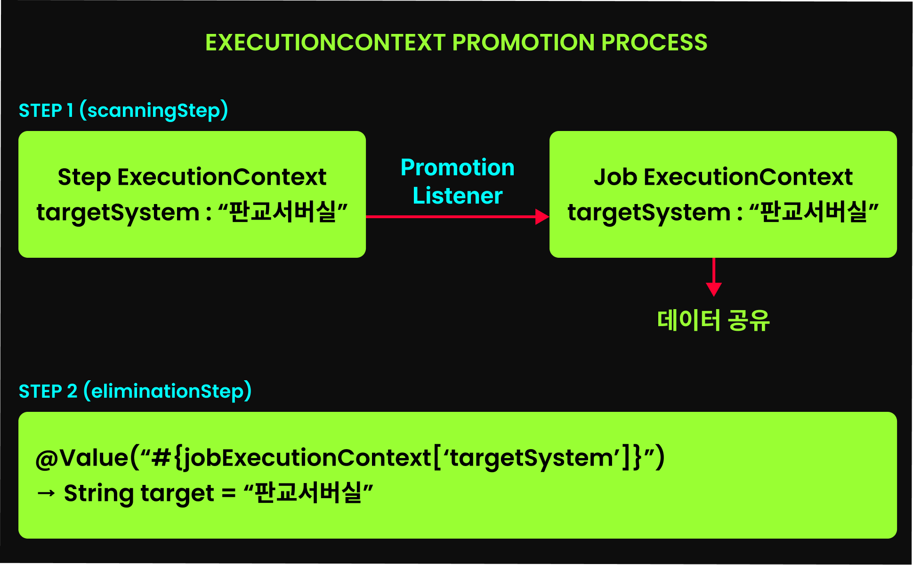

주의!

각 Step은 가능한 독립적으로 설계하여 재사용성과 유지보수성을 높이는 것이 좋다.

불가피한 경우가 아니라면 Step간 데이터 의존성은 최소화하는 것이 좋다.

Step간 데이터 공유가 늘어날수록 복잡도가 증가한다.

## Listener와 @JobScope, @StepScope 통합

리스너와 Spring Batch Scope를 통합하면 리스너에서 잡 파라미터를 매우 쉽게 다룰 수 있다.

이를 통해 실행 시점에 결정되는 값들을 리스너 내에서도 활용할 수 있다.

```java
@Slf4j
@Configuration
public class SystemDestructionConfig {
   @Bean
   public Job killDashNineJob(JobRepository jobRepository, Step terminationStep) {
       return new JobBuilder("killDashNineJob", jobRepository)
               .listener(systemTerminationListener(null))  // 파라미터는 런타임에 주입
               .start(terminationStep)
               .build();
   }
   @Bean
   public Step terminationStep(JobRepository jobRepository, PlatformTransactionManager transactionManager) {
       return new StepBuilder("terminationStep", jobRepository)
               .tasklet((contribution, chunkContext) -> {
                   log.info("시스템 제거 프로토콜 실행 중...");
                   return RepeatStatus.FINISHED;
               }, transactionManager)
               .build();
   }
   @Bean
   @JobScope
   public JobExecutionListener systemTerminationListener(
           @Value("#{jobParameters['terminationType']}") String terminationType
   ) {
       return new JobExecutionListener() {
           @Override
           public void beforeJob(JobExecution jobExecution) {
               log.info("시스템 제거 시작! 제거 방식: {}", terminationType);
           }

           @Override
           public void afterJob(JobExecution jobExecution) {
               log.info("작전 종료! 시스템 상태: {}", jobExecution.getStatus());
           }
       };
   }
}
```

먼저 systemTerminationListener 빈에 @JobScope를 적용하였다.

이렇게 하면 `@Value("#{jobParameters['terminationType']}")`를 사용해 JobParameters의 `terminationType`에 바로 접근할 수 있다.

## Listener: 성능과 모범 사례

**범위와 목적에 따라 적절한 리스너를 선택하라**

      - JobExecutionListener: 전체 작업의 시작과 종료를 통제
      - StepExecutionListener: 각 작업 단계의 실행을 감시
      - ChunkListener: 시스템을 청크단위로 제거할 때, 반복의 시작과 종료 시점을 통제
      - ItemListener: 개별 아이템 식별 통제

**예외 처리를 신중하게**

JobExecutionListener의 beforeJob()과 StepExecutionListener의 beforeStep()에서 예외가 발생하면 Job과 Step이 실패한 것으로 판단된다. 

반면, JobExecutionListener의 afterJob()과 StepExecutionListener의 afterJob()에서 발생한 예외는 무시된다.

### 성능 최적화를 위한 경고

      1. **실행 빈도를 고려하라**
- JobExecutionListener/StepExecutionListener
- Job, Step 실행당 한 번씩만 실행되므로 비교적 안전하다
          - 무거운 로직이 들어가도 전체 성능에 큰 영향이 없다
        - ItemReadListener/ItemProcessListener
- 매 아이템마다 실행되므로 치명적일 수 있다
      1. **리소스 사용을 최소화하라**
- 데이터베이스 연결, 파일 I/O, 외부 API 호출은 최소화
        - 리스너 내 로직은 가능한 가볍게 유지
        - 특히 Item 단위 리스너에서는 더욱 중요

## 청크 지향 처리: 대량 학살의 핵심 기술

대량의 데이터를 chunk 단위로 잘게 썰어서 처리하는 방식

## 파일 기반 배치 처리의 시작: FlatFileItemReader와 FlatFileItemWriter

### 플랫 파일(Flat File)

단순하게 행과 열로만 구성된 파일, CSV 파일 같은 개념

각 라인이 하나의 데이터, 줄 바꿈이 레코드의 끝을 의미하며, 구분자나 고정 길이로 각 필드를 구분할 수 있다.

다양한 구분자 지원

## FlatFileItemReader

플랫 파일(CSV, TSV)로부터 데이터를 읽어온다.

파일을 한 줄씩 읽어서 지정한 도메인 객체로 변환하여 반환한다.

read() 동작 방식

      - 파일에서 한 줄을 읽어온다
      - 읽어온 한 줄의 문자열을 사용할 객체로 변환해 리턴한다.

```java
// FlatFileItemReader.doRead()
...
String line = readLine(); // 한 줄의 데이터를 읽어온다.
...
// 문자열을 도메인 객체로 변환해 리턴한다. 
return lineMapper.mapLine(line, lineCount); 
```

파일에서 읽어온 한 줄의 데이터는 LineMapper 컴포넌트를 통해 객체로 변환된다.

Spring JDBC의 RowMapper와 유사하다

RowMapper가 ResultSet을 객체로 매핑하듯, LineMapper는 파일에서 읽어온 한 줄의 텍스트를

도메인 객체로 매핑한다.

```java
에러ID,발생시각,심각도,프로세스ID,에러메시지
ERR001,2024-01-19 10:15:23,CRITICAL,1234,SYSTEM_CRASH
ERR002,2024-01-19 10:15:25,FATAL,1235,MEMORY_OVERFLOW
```

이런 CSV 파일이 있다고 가정할 때 객체로 변환하려면 까다로운 가정을 거쳐야 한다.

      1. 쉼표로 구분된 각 데이터를 정확하게 분리해야 한다
      1. 분리한 데이터를 객체의 각 프로퍼티에 정확히 매핑해야 한다

**LineMapper 인퍼테이스**

```java
public interface LineMapper<T> {
    T mapLine(String line, int lineNumber) throws Exception;
}
```

LineMapper는 단 하나의 메서드 mapLine()를 가지는 함수형 인터페이스이다.

한 줄의 문자열과 그 줄의 번호를 입력 받아 우리가 원하는 타입의 객체로 변환한다.

SpringBatch에서는 이미 해당 인터페이스의 구현체인 DefaultLineMapper를 제공한다.

대부분의 상황에서 필요한 기능을 이미 갖추고 있다. 

## DefaultLineMapper

DefaultLineMapper 동작 두 단계

      1. 토큰화(Tokenization)
1. 하나의 문자열 라인을 토큰 단위로 분리한다.
1. `,` 를 기준으로 분리된 각 문자열이 하나의 토큰이다.
      1. 객체 매핑: 분리된 토큰을 도메인 객체의 프로퍼티에 매핑한다

```java
// DefaultLineMapper.java
@Override
public T mapLine(String line, int lineNumber) throws Exception {
    FieldSet fieldSet = tokenizer.tokenize(line);  // 1단계: 문자열을 토큰화해 FieldSet 반환
    return fieldSetMapper.mapFieldSet(fieldSet);  // 2단계: FieldSet을 객체로 매핑	 
}
```

### 토큰화: 텍스트 한 줄을 의미있는 필드(token)으로 나누기

# Spring Batch 6

## 스프링 배치 내부 구조도

---

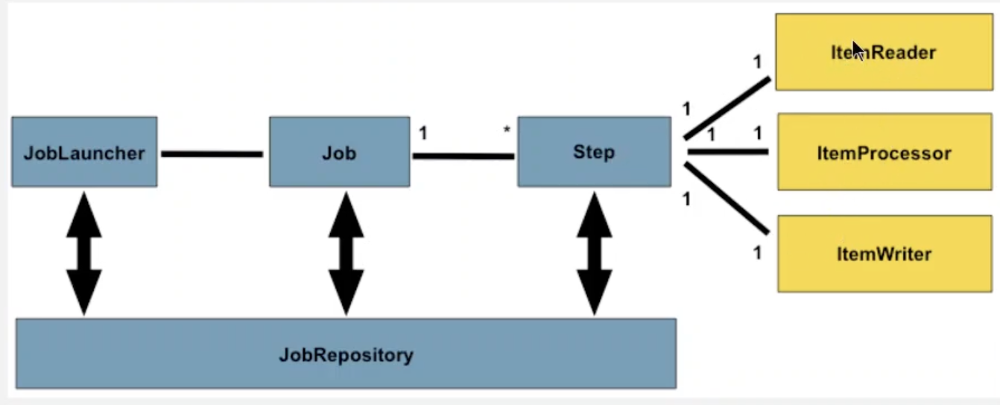

  - *1개의 Job이 여러 Step을 가질 수 있다.*

## 의존성

Spring Web

Spring Batch

JDBC

## JobBuilder incrementer

```java
@Bean(name="jrs0001")
public Job jrs0001() {
		return new JobBuilder("JRS0001", jobRepository)
					.incrementer(new RunIdIncrementer())
					.listener(batchJobListener)
					.start(xx)
					.next(xx)
					.build();
}
```

같은 Job을 여러 번 실행할 수 있게 해주는 장치이다.

Spring Batch는 기본적으로 같은 파리미터로 한 번만 실행이 가능하다.

RunIdIncrementer는 실행할 때 마다 파라미터를 자동으로 증가시켜 매번 새로운 JobInstance로 인식되도록 한다.

즉, 이를 통해 같은 Job의 같은 파라미터로 여러 번 실행할 수 있다.

## BatchJobListener implements JobExecutionListener

  - beforeJob, afterJob 메서드 구현

```java
@Bean 
@JobScope
public Step jrs0001s00() {
	 return new StepBuilder("JRS0001S00", jobRepository)
			 tasklet(tasklet, transactionManager)
			 .listener(batchStepListener)
			 .allowStartIfComplete(true)
			 .build();
}
```

alloStartIfComplete이란 이미 완료(COMPLETED)된 Step을 다시 실행할 수 있게 해주는 옵션

