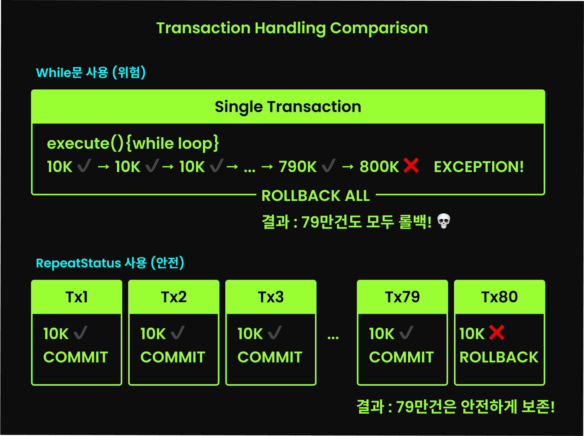
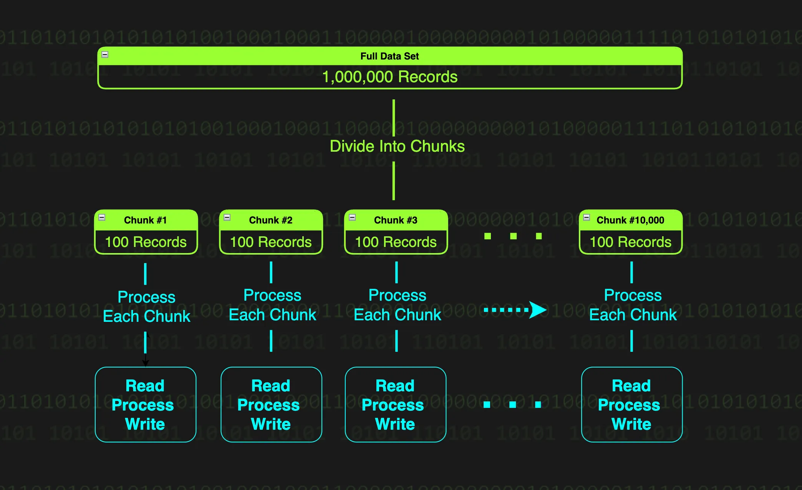
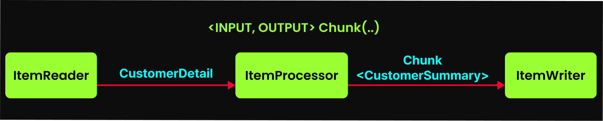
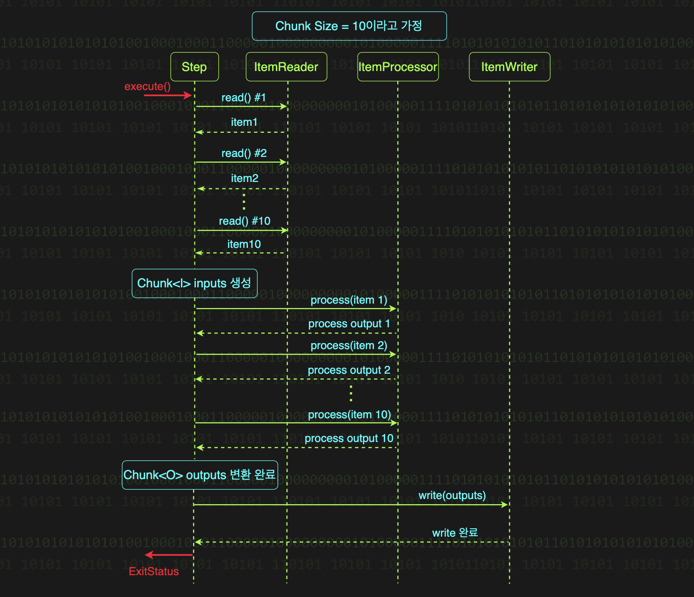
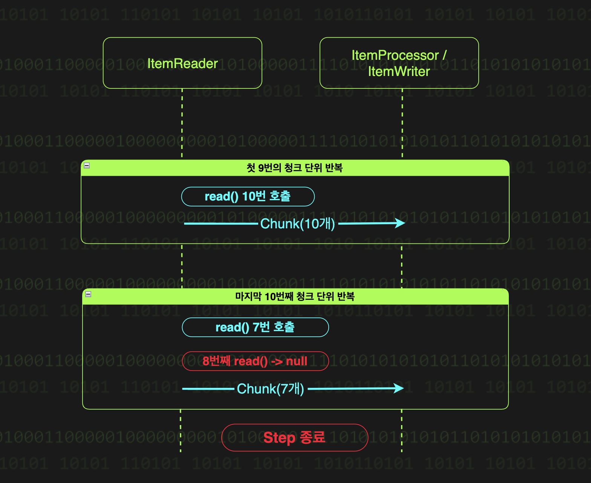

Spring Batch Step은 다음과 같이 크게 두 가지 모델 처리로 나뉜다.

- 청크 지향 처리
- 테스크릿 지향 처리

## Tasklet 지향 처리란?

태스크릿 지향 처리 모델은 Spring Batch에서 가장 기본적인 Step 구현 방식으로 비교적

복잡하지 않은 단순한 작업을 실행할 때 사용된다.

언제 태스크릿 지향 처리를 사용하는가?

일반적인 Spring Batch Step은 대부분 대량 데이터 처리(읽고-처리하고-쓰기) 작업에 초점을 맞춘다

하지만 때로는 단순한 시스템 작업이나 유틸성 작업이 필요할 때가 있다.

- 매일 새벽 불필요한 로그 파일 삭제
- 사용자에게 단순한 알림이나 메시지 또는 이메일 발송
- 외부 API 호출 후 결과를 단순히 저장하거나 로깅

이런 단일 비즈니스 로직 실행에 초점을 맞춘 작업들이 있다.

태스크릿 지향 처리는 이러한 목적을 위해 설계된 처리 방식이다.

## 태스크릿 지향 처리의 구현 방식

```java
@FunctionalInterface
public interface Tasklet {
    @Nullable
    RepeatStatus execute(StepContribution contribution, ChunkContext chunkContext) throws Exception;
}
```

Spring Batch가 제공하는 Tasklet 인터페이스의 execute() 메서드에 우리가 원하는 로직을 구현하고, 이 구현체를 Spring Batch에 넘기기만 하면 된다.

```java
@Slf4j
public class ZombieProcessCleanupTasklet implements Tasklet {
    private final int processesToKill = 10;
    private int killedProcesses = 0;

    @Override
    public RepeatStatus execute(StepContribution contribution, ChunkContext chunkContext) throws Exception {
        killedProcesses++;
        log.info("☠️  프로세스 강제 종료... ({}/{})", killedProcesses, processesToKill);

        if (killedProcesses >= processesToKill) {
            log.info("💀 시스템 안정화 완료. 모든 좀비 프로세스 제거.");
            return RepeatStatus.FINISHED;  // 모든 프로세스 종료 후 작업 완료
        }

        return RepeatStatus.CONTINUABLE;  // 아직 더 종료할 프로세스가 남아있음
    }
}
```

RepeatStatus란 Spring Batch Step이 Tasklet의 execute() 메서드 실행을 계속 할지 멈출지를

결정하는 기준이다. execute()메서드에서 적절한 RepeatStatus를 반환해, Spring Batch에게 반복 여부를 알리는 방식이다.

## RepeatStatus: FINSHED VS CONTINUABLE

RepeatStatus.FINSHED:  Step의 처리가 성공이든 실패든 상관없이 해당 Step이 완료되었음을 의미한다. 더 이상 반복할 필요 없이 다음 스탭으로 넘어가며, 배치 잡은 차근차근 진행된다.

RepeatStatus.CONTINUABLE: execute() 메서드가 추가로 더 실행되어야 함을 Spring Batch Step에게 알린다. 

그렇다면 왜 RepeatStatus가 필요할까?

반복 작업이라면 while문으로 처리하면 되는 거 아닌가?

이는 Spring Batch의 트랜잭션 동작 범위와 관련 있다.

Spring Batch는 Tasklet의 execute() 호출 마다 새로운 트랜잭션을 시작하고 execute() 메서드가 끝나고 RepeatStatus가 반환되면 해당 트랜잭션을 커밋한다.

만약 execute() 메서드 내부에 반복문을 직접 구현했다면?

모든 반복 작업이 하나의 트랜잭션 안에서 실행된다.

즉, 중간에 예외가 터지면 데이터베이스 결과가 execute()호출 전으로 롤백되어 버린다.



총 100만건의 데이터를 처리해야 할 때, execute() 내부에서 while문을 사용한다면 80만 건째 처리 중 예외가 발생한다면 이전에 처리한 데이터도 모두 롤백된다.

만약 RepeatStatus.CONTINUABLE로 반복한다면, 예외가 발생하더라도 이전 데이터 정리는

성공적으로 커밋된 상태로 남는다.

***즉, RepeatStatus를 반환하는 방식으로 반복 실행하는 이유는 작은 트랜잭션들로 나누어***

***안전하게 처리하기 위해서다.***

## Tasklet을 Step으로 등록하는 방법

```java
@Configuration
public class ZombieBatchConfig {
    private final JobRepository jobRepository;
    private final PlatformTransactionManager transactionManager;

    public ZombieBatchConfig(JobRepository jobRepository, PlatformTransactionManager transactionManager) {
        this.jobRepository = jobRepository;
        this.transactionManager = transactionManager;
    }

    @Bean
    public Tasklet zombieProcessCleanupTasklet() {
        return new ZombieProcessCleanupTasklet();
    }
    @Bean
    public Step zombieCleanupStep() {
        return new StepBuilder("zombieCleanupStep", jobRepository)
                // Tasklet과 transactionManager 설정
                .tasklet(zombieProcessCleanupTasklet(), transactionManager)  
                .build();
    }
    @Bean
    public Job zombieCleanupJob() {
        return new JobBuilder("zombieCleanupJob", jobRepository)
                .start(zombieCleanupStep())  // Step 등록
                .build();
    }
}
```

현재 Step을 생성하는 코드를 보면 Spring Boot가 자동으로 구성한 transactionManager 빈을

주입받아 사용하고 있다.

하지만 일반적으로 tasklet 에서 DB 트랜잭션 관리가 필요한 경우가 많지는 않다.

→ 파일 정리, 외부 API 호출 같은 작업

## ResourcelessTransactionManager

ResourcelessTransactionManager는 PlatformTransactionManager 구현체로,

아무것도 하지 않는 방식으로 동작한다. 즉, 이를 사용하면 불필요한 DB 트랜잭션 처리를 생략할 수 있다.

```java
@Bean
public Step zombieCleanupStep() {
    return new StepBuilder("zombieCleanupStep", jobRepository)
            // Tasklet과 ResourcelessTransactionManager 설정
            .tasklet(zombieProcessCleanupTasklet(), new ResourcelessTransactionManager())
            .build();
}
```

주의!!!

ResoucelessTransactionManager와 트랜잭션을 사용하는 PlatformTransactionManager 모두

빈으로 등록하는 경우, 충돌이 발생할 수 있다.

## 익명 클래스 또는 람다식을 활용한 Tasklet

```java
@Bean
public Step deleteOldRecordsStep() {
   return new StepBuilder("deleteOldRecordsStep", jobRepository)
           .tasklet((contribution, chunkContext) -> {
               int deleted = jdbcTemplate.update("DELETE FROM logs WHERE created < NOW() - INTERVAL 7 DAY");
               log.info("🗑️ {}개의 오래된 레코드가 삭제되었습니다.", deleted);
               return RepeatStatus.FINISHED;
           }, transactionManager)
           .build();
}

@Bean
public Job deleteOldRecordsJob() {
    return new JobBuilder("deleteOldRecordsJob", jobRepository)
            .start(deleteOldRecordsStep())  // Step을 Job에 등록
            .build();
}
```

위와 같이 단순한 작업이라면 Tasklet 구현 클래스를 만들지 않고, 람다 표현식을 사용해 Step 구성 중에 바로 Tasklet을 정의할 수 있다.

## 청크 지향 처리

데이터를 다루는 작업은 대부분 읽기 → 처리 → 쓰기라는 공통된 패턴을 보인다.

Spring Batch 또한 이 패턴을 따르며 이를 청크 지향 처리라고 부른다.

## chunk =  데이터를 작은 덩어리로 나누어 처리하는 방식

청크(chunk)는 데이터를 일정 단위로 쪼갠 덩어리를 의미한다.



백만 건의 데이터를 처리한다고 가정했을 때, Spring Batch는 전체를 한 번에 읽고 처리하지 않는다. 대신, 일정한 청크 단위로 쪼개서 읽고, 처리하고, 저장한다.

이렇게 청크 단위로 처리하는 이유는 배치 작업에서의 데이터의 양은 방대하기 때문이다.

100만건의 데이터를 한 번에 메모리로 불러오면, 배치 서버는 OutOfMemory가 터지고

DB는 과부하가 발생한다.

Tasklet과 마찬가지로 chunk 단위로 쪼개어 처리하면 트랜잭션이 가벼워지기 때문에  Recoverbility가 올라간다.

## ItemReader, ItemProcessor, ItemWriter

### ItemReader

```java
public interface ItemReader<T> {
    T read() throws Exception, 
        UnexpectedInputException, 
        ParseException, 
        NonTransientResourceException;
}
```

read() 메서드는 아이템을 하나씩 반환한다. 여기서 하나란 데이터베이스의 한 row를 의미한다.

읽을 데이터가 더 이상 없으면 null을 반환하고, 스텝은 종료된다.

파일, 데이터베이스, 메시지 큐 등 다양한 데이터 소스에 대한 구현체를 제공

### ItemProcessor

```java
public interface ItemProcessor<I, O> {
    O process(I item) throws Exception;
}
```

ItemReader로부터 데이터를 받아 process() 메서드를 통해 입력 데이터(I)를 원하는 형태(O)로 변환한다.

**필터링**

process() 메서드가 null을 반환하면 해당 입력 데이터는 처리 흐름에서 제외된다

즉, ItemWriter로 전달되지 않는다.

**데이터 검증**

만약 예외를 발생시키면 배치 잡은 중단된다. 

물론 Spring Batch Skip 가능과 함께 사용하면 예외가 발생한 데이터만 건너뛰고 배치 작업을
중단시킨다.

**Optional**

ItemProcessor는 생략이 가능하다. 즉, ItemReader → ItemWriter 흐름이 가능하다.

### ItemWriter 

ItemWriter는 ItemProcessor 또는 ItemReader로부터 받은 결과물을 받아, 원하는 방식으로
저장/출력한다.

```java
public interface ItemWriter<T> {
    void write(Chunk<? extends T> chunk) throws Exception;
}
```

ItemWriter는 Chunk 단위로 묶어서 한 번에 데이터를 쓴다.

write() 메서드의 파라미터 타입이 Chunk

## 청크 지향 처리 조립하기

```java
@Bean
public Step processStep(JobRepository jobRepository, PlatformTransactionManager transactionManager) {
   return new StepBuilder("processStep", jobRepository)
           .<CustomerDetail, CustomerSummary>chunk(10, transactionManager)  // 청크 지향 처리 활성화
           .reader(itemReader())       // 데이터 읽기 담당
           .processor(itemProcessor()) // 데이터 처리 담당
           .writer(itemWriter())      // 데이터 쓰기 담당
           .build();
}

@Bean
public Job customerProcessingJob(JobRepository jobRepository, Step processStep) {
   return new JobBuilder("customerProcessingJob", jobRepository)
           .start(processStep)  // processStep으로 Job 시작
           .build();
}
```

**1) 청크 사이즈 지정**

```java
.chunk(10, transactionManager)
```

- chunk() 메서드의 첫 번째 파라미터로 청크의 크기를 지정한다. 현재는 10을 지정했는데, 이는 ItemReader가 데이터 10개를 읽어오면, 이를 하나의 청크로 만들어 ItemProcessor, ItemWriter에서 쓰기를 수행한다

**2) 제네릭 타입으로 데이터 흐름 정의**

```java
.<CustomerDetail, CustomerSummary>chunk(..)
```

- 첫 번째 타입(CustomerDetail): ItemReader가 반환할 데이터 타입
- 두 번째 타입(CustomerSummary): CustomerDetail를 입력 받은 ItemProcessor가 아이템을 처리 후 반환할 타입이자 ItemWriter가 전달받을 Chunk 제네릭 타입
1. ItemReader는 read() 호출마다 CustomerDetail 객체를 반환
1. ItemProcessor는 이 CustomerDetail 타입을 입력받아 가공 로직을 수행한 후 CustomerSummary로 변환하여 반환
1. 이렇게 반환된 CustomerSummary들이 청크 단위로 모여 Chunk<CustomerSummary>가 된다
1. 최종적으로 이 Chunk<CustomerSummary>가 ItemWriter.write() 메서드의 파라미터로 전달



## 청크 지향 처리의 흐름

1. **데이터 읽기(ItemReader)**
데이터 소스에서 하나씩 데이터를 읽어온다. read() 메서드가 호출될 때마다 데이터를 순차적으로 반환, 청크 크기만큼 데이터를 읽어야 끝난다. 즉, 청크 크기가 10이면 read()가 10번 호출되어 하나의 청크가 생성
1. **데이터 가공(ItemProcessor)**
ItemProcessor가 ItemReader가 읽어온 청크의 각 아이템 하나씩을 처리한다

Spring Batch는 청크의 아이템마다 process()를 반복 호출해서 변환하거나 필터링
1. **데이터 쓰기(ItemWriter)**
ItemProcessor의 처리까지 완료되었다면 이제 청크를 실제로 쓸 차례

ItemWriter는 청크 전체를 한 번에 입력받아 처리한다.





***ItemReader가 null을 반환한는 순간 chunk 지향 처리 종료***

## 청크 처리와 트랜잭션

태스크릿 지향 처리에서는 execute() 메서드 실행 전에 트랜잭션이 시작되고, 메서드가 끝나면

트랜잭션도 끝난다.

청크 지향 처리에서는 트랜잭션 또한 청크 단위로 관리된다.

즉, 각각의 청크 단위 반복마다 별도의 트랜잭션이 시작되고 커밋된다.

대용량 데이터를 처리하는 도중 중간에 스탭이 실패하더라도, 이전 청크 반복에서 처리된 데이터는 이미 안전하게 커밋되어 있어 그만큼의 작업이 보존된다.

청크 사이즈가 크면, 메모리에 많은 데이터를 한 번에 로드하게 된다,

트랜잭션의 경계가 커지므로, 문제 발생 시 롤백되는 데이터의 양도 많아진다

청크 사이즈가 작으면 롤백되는 데이터의 양은 작아지지만 I/O가 자주 발생하게 된다.

