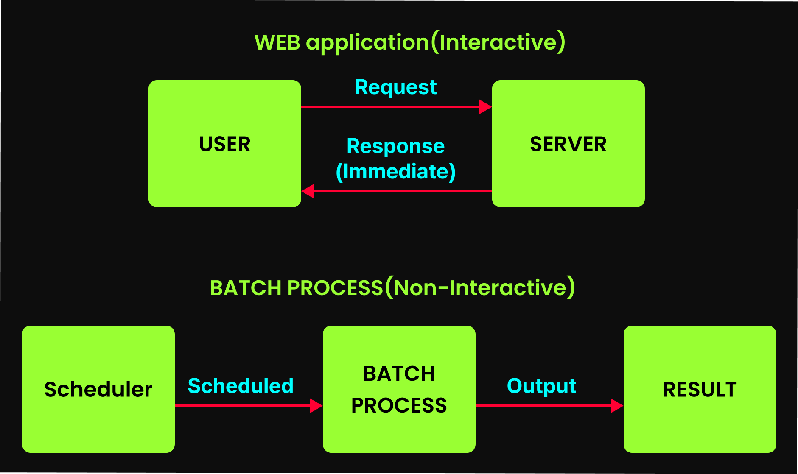

배치 처리는 대량의 데이터를 정해진 시간에 자동으로 일괄 처리하고 결과를 출력하는 작업을 말한다.

# 배치 처리의 특징

**대용량 데이터 처리:** 웹 애플리케이션이 특정 ID의 데이터 하나를 조회하거나 수정한다면, 배치는 수천, 수만 개의 데이터를 한 번에 처리한다.

**정기적 실행:** 매일, 매주, 매달 등 정해진 시간에 실행된다. 

**자동화:** 한 번 만들고 설정해두면 알아서 모든 것을 처리한다.

**유한한 양의 데이터 처리:** 배치는 정해진 양의 데이터만 처리한다. 처리 대상이 정해져 있기에 결과를 정확하게 예측할 수 있다.

**예측 가능한 부하 처리:** 배치는 시스템의 처리 능력에 맞게 설계된다. 시스템이 감당할 수 있는 만큼의 데이터만 처리하도록 설계해야 한다.

## WEB VS 


