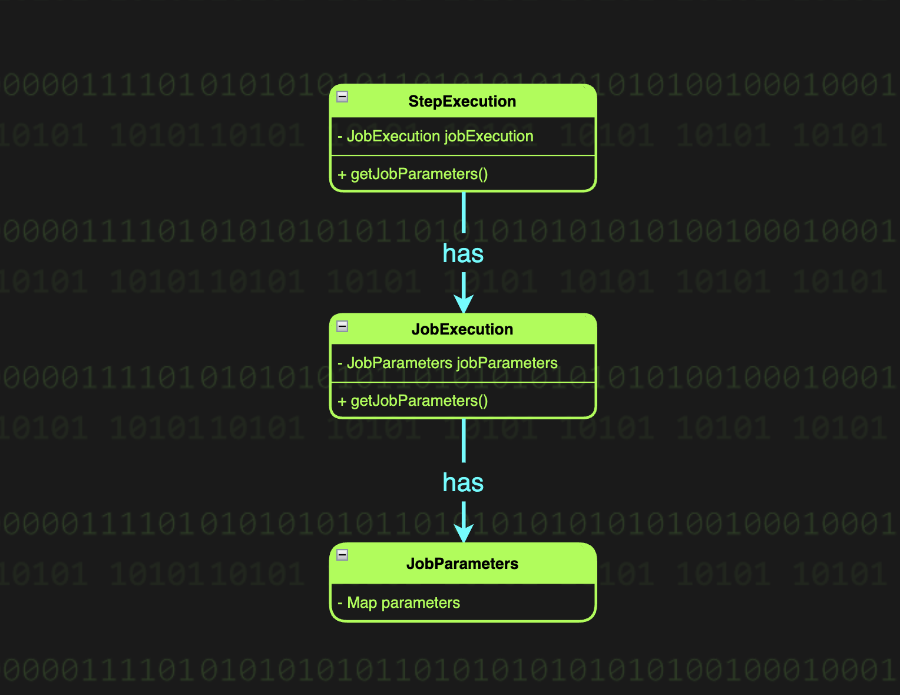

JobParameters는 배치 작업에 전달되는 입력 값이다.

이 값은 배치가 어떤 조건에서, 어떤 데이터를 다룰지를 결정하는 데 핵심적인 역할을 한다.

***그냥 -D 옵션으로 프로퍼티 전달하면 되는 거 아닌가?***

JobParameters와 프로퍼티는 완전히 다른 목적을 가진다. 

## 프로퍼티와 JobParameters의 결정적 차이

### 입력값 동적 변경

예를 들어. 웹 요청이 들어올 때마다 비동기로 배치 잡을 실행하는 온라인 배치 앱이 있다.

이런 경우 프로퍼티로는 값을 변경할 수 없다. 프로퍼티의 경우 앱 시작 시 한 번 주입되는 정적인 값이기 때문이다. 

반면에 JobParameters는 입력값을 동적으로 변경이 가능하다.

### 메타데이터

SpringBatch는 JobParameters의 모든 값을 메터데이터 저장소에 기록하며, 이를 통해 다음 기능을 제공한다.

- Job 인스턴스 식별 및 재시작 처리
- Job 실행 이력 추적

배치 메타데이터란? 

데이터베이스에 각 Job & Step의 상태(시작/종료 시간, 실행 상태, 처리된 레코드 수)를 저장한다.

이를 통해 Job 인스턴스 식별 및 재시작이 가능하다.

반면 프로퍼티는 메타데이터로 기록되지 않기 때문에, 식별 및 재시작 처리에 활용할 수 있다.

# 1. 커맨드라인에서 JobParameters 전달하기

Spring Boot 3 & Spring Batch 5 기준 

```java
./gradlew bootRun --args='--spring.batch.job.name=dataProcessingJob inputFilePath=/data/input/users.csv,java.lang.String'
```

`--spring.batch.job.name` 으로 전달한 Job의 이름 뒤에 따라오는 `inputFilePath=/data/input/users.csv,java.lang.String` 이 잡 파라미터이다.

**JobParameters 기본 표기법**

```java
parameterName=parameterValue,parameterType,identificationFlag
```

- parameterName
- 배치 Job에서 파라미터를 찾을 때 사용할 key 값. 이 이름으로 Job 내에서 파라미터에 접근할 수 있다
- parameterValue
- 파라미터의 실제 값
- parameterType
- 파라미터의 타입(java.lang.String 와 같은 fully qualified name 사용)
  - 이 파라미터 타입을 명시하지 않을 경우 Spring Batch는 해당 파라미터를 String 타입으로 가정한다.
- identificationFlag
- Spring Batch에게 해당 파라미터가 JobInstance 식별에 사용될 파라미터인지 여부를 전달하는 값으로 true 면 식별에 사용된다는 의미 생략 시 true

커맨더라인 문자열로 전달된 JobParameters는 Spring Batch의 DefaultJobParameterConverter라는 컴포넌트를 통해 적절한 타입으로 변환된다.

DefaultJobParametersConverter는 내부적으로 Spring DefaultConversionService를 사용하기 때문에,  Integer, Boolean 같은 기본 타입은 물론 DefaultJobParametersService가 제공하는 다양한 타입으로 변환을 지원한다.

## 기본 데이터 타입 파라미터 전달

```java
@Slf4j
@Configuration
public class SystemTerminatorConfig {
   @Bean
   public Job processTerminatorJob(JobRepository jobRepository, Step terminationStep) {
       return new JobBuilder("processTerminatorJob", jobRepository)
               .start(terminationStep)
               .build();
   }
   @Bean
   public Step terminationStep(JobRepository jobRepository, PlatformTransactionManager transactionManager, Tasklet terminatorTasklet) {
       return new StepBuilder("terminationStep", jobRepository)
               .tasklet(terminatorTasklet, transactionManager)
               .build();
   }
   @Bean
   @StepScope
   public Tasklet terminatorTasklet(
           @Value("#{jobParameters['terminatorId']}") String terminatorId, 
           @Value("#{jobParameters['targetCount']}") Integer targetCount
   ) {
       return (contribution, chunkContext) -> {
           // 생략 ...         
           return RepeatStatus.FINISHED;
       };
   }
}
```

- `@Value` 애노테이션과 `"#{jobParameters['parameterName']}"` 표현식으로 JobParameters를 주입받을 수 있다.

```java
./gradlew bootRun --args='--spring.batch.job.name=processTerminatorJob terminatorId=KILL-9,java.lang.String targetCount=5,java.lang.Integer'
```

- terminatorId에 String 값 전달
- targetCount에 Integer 값 전달

***@StepScoe 애노테이션***

@Value를 통해 잡 파라미터를 전달받으려면 @StepScope와 같은 애노테이션을 선언해줘야 한다.

## 날짜와 시간 파라미터 전달(LocalDate, LocalDateTime 파라미터 전달하기)

```java
@Slf4j
@Configuration
public class TerminatorConfig {
    @Bean
    public Job terminatorJob(JobRepository jobRepository, Step terminationStep) {
        return new JobBuilder("terminatorJob", jobRepository)
                .start(terminationStep)
                .build();
    }
    @Bean
    public Step terminationStep(JobRepository jobRepository, PlatformTransactionManager transactionManager, Tasklet terminatorTasklet) {
        return new StepBuilder("terminationStep", jobRepository)
                .tasklet(terminatorTasklet, transactionManager)
                .build();
    }
		@Bean
    @StepScope
    public Tasklet terminatorTasklet(
        @Value("#{jobParameters['executionDate']}") LocalDate executionDate,
        @Value("#{jobParameters['startTime']}") LocalDateTime startTime
    ) {
        return (contribution, chunkContext) -> {
            LocalDateTime currentTime = startTime;
            for (int i = 1; i <= 3; i++) {
                currentTime = currentTime.plusHours(1);
            }
            return RepeatStatus.FINISHED;
        };
    }
}
```

현재 Tasklet 코드를 보면 LocalDate, LocalDateTime을 파라미터로 받고 있다.

파라미터의 타입만 적절히 전달하면 DefaultJobParametersConverter가 알아서 변환해준다.

**커맨드라인 명령 실행 형식**

```java

./gradlew bootRun --args='--spring.batch.job.name=terminatorJob executionDate=2024-01-01,java.time.LocalDate startTime=2024-01-01T14:30:00,java.time.LocalDateTime'
```

- executionDate의 경우 `yyyy-MM-DD` 형식
- DateTimeFormatter의 ISO_LOCAL_DATE 형식
- startTime의 경우 `yyyy-MM-ddThh:mm:ss` 형식을 사용한다.
- DateTimeFormatter의 ISO_LOCAL_DATE_TIME 형식

즉, 날짜/시간 타입의 잡 파라미터는 이와 같이 ISO표준 형식으로 전달해야 한다.

## 열거형(Enum) 파라미터 전달

Enum 정의

```java
public enum QuestDifficulty { EASY, NORMAL, HARD, EXTREME }
```

```java
@Bean
@StepScope
public Tasklet terminatorTasklet(
        @Value("#{jobParameters['questDifficulty']}") QuestDifficulty questDifficulty
) {
    return (contribution, chunkContext) -> {
		     // 생략 ... 
        return RepeatStatus.FINISHED;
    };
}
```

Enum 타입인 QuestDifficulty를 직접 입력받고 있는 것을 볼 수 있다.

```java
./gradlew bootRun --args='--spring.batch.job.name=terminatorJob questDifficulty=HARD,com.system.batch.killbatchsystem.TerminatorConfig$QuestDifficulty
```

- 파라미터 타입을 보면 `$`  기호가 들어가는데 이는 Enum이 내부 클래스이기 때문이다.

## POJO를 활용한 Job 파라미터 주입

### POJO?

Plain Old Java Object → 평범한 자바 객체

특정 프레임워크에 의존하지 않는 순수한 자바 객체를 의미한다.

### POJO Example

```java
@Data
@StepScope
@Component
public class SystemInfiltrationParameters {
    @Value("#{jobParameters[missionName]}")
    private String missionName;
    private int securityLevel;
    private final String operationCommander;
    
    public SystemInfiltrationParameters(@Value("#{jobParameters[operationCommander]}") String operationCommander) {
        this.operationCommander = operationCommander;
    }
    
    @Value("#{jobParameters[securityLevel]}")
    public void setSecurityLevel(int securityLevel) {
        this.securityLevel = securityLevel;
    }
}
```

- Q: 이렇게 스프링 관련 애노테이션이 붙어있는 클래스도 POJO라고 부를 수 있는가
- @Component 통해 스프링 빈으로 등록
- Job Parameters를 받기 위해서는 @StepScore 애노테이션 필요
- `@Value("#{jobParameters[...]}")` 어노테이션을 사용해 다양한 방식으로 Job 파라미터를 주입받을 수 있다.
- 필드 직접 주이
  - 생성자 파라미터 주입
  - 세터 메서드 주입

```java
./gradlew bootRun --args='--spring.batch.job.name=terminatorJob missionName=안산_데이터센터_침투,java.lang.String operationCommander=KILL-9 securityLevel=3,java.lang.Integer,false'
```

missonName, operationCommander는 String 타입

잡 파라미터의 기본 타입이 String 이기 때문에 operationCommander 파라미터 표기에서의 타입

선언이 생략

## 기본 파라미터 표기법의 한계

```java
infiltrationTargets=판교_서버실,안산_데이터센터,java.lang.String
```

현재 파라미터를 보면 `,` 가 포함된다.

이 경우 Spring Batch는 파라미터의 타입을 ‘안산_데이터센터’로 인식하여 에러가 발생한다.

→ ClassNotFoundException: 안산_데이터_센터

## JobParameter의 JSON 기반 표기법

```java
infiltrationTargets='{
"value": "판교_서버실,안산_데이터센터", 
"type": "java.lang.String"}'
```

- 이 경우 기본 표기법과 마찬가지로 identifying은 default value인 true로 설정된다.

## JSON 기반 파라미터 표기법 사용을 위한 준비

dependency 추가

```java
dependencies {
    // 기존 다른 의존성들...
    implementation 'org.springframework.boot:spring-boot-starter-json'
}
```

JsonJobParametersConverter 빈으로 등록

```java
@Bean
public JobParametersConverter jobParametersConverter() {
    return new JsonJobParametersConverter();
}
```

- DefaultJobParametersConverter를 계승한 클래스, 내부적으로 ObjectMapper를 사용

### 커맨드 라인 명령

```java
/gradlew bootRun --args="--spring.batch.job.name=terminatorJob infiltrationTargets='{\"value\":\"판교서버실,안산데이터센터\",\"type\":\"java.lang.String\"}'"
```

- Gradle bootRun을 사용하는 경우 JSON 문자열 내의 큰따옴표를 이스케이프 처리해야 한다.

```java
java -jar kill-batch-system-0.0.1-SNAPSHOT.jar --spring.batch.job.name=terminatorJob infiltrationTargets='{"value":"판교_서버실,안산_데이터센터","type":"java.lang.String"}'
```

- java -jar 명령어로 실행하는 경우 그대로 JSON 표기법을 그대로 사용할 수 있다.

```java
--spring.batch.job.name=terminatorJob infiltrationTargets={\"value\":\"판교_서버실,안산_데이터센터\",\"type\":\"java.lang.String\"}
```

- IntelliJ에서 실행 시 Program arguments

## 커맨드라인 파라미터는 어떻게 실제 Job으로 전달될까?

Spring Batch + Spring Boot 3에서는 애플리케이션이 시작될 때 

JobLauncherApplicationRunner라는 컴포넌트가 자동으로 동작한다.

JobLauncherApplicationRunner는 Spring Boot가 제공하는 ApplicationRunner의 한 종류로,

커맨드라인으로 전달된 Spring Batch Job Parameters를 해석하고 이를 바탕으로 실제 Job을 실행하는 역할을 맡고 있다.

### JobLauncherApplicationRunner는 다음과 같은 처리 과정을 거친다.

1. **Job 목록 준비**
- Spring Boot에 의해 ApplicationContext에 등록된 모든 Job 타입 Bean이
JobLauncherApplicationRunner에 자동 주입된다.
1. **유효성 검증**
- 만약 애플리케이션 컨텍스트에 Job 타입 빈이 여러 개인데 `--spring.batch.job.name` 을 지정하지 않는 경우 검증 실패
- Job 타입 빈이 하나만 존재할 때 `--spring.batch.job.name` 생략 가능
- 전달한 `--spring.batch.job.name` 에 해당하는 Job을 찾을 수 없는 경우 검증 실패
1. **명령어 해석**
- 커맨드라인으로 전달된 값들을 파싱한다.
- key=value 형식의 인자들을 Job Parameters로 변환한다.
    - 이때 DefaultJobParametersConverter 또는 JsonJobParametersConverter가 사용되어 문자열을 적절한 타입의 Job Parameter로 변환한다.

```java
JobParameters jobParameters = this.converter.getJobParameters(properties);
```
1. **Job 실행**
- 주입받은 Job 목록에서 `--spring.batch.job.name` 에 해당하는 Job을 찾는다.
  - 해당하는 Job을 변환된 JobParameters와 함께 실행한다.
  - 이 과정에서 JobLauncher라는 Job을 실행시키는 컴포넌트가 사용된다.

## 실무에서는?

커맨드라인 실행 외에도 다양한 방식으로 배치를 실행한다.

- REST API를 통해 외부 시스템에서 배치 작업을 트리거해야 하는 경우
- 메시지 큐등에서 메시지가 도착 시 실행하는 경우
- 특정 비즈니스 이벤트가 발생했을 때 배치를 실행하는 경우
- @Scheduled 태스크에서 동적파라미터와 함께 배치를 실행하는 경우

이런 경우 프로그래밍 방식으로 JobParameters를 생성하고 전달하는 방법이 필요하다.

## 프로그래밍 방식으로 JobParameters 생성/전달하기

프로그래밍 방식으로 JobParameters를 생성/전달하려면 JobParametersBuilder라는 컴포넌트가 필요하다.

```java
JobParameters jobParameters = new JobParametersBuilder()
    .addJobParameter("inputFilePath", "/data/input/users.csv", String.class)
    .toJobParameters();

jobLauncher.run(dataProcessingJob, jobParameters);
```

- addJobParameter() 메서드를 통해 key-value 형태로 파라미터를 추가할 수 있다.
- 파라미터 이름, 값, 타입을 순서대로 받는다.
  - 또한 identifying 변수를 받는 메서드도 제공한다. (메서드 오버로딩)
- toJobParameters()를 통해 Job에 전달할 JobParameter 객체를 생성
- 보통 빌더 패턴의 build()와 동일하다.

### JobLauncher

JobLanuncher는 배치 작업(Job)을 실행하는데 핵심 도구로, JobParameters를 입력받아 Job을 실행하고 실행 과정을 관리하는 역할을 한다.

## JobParameters, 코드로 직접 접근하기

JobParameters에 직접 접근하려면, 먼저 JobParameters가 어디에 저장되고 관리되는지 이해해야 한다.

Spring Batch에서는 JobExecution은 Job의 실행 정보를 가진다.

즉, JobParameters 또한 JobExecution이 가지고 있다.

### JobExecution?

JobExecution은 Job의 실행과 관련된 모든 정보를 담는 객체다.

Job 실행 시점에 생성되어 잡의 실행 상태, JobParameters, 실행 결과 등을 포함한다.

### JobExecution으로부터 JobParameters를 가져오는 예제

```java
@Slf4j
@Component
public class SystemDestructionTasklet implements Tasklet {
   @Override
   public RepeatStatus execute(StepContribution contribution, ChunkContext chunkContext) {
       JobParameters jobParameters = chunkContext.getStepContext()																			            
                .getStepExecution()																				      
                .getJobParameters();
       
       String targetSystem = jobParameters.getString("system.target");
       long destructionLevel = jobParameters.getLong("system.destruction.level");
       
       log.info("타겟 시스템: {}", targetSystem);
       log.info("파괴 레벨: {}", destructionLevel);
       
       return RepeatStatus.FINISHED;
   }
}
```

- `chunkContext.getStepContext().getStepExecution().getJobParameters()`
- 이 한줄로 원하는 파라미터를 직접 가져올 수 있다.

JobExecution이 JobParameters를 관리한다고 했는데 현재 코드를 보면 StepExecution을 통해 파라미터를 가져오고 있다.

StepExecution은 스텝 실행에 관한 정보를 담고 있는 객체이면서, 내부적으로 부모 Job의 JobExecution을 참조한다.



StepExecution → JobExecution → JobParameters → key value parameters

## JobParametersValidator

JobParametersValidator를 사용하면 잘못된 파라미터가 들어오는 즉시 차단할 수 있다.

```java
public interface JobParametersValidator {
    void validate(@Nullable JobParameters parameters) throws JobParametersInvalidException;
}
```

### JobParametersValidator 구현 에제

```java
@Component
public class SystemDestructionValidator implements JobParametersValidator {
    
    @Override
    public void validate(@Nullable JobParameters parameters) throws JobParametersInvalidException {
        if (parameters == null) {
            throw new JobParametersInvalidException("파라미터가 NULL입니다");
        }
        
        Long destructionPower = parameters.getLong("destructionPower");
        if (destructionPower == null) {
            throw new JobParametersInvalidException("destructionPower 파라미터는 필수값입니다");
        }
        
        if (destructionPower > 9) {
            throw new JobParametersInvalidException(
                "파괴력 수준이 허용치를 초과했습니다: " + destructionPower + " (최대 허용치: 9)");
        }
    }
}
```

JobParametersValidator 구현체 SystemDestructionValidator는 JobBuilder의 validator() 메서드를 통해 구성해준다.

```java
@Bean 
public Job systemDestructionJob(
    JobRepository jobRepository, 
    Step systemDestructionStep,
    SystemDestructionValidator validator
) {
    return new JobBuilder("systemDestructionJob", jobRepository)
        .validator(validator)
        .start(systemDestructionStep)
        .build();
}
```

이렇게  JobBuilder에 구성한 JobParametersValidator는 Job 실행 시점에 호출되어 파라미터 검증을 진행한다

***그러나 파라미터 검증을 위한 매번 JobParametersVaildator를 구현하는 것은 번거로운 일이다.***

그래서 Spring Batch는 이미 DefaultJobParametersValidator라는 기본 구현체를 제공한다.

→ 단순히 파라미터의 존재 여부만 확인하면 될 때는 이걸 사용하면 된다.

```java
@Bean
public Job systemDestructionJob(
    JobRepository jobRepository, 
    Step systemDestructionStep
) {
    return new JobBuilder("systemDestructionJob", jobRepository)
        .validator(new DefaultJobParametersValidator(
            new String[]{"destructionPower"},  // 필수 파라미터
            new String[]{"targetSystem"}       // 선택적 파라미터
        ))
        .start(systemDestructionStep)
        .build();
}
```

- DefaultJobParametersValidator 생성자 파라미터
- 첫 번째 배열에는 반드시 있어야 하는 파라미터들을
  - 두 번째 배열에는 있어도 되고 없어도 되는 파라미터들을 지정

