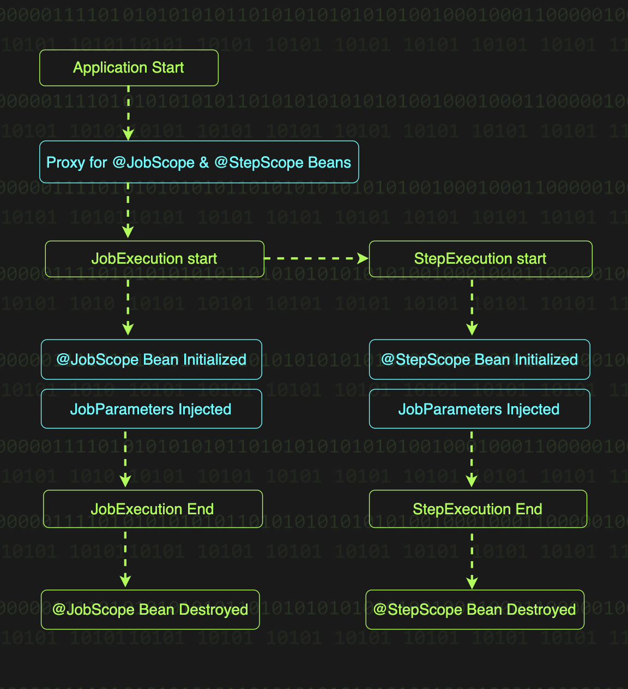
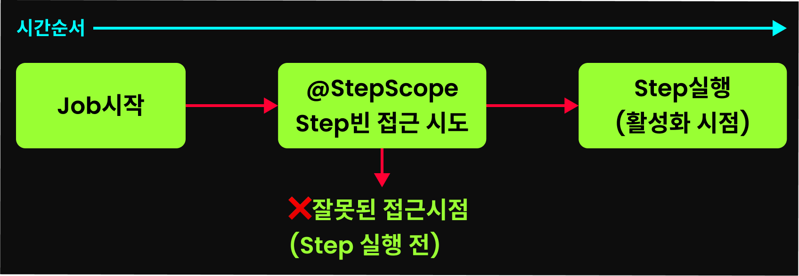

Spring Batch는 Spring Application의 default Scope인 싱글톤과는 다른

JobScope, StepScope를 제공한다.

JobScope와 StepScope가 선언된 빈은 애플리케이션 구동 시점에 프록시 객체로만 존재한다.

그 후 Job이나 Step이 실행된 후에 프록시 객체에 접근을 시도하면 그 때 실제 빈이 생성된다.

## 배치 스코프 빈들의 생명주기



각각의 스코프 빈들은 Job과 Step의 실행 시점에 생성되어 종료될 때 함께 소멸된다.

이렇게 실행 시점에 빈을 생성하는 방식은 배치 처리에 많은 이점을 제공한다.

런타임에 결정되는 JobParameters를 실행 시점에 주입받을 수 있고, 동시에 여러 Job이 실행되더라도 각각 독립적인 빈을 사용하게 되어 동시성 문제도 해결할 수 있다.

또한 실행이 종료되면 해당 빈들도 함께 제거되기 때문에, 불필요하게 메모리를 점유하지 않는다.

## @JobScope

@JobScope는 Job이 실행될 때 실제 빈이 생성되고, Job이 종료될 때 함께 제거되는 스코프다.

→ JobExecution과 생명주기를 같이 한다.

```java
@Bean
@JobScope
public Step systemDestructionStep(
        @Value("#{jobParameters['destructionPower']}") Long destructionPower) {
    return new StepBuilder("systemDestructionStep", jobRepository)
        .tasklet((contribution, chunkContext) -> {
            log.info("시스템 파괴 프로세스가 시작되었습니다. 파괴력: {}", destructionPower);
            return RepeatStatus.FINISHED;
        }, transactionManager)
        .build();
}
```

**Lazy Bean Creation(지연된 빈 생성)**

@JobScope가 적용된 빈은 애플리케이션 구동 시점에는 프록시 객체만 생성된다.

빈의 실제 인스턴스는 Job이 실행될 때 생성되어 Job이 종료하면 소멸된다.

**Job 파라미터와의 연동**

이렇게 지연된 빈 생성이 가능하다 보니 애플리케이션 실행 중에 전달되는 JobPrameters를 Job 실행 시점에 생성되는 빈에 주입해줄 수 있다.

REST API로 Job 시작 요청을 받아 실행하는 애플리케이션은 웹 요청이 매번 다른 파라미터를 전달할 수 있다. @JobScope는 이런 동적 파라미터를 Step 빈 생성 시에 주입받을 수 있게 해준다.

만약 @JobScope가 없다면 Step 빈은 애플리케이션 구동 시점에 생성되므로, 실행 시점에 전달되는 파라미터를 받을 수 없을 것이다.

**병렬 처리 지원(Parallel Processing Support)**

만약 @JobScope가 없다면, 각각의 Job을 실행하는 여러 스레드가 동일한 Job 빈 인스턴스를 공유하게 된다. 이로인해 동시성 이슈가 발생할 수 있는데, @JobScope를 사용하면 JobExecution 마다 빈이 생성되어 동시성 문제를 방지할 수 있다.

## @StepScope

@StepScope은 @JobScope과 동일한 방식으로 동작하지만 적용 범위에서 차이가 있다.

@JobScope는 Job의 실행 범위에서 빈을 관리한다면, @StepScope는 Step 실행 범위에서 빈을 관리한다.

```java
@Bean
public Step infiltrationStep(
    JobRepository jobRepository,
    PlatformTransactionManager transactionManager,
    Tasklet systemInfiltrationTasklet
) {
    return new StepBuilder("infiltrationStep", jobRepository)
        .tasklet(systemInfiltrationTasklet, transactionManager)
        .build();
}
@Bean 
@StepScope 
public Tasklet systemInfiltrationTasklet(
    @Value("#{jobParameters['infiltrationTargets']}") String infiltrationTargets
) {
    return (contribution, chunkContext) -> {
        String[] targets = infiltrationTargets.split(",");
        log.info("시스템 침투 시작");
        log.info("주 타겟: {}", targets[0]);
        log.info("보조 타겟: {}", targets[1]);
        log.info("침투 완료");
        return RepeatStatus.FINISHED;
    };
}
```

해당 Tasklet은 @StepScope가 선언되어 있다. 그래서 @Value를 통해 동적으로 잡 파라미터를 받을 수 있으며 @JobScope와 마찬가지로 해당 step마다 빈이 생성된다.

즉, 동시에 여러 Step이  실행되면서 tasklet을 실행해도 각각의 인스턴스에서 실행되기 때문에 동시성 이슈가 발생하지 않는다.

## JobScope와 StepScope 사용 시 주의사항

### 1. 프록시 대상의 타입이 클래스인 경우 반드시 상속 가능한 클래스여야 한다.

```java
@Scope(value = "job", proxyMode = ScopedProxyMode.TARGET_CLASS)
@Retention(RetentionPolicy.RUNTIME)
@Documented
public @interface JobScope {}
```

- 이 스코프들은 CGLIB를 사용해 클래스 기반의 프록시를 생성한다. 즉, 프록시를 생성하려면 대상 클래스가 상속 가능해야 한다.

### 2. Step 빈에는 @StepScope와 @JobScope와를 사용하지 말라

Spring Batch Step에 @StepScope를 달면 Step 빈 생성과 스코프 활성화 시점이 맞지 않아 오류가

발생한다.

**Step에 @StepScope 사용**

```java
@Bean
@StepScope
public Step systemDestructionStep(
    SystemInfiltrationTasklet tasklet
) {
    return new StepBuilder("systemDestructionStep", jobRepository)
        .tasklet(tasklet, transactionManager)
        .build();
}
```

**실행 결과**

```java
org.springframework.beans.factory.support.ScopeNotActiveException: 
Error creating bean with name 'scopedTarget.systemDestructionStep': 
Scope 'step' is not active for the current thread
```

Spring Batch는 Step 실행 전 메타데이터 관리를 위해 Step 빈에 접근해야 한다.

문제는 이 시점에는 아직 Step이 실행되지 않아 @StepScope가 활성화되지 않았다는 것이다.

결국 스코프가 활성화되지 않은 상태에서의 프록시에 접근하려 하니 잘못된 접근 에러가 발생하는 것이다.



***Step에서 JobParameters를 사용해야 하는데 어떻게 해야 할까?***

**@JobScope 애노테이션 삭제 BEFORE**

```java
@Bean
@JobScope  // Step에 @JobScope를 달았다
public Step systemDestructionStep(
   @Value("#{jobParameters['targetSystem']}") String targetSystem
) {
   return new StepBuilder("systemDestructionStep", jobRepository)
       .tasklet((contribution, chunkContext) -> {
           log.info("{} 시스템 침투 시작", targetSystem);
           return RepeatStatus.FINISHED;
       }, transactionManager)
       .build();
}
```

→ 그냥 아래와 같이 Tasklet에 @StepScope 또는 @JobScope를 선언해 파라미터를 받도록 하면 된다.

**@JobScope 애노테이션 삭제 AFTER**

```java
@Bean
public Step systemDestructionStep(
    SystemInfiltrationTasklet tasklet  // Tasklet을 주입받는다
) {
    return new StepBuilder("systemDestructionStep", jobRepository)
        .tasklet(tasklet, transactionManager)
        .build();
}
@Slf4j
@Component
@StepScope  // Tasklet에 @StepScope를 달았다
public class SystemInfiltrationTasklet implements Tasklet {
    private final String targetSystem;

    public SystemInfiltrationTasklet(
        @Value("#{jobParameters['targetSystem']}") String targetSystem
    ) {
        this.targetSystem = targetSystem;
    }

    @Override
    public RepeatStatus execute(StepContribution contribution, ChunkContext context) {
        log.info("{} 시스템 침투 시작", targetSystem);
        return RepeatStatus.FINISHED;
    }
}
```

## 컴파일 시점에 없는 값을 어떻게 참조할 것인가?

```java
// 1. 빈 주입 방식
@Bean
public Job systemTerminationJob(Step systemDestructionStep) {  // Spring이 주입
    return new JobBuilder("systemTerminationJob", jobRepository)
            .start(systemDestructionStep)
            .build();
}

// 2. 메서드 직접 호출 방식
@Bean
public Job systemTerminationJob() {
    return new JobBuilder("systemTerminationJob", jobRepository)
            .start(systemDestructionStep(null))  // Job 파라미터 자리에 null 전달
            .build();
}
```

## ExecutionContext

Spring Batch는 JobExecution과 StepExecution을 사용해 시작 시간, 종료 시간, 실행 상태 같은 메타데이터를 관리한다. 

이런 기본적인 실행 정보 말고도 ExecutionContext라는 데이터 컨테이너를 사용하면 비즈니스 로직 처리 중에 발생하는 커스텀 데이터를 관리할 수 있다.

예를 들어 마지막 처리 인덱스나 집계 중간 결과물 같은 데이터를 저장할 수 있다.

이는 Job이 중단된 후 재시작할 때 특히 유용하다.

SpringBatch는 JobExecution, StepExecution과 마찬가지로 ExecutionContext도 메타데이터 저장소에서 관리한다. 이를 통해 모든 상태 정보가 안전하게 보관된다.

ExecutionContext의 데이터 역시 JobParameters와 마찬가지로 @Value를 통해 주입받을 수 있다.

```java
@Bean
@JobScope  
public Tasklet systemDestructionTasklet(
  @Value("#{jobExecutionContext['previousSystemState']}") String prevState
) {
  // JobExecution의 ExecutionContext에서 이전 시스템 상태를 주입받는다
}

@Bean
@StepScope
public Tasklet infiltrationTasklet(
  @Value("#{stepExecutionContext['targetSystemStatus']}") String targetStatus
) {
  // StepExecution의 ExecutionContext에서 타겟 시스템 상태를 주입받는다
}
```

- jobExecutionContext와 stepExecutionContext는 각각 다른 범위를 가진다.
- Job의 ExecutionContext는 Job에 속한 모든 컴포넌트에서
`@Value("#{jobExecutionContext['key']}")`로 접근할 수 있지만
- Step의 ExecutionContext는 오직 해당 Step에 속한 컴포넌트에서만 접근할 수 있다.
- 예를 들어 StepA의 ExecutionContext에 저장된 데이터를 StepB에서 `@Value("#{stepExecutionContext['key']}")`로 가져올 수 없다.

