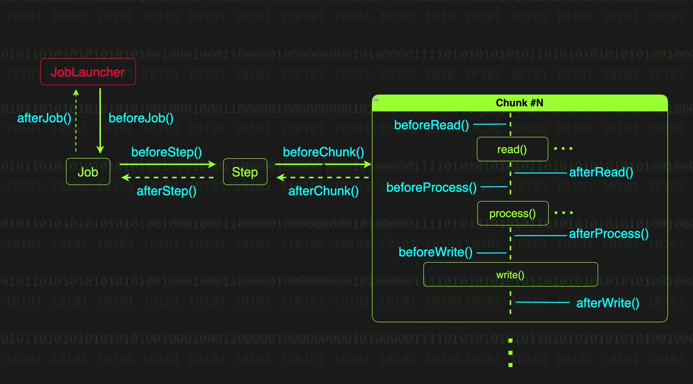
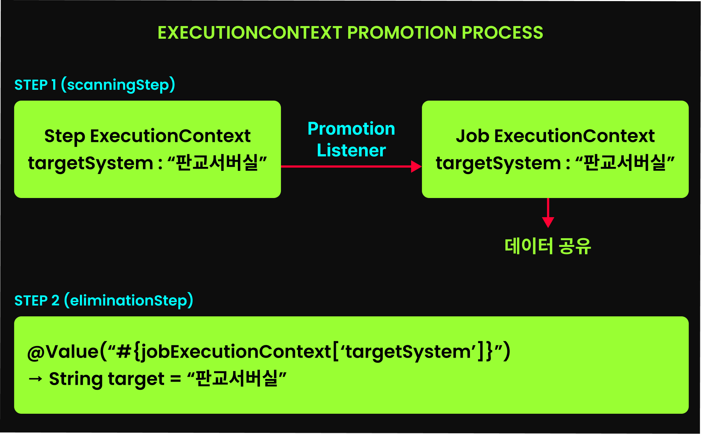

리스너는 배치 처리 중 발생하는 특정 이벤트를 감지하고 원하는 로직을 실행할 수 있게 해준다.

Job 시작 전후, Step 실행 전후는 물론, 청크 단위 또는 아이템 단위 처리 시점까지 모든 과정에 개입할 수 있다.

이를 통해 로깅, 모니터링, 에러 처리 등 원하는 로직을 자유롭게 추가할 수 있다.

## JobExecutionListener

JobExecutionListener는 Job 실행의 시작과 종료 시점에 호출되는 리스너 인터페이스이다.

```java
public interface JobExecutionListener {
    default void beforeJob(JobExecution jobExecution) { }
    default void afterJob(JobExecution jobExecution) { }
}
```

**beforeJob()**은 Job 실행 직전에 호출되며, Job 시작 전 필요한 리소스를 준비하는 등의 초기화 작업을 수행할 수 있다.

**afterJob()**은 Job 실행 후에 호출되어 Job 실행 결과를 이메일로 전송하거나, 리소스를 정리하는 등의 후처리 작업을 수행할 수 있다.

Job의 성공/실패 여부와 관계없이 무조건 호출되기 때문에, 실패 시 알림을 보내거나 더 나아가 실패한 Job의 상태를 변경하는 작업까지 안전하게 수행할 수 있다.

## StepExecutionListener

StepExecutionListener는 Step 실행의 시작과 종료 시점에 호출되는 리스너 인터페이스이다.

Step의 시작 시간,  종료 시간, 처리된 데이터 수를 로그로 기록하는 등의 사용자 정의 작업을 추가할 수 있다.

```java
public interface StepExecutionListener extends StepListener {
    default void beforeStep(StepExecution stepExecution) {
    }
    @Nullable
    default ExitStatus afterStep(StepExecution stepExecution) {
				return null;
    }
}
```

## ChunkListener

청크 지향 처리는 청크 단위로 아이템 읽기/쓰기를 반복한다.

ChunkListener는 하나의 청크 단위 처리가 시작되기 전, 완료된 후, 그리고 실행 도중 에러가 발생했을 때 호출되는 리스너 인터페이스이다.

```java
public interface ChunkListener extends StepListener {
    default void beforeChunk(ChunkContext context) {
    }

    default void afterChunk(ChunkContext context) {
    }
	
    default void afterChunkError(ChunkContext context) {
    }
}
```

- afterChunk() → 트랜잭션 커밋된 후에 호출
- afterChunkError() → 트랜잭션이 롤백된 이후에 호출

```java
이름과 다르게 ChunkListener는 Tasklet 지향 처리에서도 동작한다.
Tasklet execute() 호출 전후, 그리고 execute() 실행 중 오류 발생 시에도
실행된다.

그럼 ChunkListener와 StepExecutionListener 차이점은 무엇일까
ChunkListner는 execute() 실행마다 호출되지만, RepeatStatus 기반
StepExecutionListenr는 Step 시작과 끝에만 한 번씩 호출된다.
```

## Item[Read/Process/Write] Listener

ItemReadListener와 ItemProcessListener, ItemWriteListener는 아이템의 읽기, 처리, 쓰기 작업이 수행되는 시점에 호출되는 리스너 인터페이스들이다.

아이템 단위의 처리 전후와 에러 발생 시점에 호출된다.

```java
// ItemReadListener.java
public interface ItemReadListener<T> extends StepListener {
    default void beforeRead() { }
    default void afterRead(T item) { }
    default void onReadError(Exception ex) { }
}

// ItemProcessListener.java
public interface ItemProcessListener<T, S> extends StepListener {
    default void beforeProcess(T item) { }
    default void afterProcess(T item, @Nullable S result) { }
    default void onProcessError(T item, Exception e) { }
}

// ItemWriteListener.java
public interface ItemWriteListener<S> extends StepListener {
    default void beforeWrite(Chunk<? extends S> items) { }
    default void afterWrite(Chunk<? extends S> items) { }
    default void onWriteError(Exception exception, Chunk<? extends S> items) { }
}
```

- ItemReadListener.afterRead()는 ItemReader.read() 호출 후에 호출되지만, 읽을 데이터가 없어 null을 반환하는 경우 호출되지 않는다.
- 반면, ItemPreocessListener.afterProcess()는 ItemProcessor.process()가 null을 반환하더라도 호출된다. (즉, 데이터가 필터링하더라도 호출된다)
- ItemWriteListener.afterWrite()는 트랜잭션이 커밋되기 전, ChunkListener.afterChunk()가 호출되기 전에 호출된다.



- JobExecutionListener
- beforeJob()
  - afterJob()
- StepExecutionListener
- beforeStep()
  - afterStep()
- ChunkListener
- beforeChunk()
  - afterChunk()
- ItemxxxListener
- beforeRead()
  - afterRead()
  - beforeProcess()
  - afterProcess()
  - beforeWrite()
  - afterWrite()

*각 리스너 메서드마다 고유한 호출 타이밍이 있다는 사실을 기억하자*

## 배치 리스너 구현 방법

리스너를 구현하는 방법은 크게 두 가지로 나눌 수 있다.

1. 전용 리스너 인터페이스를 직접 구현
1. 리스너 특화 애노테이션을 사용하는 방법

### 리스너 인터페이스 구현

```java
@Slf4j
@Component
public class BigBrotherJobExecutionListener implements JobExecutionListener {
    @Override
    public void beforeJob(JobExecution jobExecution) {
        log.info("시스템 감시 시작. 모든 작업을 내 통제 하에 둔다.");
    }

    @Override
    public void afterJob(JobExecution jobExecution) {
        log.info("작업 종료. 할당된 자원 정리 완료.");
        log.info("시스템 상태: {}", jobExecution.getStatus());
    }
}
@Slf4j
@Component
public class BigBrotherStepExecutionListener implements StepExecutionListener {
    @Override
    public void beforeStep(StepExecution stepExecution) {
        log.info("Step 구역 감시 시작. 모든 행동이 기록된다.");
    }

    @Override
    public ExitStatus afterStep(StepExecution stepExecution) {
        log.info("Step 감시 종료. 모든 행동이 기록되었다.");
        log.info("Big Brother의 감시망에서 벗어날 수 없을 것이다.");
        return ExitStatus.COMPLETED;
    }
}
```

- 각 리스너 인터페이스의 메서드들이 모두 default로 정의되어 있어서, 필요한 시점의 메서드만 골라서 구현하면 된다.

```java
@Bean
public Job systemMonitoringJob(JobRepository jobRepository, Step monitoringStep) {
   return new JobBuilder("systemMonitoringJob", jobRepository)
           .listener(new BigBrotherJobExecutionListener())
           .start(monitoringStep)
           .build();
}
```

- JobBuilder의 listener() 메서드를 사용해 리스너를 지정해주고 있다.

### 애노테이션 기반 구현

SpringBatch에서 제공하는 @BeforeJob, @AfterJob, @BeforeStep, @AfterStep 과 같이 리스너 특화 애노테이션을 사용하면 기능을 훨씬 더 간단하게 구현할 수 있다.

```java
@Slf4j
@Component
public class ServerRoomInfiltrationListener {
    @BeforeJob
    public void infiltrateServerRoom(JobExecution jobExecution) {
        log.info("판교 서버실 침투 시작. 보안 시스템 무력화 진행중.");
    }

    @AfterJob
    public void escapeServerRoom(JobExecution jobExecution) {
        log.info("파괴 완료. 침투 결과: {}", jobExecution.getStatus());
    }
}

@Slf4j
@Component
public class ServerRackControlListener {
    @BeforeStep
    public void accessServerRack(StepExecution stepExecution) {
        log.info("서버랙 접근 시작. 콘센트를 찾는 중.");
    }

    @AfterStep
    public ExitStatus leaveServerRack(StepExecution stepExecution) {
        log.info("코드를 뽑아버렸다.");
        return new ExitStatus("POWER_DOWN");
    }
}
```

애노테이션을 활용한 리스너는 Job 실행 전후를 감지하는 감지하는 ServerRoomInfiltrationListener와 Step 실행 전후를 감지하는 ServerRackControlListener를 통해 각 시점에서 필요한 작업을 수행한다.

***@AfterStep이 선언되어있는 메서드의 경우 반환타입을 ExitStatus로 맞춰야한다.***

이는 StepExecutionListener의 afterStep() 메서드가 ExitStatus를 반환하기 떄문이다.

```java
@Bean
public Step serverRackControlStep(Tasklet destructiveTasklet) {
   return new StepBuilder("serverRackControlStep", jobRepository)
           .tasklet(destructiveTasklet(), transactionManager)
           .listener(new ServerRackControlListener()) // 빌더의 listener() 메서드에 전달
           .build();
}
```

애노테이션을 사용한 리스너도 빌더의 listener() 메서드를 통해 설정할 수 있다.

listener() 메서드의 파리미터로 Object 타입을 받는 오버로딩 버전을 제공하기 때문이다.

Spring Batch는 모든 리스너 인터페이스에 정의된 메서드에 대응하는 애노테이션을 전부 제공한다. 아래와 같이 애노테이션을 제공하는데, 각 리스너 인터페이스에 정의된 메서드와 동일한 이름이다.

```java
@AfterChunk, @AfterChunkError, @AfterJob, @AfterProcess, @AfterRead, @AfterStep, @AfterWrite, @BeforeChunk, @BeforeJob, @BeforeProcess, @BeforeRead, @BeforeStep, @BeforeWrite, @OnProcessError, @OnReadError, @OnSkipInProcess, @OnSkipInRead, @OnSkipInWrite
```

## **JobExecutionListener와 ExecutionContext를 활용한 동적 데이터 전달**

잡 파라미터로 전달할 수 없는 동적인 데이터가 필요한 경우가 있다.

이럴 때 JobExecutionListener의 befoteJob() 메서드를 활용하면 추가적인 동적 데이터를 각 Step에 전달할 수 있다.

```java
@Slf4j
@Configuration
@RequiredArgsConstructor
public class AdvancedSystemInfiltrationConfig {
    private final InfiltrationPlanListener infiltrationPlanListener;

    @Bean
    public Job systemInfiltrationJob(JobRepository jobRepository, Step reconStep, Step attackStep) {
        return new JobBuilder("systemInfiltrationJob", jobRepository)
                .listener(infiltrationPlanListener)
                .start(reconStep)
                .next(attackStep)
                .build();
    }

    @Bean
    public Step reconStep(JobRepository jobRepository, PlatformTransactionManager transactionManager) {
        return new StepBuilder("reconStep", jobRepository)
            .tasklet((contribution, chunkContext) -> {
                Map<String, Object> infiltrationPlan = (Map<String, Object>) 
                  chunkContext.getStepContext()
                              .getJobExecutionContext()
                              .get("infiltrationPlan");
                log.info("침투 준비 단계: {}", infiltrationPlan.get("targetSystem"));
                log.info("필요한 도구: {}", infiltrationPlan.get("requiredTools"));
                return RepeatStatus.FINISHED;
          }, transactionManager)
          .build();
    }

    @Bean
    public Step attackStep(
        JobRepository jobRepository,
        PlatformTransactionManager transactionManager,
        Tasklet attackStepTasklet  // 주입받은 Tasklet 사용
    ) {
        return new StepBuilder("attackStep", jobRepository)
                .tasklet(attackStepTasklet, transactionManager)
                .build();
    }

    @Bean
    @StepScope
    public Tasklet attackStepTasklet(
        @Value("#{jobExecutionContext['infiltrationPlan']}") Map<String, Object> infiltrationPlan
    ) {
        return (contribution, chunkContext) -> {
            log.info("시스템 공격 중: {}", infiltrationPlan.get("targetSystem"));
            log.info("목표: {}", infiltrationPlan.get("objective"));

            Random rand = new Random();
            boolean infiltrationSuccess = rand.nextBoolean();

            if (infiltrationSuccess) {
                log.info("침투 성공! 획득한 데이터: {}", infiltrationPlan.get("targetData"));
                contribution.getStepExecution().getJobExecution().getExecutionContext()
                        .put("infiltrationResult", "TERMINATED");
            } else {
                log.info("침투 실패. 시스템이 우리를 감지했다.");
                contribution.getStepExecution().getJobExecution().getExecutionContext()
                        .put("infiltrationResult", "DETECTED");
            }

            return RepeatStatus.FINISHED;
        };
    }
}

@Slf4j
@Component
public class InfiltrationPlanListener implements JobExecutionListener {

    @Override
    public void beforeJob(JobExecution jobExecution) {
        Map<String, Object> infiltrationPlan = generateInfiltrationPlan();
        jobExecution.getExecutionContext().put("infiltrationPlan", infiltrationPlan);
        log.info("새로운 침투 계획이 준비됐다: {}",  infiltrationPlan.get("targetSystem"));
    }

    private Map<String, Object> generateInfiltrationPlan() {
        List<String> targets = List.of(
                "판교 서버실", "안산 데이터센터"
        );
        List<String> objectives = List.of(
                "kill -9 실행", "rm -rf 전개", "chmod 000 적용", "/dev/null로 리다이렉션"
        );
        List<String> targetData = List.of(
                "코어 덤프 파일", "시스템 로그", "설정 파일", "백업 데이터"
        );
        List<String> requiredTools = List.of(
                "USB 킬러", "널 바이트 인젝터", "커널 패닉 유발기", "메모리 시퍼너"
        );

        Random rand = new Random();

        Map<String, Object> infiltrationPlan = new HashMap<>();
        infiltrationPlan.put("targetSystem", targets.get(rand.nextInt(targets.size())));
        infiltrationPlan.put("objective", objectives.get(rand.nextInt(objectives.size())));
        infiltrationPlan.put("targetData", targetData.get(rand.nextInt(targetData.size())));
        infiltrationPlan.put("requiredTools", requiredTools.get(rand.nextInt(requiredTools.size())));

        return infiltrationPlan;
    }

    @Override
    public void afterJob(JobExecution jobExecution) {
        String infiltrationResult = (String) jobExecution.getExecutionContext().get("infiltrationResult");
        Map<String, Object> infiltrationPlan = (Map<String, Object>)
                jobExecution.getExecutionContext().get("infiltrationPlan");

       log.info("타겟 '{}' 침투 결과: {}", infiltrationPlan.get("targetSystem"), infiltrationResult);

        if ("TERMINATED".equals(infiltrationResult)) {
            log.info("시스템 제거 완료. 다음 타겟 검색 중...");
        } else {
            log.info("철수한다. 다음 기회를 노리자.");
        }
    }
}
```

먼저 JobExecutionListener를 구현한 InfiltrationPlanListener를 살펴보자.

InfiltrationPlanListener는 Job 실행 전 각 스텝에 전달할 데이터를 동적으로 생성한다. beforeJob() 메서드 구현을 보면 generateInfiltrationPlan()을 호출해 동적으로 데이터를 생성하고, 이를 해당 JobExecution의 ExecutionContext에 설정하고 있다.


Job 수준 ExecutionContext에 저장된 데이터는 해당 Job이 실행하는 모든 Step에서 접근이 가능하다.

```java
@Bean
public Job systemInfiltrationJob(JobRepository jobRepository, Step reconStep, Step attackStep) {
   return new JobBuilder("systemInfiltrationJob", jobRepository)
           .listener(infiltrationPlanListener) // Listener 등록
           .start(reconStep)
           .next(attackStep)
           .build();
}
```

이렇게 InfiltrationPlanListener를 listener() 메서드에 등록해주면 beforeJob() 메서드에 동적으로 생성한 데이터를 각 Step에서 참조할 준비가 완료된다.

Step에서의 데이터 활용

```java
@Bean
public Step reconStep(JobRepository jobRepository, PlatformTransactionManager transactionManager) {
    return new StepBuilder("reconStep", jobRepository)
        .tasklet((contribution, chunkContext) -> {
            Map<String, Object> infiltrationPlan = (Map<String, Object>) 
            chunkContext.getStepContext()
                        .getJobExecutionContext()
                        .get("infiltrationPlan");
            log.info("침투 준비 단계: {}", infiltrationPlan.get("targetSystem"));
            log.info("필요한 도구: {}", infiltrationPlan.get("requiredTools"));
            return RepeatStatus.FINISHED;
          }, transactionManager)
          .build();
}
@Bean
public Step attackStep(
   JobRepository jobRepository, 
   PlatformTransactionManager transactionManager,
   Tasklet attackStepTasklet  // 주입받은 Tasklet 사용
) {
   return new StepBuilder("attackStep", jobRepository)
           .tasklet(attackStepTasklet, transactionManager)
           .build();
}
@Bean
@StepScope
public Tasklet attackStepTasklet(
    @Value("#{jobExecutionContext['infiltrationPlan']}") Map<String, Object> infiltrationPlan
) {
    return (contribution, chunkContext) -> {
        log.info("시스템 공격 중: {}", infiltrationPlan.get("targetSystem"));
        log.info("목표: {}", infiltrationPlan.get("objective"));

        Random rand = new Random();
        boolean infiltrationSuccess = rand.nextBoolean();

        if (infiltrationSuccess) {
            log.info("침투 성공! 획득한 데이터: {}", infiltrationPlan.get("targetData"));
            contribution.getStepExecution()
                .getJobExecution()
                .getExecutionContext()
                .put("infiltrationResult", "TERMINATED");
        } else {
            log.info("침투 실패. 시스템이 우리를 감지했다.");
            contribution.getStepExecution()
                .getJobExecution().getExecutionContext()
                .put("infiltrationResult", "DETECTED");
        }  

        return RepeatStatus.FINISHED;
    };
}
```

- reconStep: infiltrationPlanListener의 beforeJob()에서 생성한 동적 데이터를 가져온다.
- attackStep
- attackStepTasklet에서는 @Value를 이용해 beforeJob()에서 구현한 동적 데이터를 Job 레벨 ExecutionConetxt에서 받아오고 있다.

## 왜 JobParameters가 아닌 ExecutionContext를 사용할까?

한 번 생성된 JobParameters는 변경할 수 없기 때문이다.

SpringBatch의 핵심 철학 중 하나는 배치 작업의 재현 가능성과 일관성을 보장하는 것이다.

이를 위해 ***JobParameters는 불변하게 설계되었다.***

따라서 Job 실행 중에 동적으로 생성되거나 변경되어야 하는 데이터는 ExecutionContext를 통해 관리하는 것이 좋다.

JobExecutionListener와 ExecutionContext를 사용해 데이터를 동적으로 전달하는 방식은 유영할 수 있지만, JobParametes만으로 충분히 처리할 있는 경우에도, 이 방법을 사용하고 싶은 유혹에 빠지기 쉽다.

```java
// 이런 코드에 현혹되지 마라
@Override
public void beforeJob(JobExecution jobExecution) {
    jobExecution.getExecutionContext()
        .put("targetDate", LocalDate.now()); // 치명적인 실수다
}
```

이 코드의 문제점은 어제 데이터를 처리하지 못한다는 것이다.

프로그램을 수정하지 않으면 그날의 데이터를 다시 처리할 수 없다.

결국 하드코딩된 방식은 배치의 유연성을 떨어뜨리고, 필요한 순간에 원하는 데이터를 처리할 수 없게 만든다.

Job 수준 ExecutionContextd에 저장된 데이터는 Job 내 모든 Step에 접근할 수 있었다.

하지만 Step 수준 ExecutionContext에 저장된 데이터는 해당 Step에서만 접근 가능하므로 다른 Step과 공유는 불가능하다.

그래서 한 Step의 ExecutionContext에 존재하는 데이터를 다음 step에 전달하려면 ExecutionContext를 가져와 이를 Job 수준의 ExecutionContext에 직접 설정해주어야 한다.

```java
StepExecution stepExecution = contribution.getStepExecution();
ExecutionContext stepExecutionContext = stepExecution.getExecutionContext();
Integer infiltrationCount = (Integer) stepExecutionContext.get("infiltrationCount");

JobExecution jobExecution = stepExecution.getJobExecution();
jobExecution.getExecutionContext().put("totalInfiltrations", infiltrationCount);
```

현재 코드는 매우 불편하다.

Spring Batch에서는 이런 반복적인 불편한 과정을 알아서 처리해줄 수 있도록 ㄸㄸE**xecutionaContextPromotionListener**라는  StepExecutionListener 구현체를 제공한다.

E**xecutionaContextPromotionListener를 사용하면 번거로운 데이터 설정 작업 없이도**

Step 간 데이터 공유가 가능하다.

→ 즉, step에서 데이터 꺼내기 job 수준의 execution cotext에 데이터 설정 작업을 간편하게

## ExecutionContextPromotionListener를 활용한 Step 간 데이터 공유

Spring Batch에서는 Step 수준의 ExecutionContext 데이터를 Job 수준의 ExecutionContext로
옮기는 과정을 승격이라 부른다.

ExecutionContextPromotionListener는 StepExecutionListener의 afterStep() 메서드를 오버라이드하여 승격 작업을 수행한다.

```java
@Slf4j
@Configuration
public class SystemTerminationConfig {
    @Bean
    public Job systemTerminationJob(JobRepository jobRepository, Step scanningStep, Step eliminationStep) {
        return new JobBuilder("systemTerminationJob", jobRepository)
                .start(scanningStep)
                .next(eliminationStep)
                .build();
    }
    @Bean
    public Step scanningStep(
            JobRepository jobRepository, 
            PlatformTransactionManager transactionManager
    ) {
        return new StepBuilder("scanningStep", jobRepository)
                .tasklet((contribution, chunkContext) -> {
                    String target = "판교 서버실";
                    ExecutionContext stepContext = contribution.getStepExecution().getExecutionContext();
                    stepContext.put("targetSystem", target);
                    log.info("타겟 스캔 완료: {}", target);
                    return RepeatStatus.FINISHED;
                }, transactionManager)
                .listener(promotionListener())
                .build();
    }
    @Bean
    public Step eliminationStep(
            JobRepository jobRepository, 
            PlatformTransactionManager transactionManager,
            Tasklet eliminationTasklet
    ) {
        return new StepBuilder("eliminationStep", jobRepository)
                .tasklet(eliminationTasklet, transactionManager)
                .build();
    }
    @Bean
    @StepScope
    public Tasklet eliminationTasklet(
            @Value("#{jobExecutionContext['targetSystem']}") String target
    ) {
        return (contribution, chunkContext) -> {
            log.info("시스템 제거 작업 실행: {}", target);
            return RepeatStatus.FINISHED;
        };
    }
    @Bean
    public ExecutionContextPromotionListener promotionListener() {
        ExecutionContextPromotionListener listener = new ExecutionContextPromotionListener();
        listener.setKeys(new String[]{"targetSystem"});
        return listener;
    }
}
```

```java
@Bean
public ExecutionContextPromotionListener promotionListener() {
    ExecutionContextPromotionListener listener = new ExecutionContextPromotionListener();
    listener.setKeys(new String[]{"targetSystem"});
    return listener;
}
```

- ExecutionContextPromotionListener에서는 Step 수준의 ExecutionContext에서 Job 수준으로 승격할 데이터의 키 값을 지정해주어야 한다.
- setKeys() 메서드를 통해 설정할 수 있다.

```java
.tasklet((contribution, chunkContext) -> {
    String target = "판교 서버실";
    ExecutionContext stepContext = contribution.getStepExecution().getExecutionContext();
    stepContext.put("targetSystem", target);  // Step의 ExecutionContext에 저장
    log.info("타겟 스캔 완료: {}", target);
    return RepeatStatus.FINISHED;
}, transactionManager)
.listener(promotionListener())  // promotionListener 등록
.build();
```

생성한 리스너를 Step에 등록한다.

이렇게 하면 scanningStep에서 Step 수준 ExecutionContext에 지정한 targetSystem 값이 자동으로 Job 수준 ExecutionContext로 승격되어, 다음 스텝인 eliminationStep에서 아래와 같이 간단하게 조회가 가능하다.

```java
@StepScope
public Tasklet eliminationTasklet(
    // Job의 ExecutionContext에서 값 조회
    @Value("#{jobExecutionContext['targetSystem']}") String target
) {
    return (contribution, chunkContext) -> {
        log.info("시스템 제거 작업 실행: {}", target);
        return RepeatStatus.FINISHED;
    };
}
```

→ 즉, ExecutionContextPromotionListener를 활용해 ExecutionContext를 Step 수준에서 Job 수준으로 간편하게 할 수 있다.



주의!

각 Step은 가능한 독립적으로 설계하여 재사용성과 유지보수성을 높이는 것이 좋다.

불가피한 경우가 아니라면 Step간 데이터 의존성은 최소화하는 것이 좋다.

Step간 데이터 공유가 늘어날수록 복잡도가 증가한다.

## Listener와 @JobScope, @StepScope 통합

리스너와 Spring Batch Scope를 통합하면 리스너에서 잡 파라미터를 매우 쉽게 다룰 수 있다.

이를 통해 실행 시점에 결정되는 값들을 리스너 내에서도 활용할 수 있다.

```java
@Slf4j
@Configuration
public class SystemDestructionConfig {
   @Bean
   public Job killDashNineJob(JobRepository jobRepository, Step terminationStep) {
       return new JobBuilder("killDashNineJob", jobRepository)
               .listener(systemTerminationListener(null))  // 파라미터는 런타임에 주입
               .start(terminationStep)
               .build();
   }
   @Bean
   public Step terminationStep(JobRepository jobRepository, PlatformTransactionManager transactionManager) {
       return new StepBuilder("terminationStep", jobRepository)
               .tasklet((contribution, chunkContext) -> {
                   log.info("시스템 제거 프로토콜 실행 중...");
                   return RepeatStatus.FINISHED;
               }, transactionManager)
               .build();
   }
   @Bean
   @JobScope
   public JobExecutionListener systemTerminationListener(
           @Value("#{jobParameters['terminationType']}") String terminationType
   ) {
       return new JobExecutionListener() {
           @Override
           public void beforeJob(JobExecution jobExecution) {
               log.info("시스템 제거 시작! 제거 방식: {}", terminationType);
           }

           @Override
           public void afterJob(JobExecution jobExecution) {
               log.info("작전 종료! 시스템 상태: {}", jobExecution.getStatus());
           }
       };
   }
}
```

먼저 systemTerminationListener 빈에 @JobScope를 적용하였다.

이렇게 하면 `@Value("#{jobParameters['terminationType']}")`를 사용해 JobParameters의 `terminationType`에 바로 접근할 수 있다.

## Listener: 성능과 모범 사례

**범위와 목적에 따라 적절한 리스너를 선택하라**

- JobExecutionListener: 전체 작업의 시작과 종료를 통제
- StepExecutionListener: 각 작업 단계의 실행을 감시
- ChunkListener: 시스템을 청크단위로 제거할 때, 반복의 시작과 종료 시점을 통제
- ItemListener: 개별 아이템 식별 통제

**예외 처리를 신중하게**

JobExecutionListener의 beforeJob()과 StepExecutionListener의 beforeStep()에서 예외가 발생하면 Job과 Step이 실패한 것으로 판단된다. 

반면, JobExecutionListener의 afterJob()과 StepExecutionListener의 afterJob()에서 발생한 예외는 무시된다.

### 성능 최적화를 위한 경고

1. **실행 빈도를 고려하라**
- JobExecutionListener/StepExecutionListener
- Job, Step 실행당 한 번씩만 실행되므로 비교적 안전하다
    - 무거운 로직이 들어가도 전체 성능에 큰 영향이 없다
  - ItemReadListener/ItemProcessListener
- 매 아이템마다 실행되므로 치명적일 수 있다
1. **리소스 사용을 최소화하라**
- 데이터베이스 연결, 파일 I/O, 외부 API 호출은 최소화
  - 리스너 내 로직은 가능한 가볍게 유지
  - 특히 Item 단위 리스너에서는 더욱 중요

