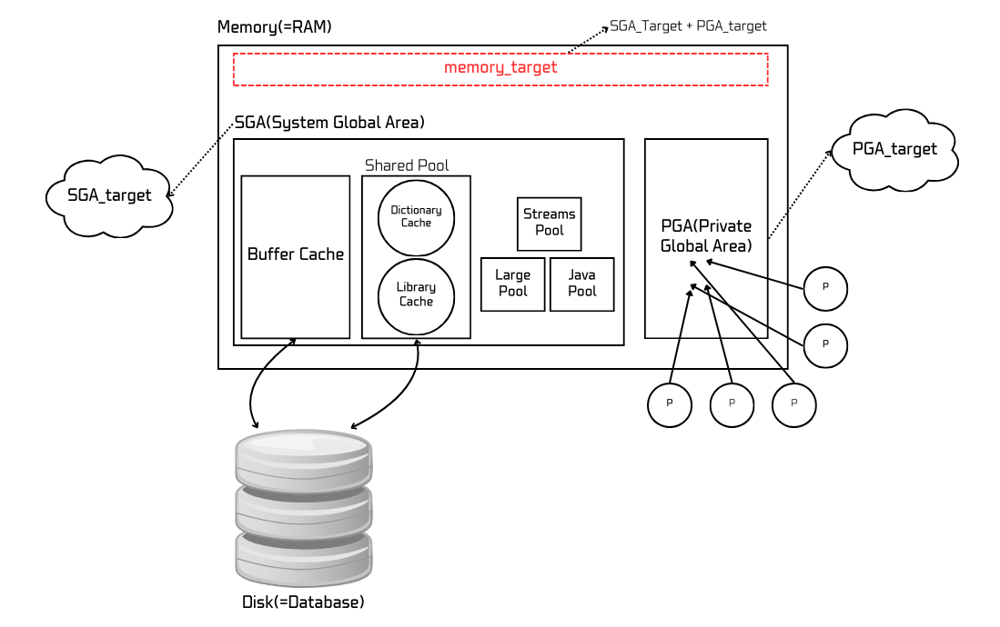



## DB 버퍼 캐시

자주 읽는 블록을 매번 디스크에서 읽는 것은 매우 비효율적이다.

그래서 데이터 캐싱 메커니즘이 DBMS에 필요한데 이를 DB 버퍼 캐시를 통해서 한다.

라이브러리 캐시가 SQL과 실행계획, DB 저장형 함수/프로시저를 캐싱하는 코드 캐시라고 한다면

DB 버퍼캐시는 데이터 캐시라고 할 수 있다.

DB 버퍼캐시는 서버 프로세스와 데이터파일 사이에 버퍼캐시가 있으므로 데이터 블록을 읽을 땐 항상 버퍼캐시부터 탐색한다.

버퍼캐시는 공유 메모리 영역이므로 같은 블록을 읽는 다른 프로세스도 득을 본다.

