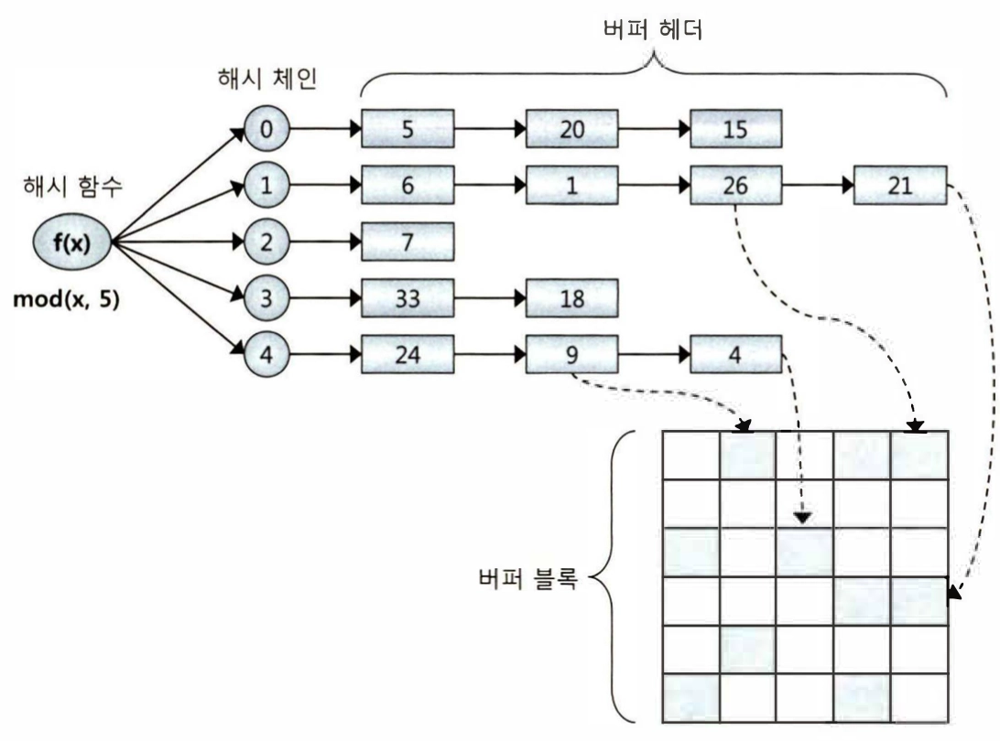

Direct Path I/O를 제외한 모든 블록 I/O는 메모리 버퍼 캐시를 경유한다.

- 인덱스 루트 블록을 읽을 때
- 인덱스 루트 블록에서 얻은 주소 정보로 브랜치 블록을 읽을 때
- 인덱스 브랜치 블록에서 얻은 주소 정보로 리프 블록을 읽을 때
- 인덱스 리프 블록에서 얻은 주소 정보로 테이블 블록을 읽을 때
- 테이블 블록을 Full Scan 할 때

## 버퍼캐시 = 해시 구조

DBMS는 버퍼캐시를 해시 구조로 관리한다.

그림에서는 모듈러 함수로 해시 함수를 표현하지만 실제로는 훨씬 정교한 알고리즘을 사용한다. 

예를들어 27번 블록을 찾는다고하면 블록 번호를 5로 나눈다면 나머지는 2이다. 만약 이 블록이 캐싱돼 있다면 세 번째 해시 체인(해시 값 = 2)에 있을것이다. 세 번째 해시 체인을 쭉 탐색하고 없다면 다른 해시 체인을 탐색할 필요 없이 디스크에서 해당 블록을 읽고 캐시 체인에 연결한 다음 읽으면 된다.

즉, 해시 구조는 다음과 같은 특징을 가진다.

- 같은 입력 값은 항상 동일한 해시 체인(=버킷)에 연결된다.
- 다른 입력 값이 동일한 해시 체인에 연결될 수 있다.
- 해시 체인 내에서는 정렬이 보장되지 않는다.

## 버퍼캐시 동시성 문제(메모리 공유자원에 대한 엑세스 직렬화)

버퍼 캐시는 SGA 구성요소이므로 버퍼캐시에 캐싱된 버퍼블록은 모두 공유자원이다.

하나의 버퍼블록을 두 개 이상의 프로세스가 동시에 접근하려고 할 때 블록 정합성에 문제가 발생할 수 있기 때문에 한 프로세스씩 순차적으로 접근하도록 직렬화 메커니즘(래치, Latch)이 필요하다.

## 캐시버퍼 체인 래치

블록을 탐색할 때 DBA(Data Block Address)를 해시 함수에 입력하고 거기서 반환된 값으로 스캔해야 할 해시 체인을 찾는다.

해시 체인을 스캔하는 동안 다른 프로세스가 체인 구조를 변경하는 것을 막기위해 해시 체인 래치가 존재하며

버퍼구조 그림에서 보이는 0~4까지 다섯 개 체인 앞쪽에 자물쇠가 있다고 생각하면 된다.

